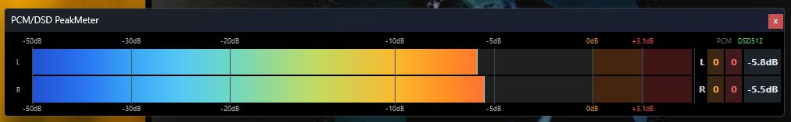
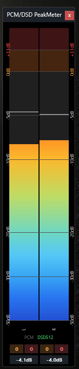
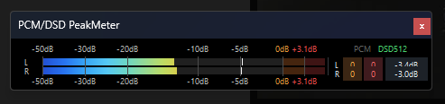
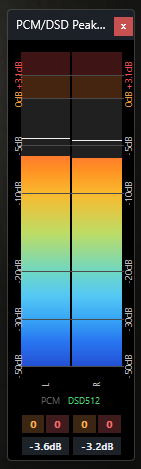

# PCM/DSD PeakMeter v1.0.1 — foobar2000 x64

**Current release: v1.0.1 (2026-10-16).** [Download / 공식 다운로드](https://github.com/jjh212/PCM_DSD_PEAKMETER_RELEASES/releases/tag/v1.0.1) · [SHA256SUMS](https://github.com/jjh212/PCM_DSD_PEAKMETER_RELEASES/releases/download/v1.0.1/SHA256SUMS.txt)

**Recommended installation / 권장 설치:** Install `foo_pcm_dsd_peakmeter_v1.0.1_x64.fb2k-component` via foobar2000 **Preferences → Components → Install**, then restart. The installer archive contains one `foo_pcm_dsd_peakmeter.dll` at its ZIP root.

**Final v1.0.1 documentation / 최종 설명서**
- [한국어 사용설명서](docs/USER_MANUAL_V101_KO.md) · [English User Manual](docs/USER_MANUAL_V101_EN.md)
- [한국어 변경내역](docs/CHANGELOG_V101_KO.md) · [English Release Notes](docs/CHANGELOG_V101_EN.md)

**v1.0.1 highlights / 주요 변경:** PCM/DSD warning and danger thresholds, source-DSD modulation-limit window counters, L/R and format-label readability, panel-local statistics, and Korean/English card-style tooltips. FAST/LPF processing remains metering-only; playback audio and DAC-bound data are unchanged.

**Official v1.0.1 DLL SHA256:** `AD33EC851B7632FF502D7B6B05ECCCD1AAFE0A04806056DB8D2AD47857262FFD`

**Documentation note / 문서 안내:** The v1.0.1 Windows ZIP predates the final manual revision. The online final v1.0.1 manuals linked above supersede the manuals inside that ZIP. Previous release files and history are preserved.

---

# PCM/DSD PeakMeter v1.0 — foobar2000 x64

**Historical version: v1.0.** [English manual](docs/USER_MANUAL_EN.md) · [한국어 설명서](docs/USER_MANUAL_KO.md) · [Change log](CHANGELOG.md)

## v1.0 — FAST / LPF measurement and final meter UI

- DSD FAST: 28–896-bit direct-modulation peak metering; default calibration offset −4.8586 dB (display-only).
- DSD LPF: 20–200 kHz selectable cutoff (40 kHz default); Slow / Medium / Sharp Roll-off (Medium default).
- PCM/DSD warning entry counters, peak hold, maximum readings, click-to-reset statistics, and top/bottom warning tick highlights.
- PCM caution/danger 0/+5 dB; DSD caution/danger 0/+3.1 dB, with +6.02 dB as DSD upper scale tick.
- FAST and LPF affect **metering only**, never the playback stream, DSP output, or DAC signal.
- Updated bilingual manuals with 22 actual v1.0 UI screenshots.

**Validated v1.0 TEST DLL SHA256:** `AA2F514B8C8199923BBEE9F730A42222878B437DF5F6558BA94C6268160CF561`

[v1.0 changes (English)](docs/CHANGELOG_V100_EN.md) · [v1.0 변경내역 (한국어)](docs/CHANGELOG_V100_KO.md)

Historical release notes below remain unchanged. Their SHA256 values refer to previous versions only.

---

# PCM/DSD PeakMeter v0.8.2 — foobar2000 x64

**Historical release:** [v0.8.2](https://github.com/jjh212/PCM_DSD_PEAKMETER_RELEASES/releases/tag/v0.8.2) · [English manual](docs/USER_MANUAL_EN.md) · [한국어 설명서](docs/USER_MANUAL_KO.md) · [Full changelog](CHANGELOG.md)

## v0.8.2 — Peak Hold animation / 최대 피크 마커 애니메이션

PCM and DSD peak-hold markers now rise immediately on new peaks, hold **0.50 s**, then descend continuously at **30 dB/s**, responding instantly to higher peaks. Only Peak Hold animation was changed. PCM/DSD detection, sample analysis, main bar ballistics, audio output, calibration and UI layout are unchanged.

PCM과 DSD의 최대 피크 마커를 foobar2000 내장 Peak Meter와 유사한 동작으로 개선했습니다. **0.50초 유지 → 30 dB/s 연속 하강**, 새 최대 피크에 즉시 반응합니다. 계측식·출력·일반 피크바·자동판별·UI는 변경하지 않았습니다.

- DLL SHA256: `6A1CF501C12A00BEB92A11FAB139A3EB14BA22C94F1678C031D33549131AC7FC`
- [v0.8.2 release installer](https://github.com/jjh212/PCM_DSD_PEAKMETER_RELEASES/releases/tag/v0.8.2)
- [English changes](docs/CHANGELOG_V082_EN.md) | [한국어 변경내역](docs/CHANGELOG_V082_KO.md)

---

## Previous v0.8.1 documentation / 기존 v0.8.1 안내

## English

**v0.8.1 is a metadata-only maintenance release of v0.8.0.** foobar2000 Components now identifies this component as **0.8.1**, the General Preferences page identifies **0.8.1**, outdated `TEST ONLY` component wording has been removed, and startup diagnostics use the current version. **Peak measurement, PCM/DSD automatic detection, DSP and audio output processing, layout, and calibration are unchanged.**

Main features (introduced in v0.8.0): DoP markers `0x05` / `0xFA` with 1-second voting, PCM sample-rate and DSD64–2048 format indications, format-specific 28–896-bit FAST direct-modulation windows, per-channel stereo peaks, peak hold, warning counters, maximum values, clickable statistics reset, horizontal/vertical compact layouts, panel themes and bilingual Preferences. **Manual PCM/DSD switching is not available.**

DSD FAST default offset: **−4.8586 dB** (display only, user-adjustable). **LPF audio reconstruction and certified DSD true-peak metering are not implemented.** The component never modifies output audio or changes the DAC mode. Actual end-to-end DSD runtime verification is not claimed for all six DSD rates.

### Downloads / integrity

- DLL: `foo_pcm_dsd_peakmeter.dll` — SHA256: `757A49FEE98FF97CA316D03F1AB772665945586F8661232279FE22BADE27A144`.
- [v0.8.1 release package and SHA256SUMS](https://github.com/jjh212/PCM_DSD_PEAKMETER_RELEASES/releases/tag/v0.8.1)
- [v0.8.1 patch notes (English)](docs/CHANGELOG_V081_EN.md)
- [v0.8.0 full feature changes](docs/CHANGELOG_V080_EN.md)

Close foobar2000 before replacing the DLL; preserve a backup of the previous component. The usual portable component path is `profile\user-components-x64\foo_pcm_dsd_peakmeter\foo_pcm_dsd_peakmeter.dll`.

## 한국어

**v0.8.1은 v0.8.0의 메타데이터 정정 릴리스입니다.** foobar2000 Components에 표시되는 컴포넌트 버전과 Preferences 일반 탭의 버전을 **0.8.1**로 통일하고, `TEST ONLY` 시험판 표기 및 구버전 시작 진단 문구를 정리했습니다. **PCM/DSD 판별·피크 계측·출력 신호·UI·보정 알고리즘은 변경하지 않았습니다.**

v0.8.0 기능: DoP 마커 자동판별(수동 전환 없음), PCM 샘플레이트·DSD64~2048 포맷 표시, 포맷별 28~896비트 FAST 측정, 좌우 피크/홀드·경고·최대치·통계 초기화, 가로/세로 최소 레이아웃, 테마 및 한영 환경설정. FAST −4.8586 dB는 표시 보정이며 **LPF 및 재구성된 DSD True Peak 계측은 미구현**입니다.

- [v0.8.1 변경 내역 한국어](docs/CHANGELOG_V081_KO.md)
- [v0.8.0 기능 변경 내역](docs/CHANGELOG_V080_KO.md)
- [한국어 사용설명서](docs/USER_MANUAL_KO.md) · [English User Manual](docs/USER_MANUAL_EN.md)

### Horizontal and vertical / 가로·세로 실사용 화면

### Minimum-size modes / 최소 모드

**가로 최소 / Horizontal minimum**

**세로 최소 / Vertical minimum**

Earlier stable releases, including [v0.8.0](https://github.com/jjh212/PCM_DSD_PEAKMETER_RELEASES/releases/tag/v0.8.0), remain available. 이전 릴리스는 보존합니다.
