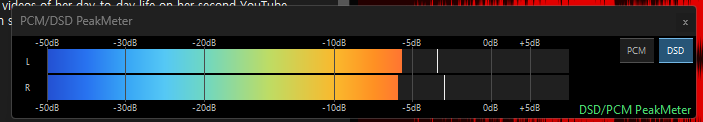
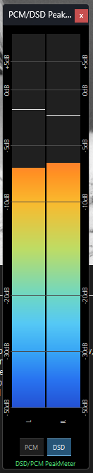
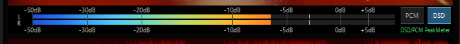

# PCM/DSD PeakMeter for foobar2000

## English

**PCM/DSD PeakMeter v0.4.0** is a native Windows x64 stereo peak-meter component for foobar2000. It is **display-only**: it does not change playback gain, DSP chains, DAC output mode or the audio samples. It operates in an independent window or as an embedded **Columns UI** panel.

[**Download official v0.4.0 stable release**](https://github.com/jjh212/PCM_DSD_PEAKMETER_RELEASES/releases/tag/v0.4.0) · [DLL](https://github.com/jjh212/PCM_DSD_PEAKMETER_RELEASES/releases/download/v0.4.0/foo_pcm_dsd_peakmeter.dll) · [SHA256SUMS](https://github.com/jjh212/PCM_DSD_PEAKMETER_RELEASES/releases/download/v0.4.0/SHA256SUMS.txt)

| Release | Size | SHA256 |
|---|---:|---|
| `foo_pcm_dsd_peakmeter.dll` v0.4.0 | **471,040 bytes** | `74C66AF9E58B5040F6243A90E6DD39B65AB5B1C6B93A4E2A0A5127D6E5535A55` |

### Display examples

| Independent horizontal | Independent vertical |
|---|---|
|  |  |

**Embedded in a custom foobar2000 skin**

### Features

- Automatic PCM/DSD display interpretation from verified **applied DSP-chain evidence** and user preset/component rules; manual PCM/DSD buttons.
- Stereo left/right peak bars, peak hold, dB markers and display corrections (default PCM **0 dB**, DSD **−6 dB**).
- Standalone and Columns UI embedded windows, per-panel **Horizontal / Vertical UP / Vertical DOWN** orientation.
- v0.4.0 minimum-size protection: windows **stop shrinking** before the meter and controls disappear. Overlapping dB labels may be omitted.
- Editable dB scale, V3 gradient / solid RGB / peak-dependent single-color palettes, fonts, button geometry, state colors and appearance-only JSON themes.
- Eight Preferences pages, with selectable English and Korean interface language.
- Automated core/layout regression **15/15 PASS** and actual minimum-size acceptance **5/5 PASS** (user-verified configuration).

### Documentation

- **[Complete illustrated bilingual manual — English first, Korean below](docs/USER_MANUAL.md)**
- [English user manual — 8 Preferences screenshots and operation examples](docs/USER_MANUAL_EN.md)
- [한국어 사용자 설명서](docs/USER_MANUAL_KO.md)
- [English troubleshooting](docs/TROUBLESHOOTING_EN.md) · [한국어 문제 해결](docs/TROUBLESHOOTING_KO.md)
- [Detailed changelog / 상세 변경내역](CHANGELOG.md)

### Install in brief

1. Exit foobar2000 and back up the previous DLL.
2. Download the official DLL and verify the **exact SHA256** above.
3. In the portable configuration verified for this project, copy the DLL to `<portable foobar2000>\profile\user-components-x64\foo_pcm_dsd_peakmeter\foo_pcm_dsd_peakmeter.dll`.
4. Restart foobar2000, load the meter as an independent window or Columns UI panel, and open **Preferences → Tools → PCM/DSD PeakMeter**.

The DSD level is a **display-corrected visualization**, not a certified native-DSD bitstream true-peak measurement. The DarkOne fullscreen Z-order interaction is tracked separately.

---

## 한국어

**PCM/DSD PeakMeter v0.4.0**은 Windows x64용 foobar2000 네이티브 C++ 스테레오 피크미터입니다. **표시 전용** 컴포넌트이므로 재생 음량, DSP 체인, DAC 출력 모드나 오디오 샘플을 변경하지 않습니다. **독립 실행 창**과 **Columns UI 삽입형 패널**로 사용할 수 있습니다.

[**v0.4.0 정식 릴리스 다운로드**](https://github.com/jjh212/PCM_DSD_PEAKMETER_RELEASES/releases/tag/v0.4.0) · [DLL 직접 다운로드](https://github.com/jjh212/PCM_DSD_PEAKMETER_RELEASES/releases/download/v0.4.0/foo_pcm_dsd_peakmeter.dll) · [SHA256SUMS](https://github.com/jjh212/PCM_DSD_PEAKMETER_RELEASES/releases/download/v0.4.0/SHA256SUMS.txt)

DLL 크기는 **471,040바이트**이며 SHA256은 위 영문 표와 동일합니다. 다운로드 후 해시를 검증하세요.

### 동작 화면

| 독립 창 가로 | 독립 창 세로 |
|---|---|
|  |  |

**테마 삽입 예시**

### 주요 기능

- 실제 **적용된 DSP 체인**과 사용자 프리셋/구성요소 규칙을 이용한 PCM/DSD 자동 판별, PCM/DSD 수동 버튼.
- 좌·우 채널 피크바, 피크 홀드, dB 눈금, 표시 보정(기본 PCM **0dB**, DSD **−6dB**).
- 독립 창과 Columns UI 패널, 패널별 **가로 / 세로 UP / 세로 DOWN** 방향.
- v0.4.0 최소 크기 제한: 피크바가 사라질 정도로 창이 줄어들지 않습니다. 공간이 부족하면 겹치는 dB 글자만 생략됩니다.
- dB 눈금 편집, 3종 색상 방식, 글꼴·버튼·상태별 색상, 외형 전용 JSON 테마.
- 한글·영문 UI를 갖춘 8개 Preferences 탭.
- 자동 테스트 **15/15 PASS**, 실사용 최소 크기 검증 **5/5 PASS**.

### 상세 설명서

- **[영문 전체 위 / 한글 전체 아래 — 19장 이미지 통합 사용자 설명서](docs/USER_MANUAL.md)**
- [English user manual](docs/USER_MANUAL_EN.md)
- [한국어 사용자 설명서 — 설정 8개 탭 상세 안내](docs/USER_MANUAL_KO.md)
- [한국어 문제 해결](docs/TROUBLESHOOTING_KO.md) · [English troubleshooting](docs/TROUBLESHOOTING_EN.md)
- [상세 업데이트 내역](CHANGELOG.md)

### 설치 요약

1. foobar2000을 완전히 종료하고 기존 DLL을 백업합니다.
2. 공식 릴리스의 DLL을 다운로드한 뒤 **SHA256을 반드시 확인**합니다.
3. 본 프로젝트에서 검증한 Portable 구조는 `<foobar2000 폴더>\profile\user-components-x64\foo_pcm_dsd_peakmeter\foo_pcm_dsd_peakmeter.dll`입니다.
4. 재실행 후 독립 창 또는 Columns UI 패널을 열고 **Preferences → Tools → PCM/DSD PeakMeter**에서 설정합니다.

DSD 표시 수치는 **시각화용 보정값**이며 네이티브 DSD 비트스트림 True Peak 측정의 공인값이 아닙니다. DarkOne 전체화면 Z-order 현상은 별도 진단 과제입니다.
