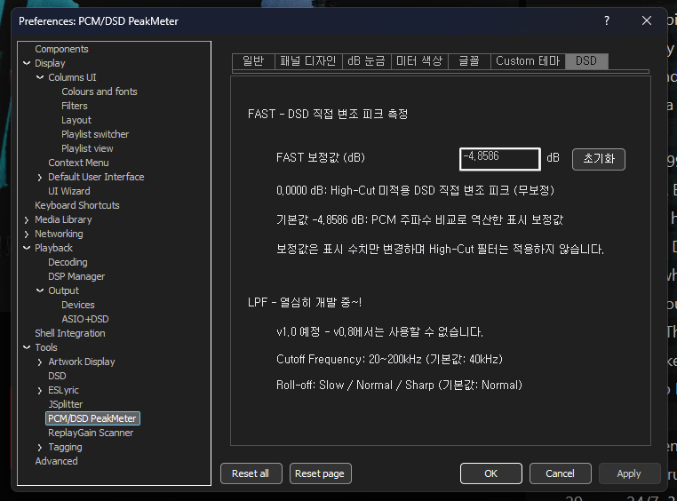

# PCM/DSD PeakMeter — v0.8.0 Change History / 업데이트 내역

# PCM/DSD PeakMeter — v0.8.0 Release Changes (English)

**Release date:** 2026-10-14 · **DLL SHA256:** `DFEE5B07E0C23D4252C3382F5CE69616D479445B449C20C34031FB33D4F17E60` · [Full manual](USER_MANUAL_EN.md)

## Major upgrades from v0.4.0

1. **Actual DoP stream detection.** Identify PCM versus DoP-carried DSD by alternating `0x05` / `0xFA` markers, validated stereo framing and one-second majority voting. No longer rely on DSP profile name for mode classification.
2. **Removed manual PCM/DSD mode switching.** PCM and DSD are now non-interactive format/status indicators; re-confirmation of the same mode does not reset the meter.
3. **Real sample-rate / format indicators.** Show `PCM 44.1kHz`, `PCM 705.6kHz`, etc., or `DSD64`–`DSD2048` when verified DoP is detected. DoP markers alone do not encode the format multiplier; the verified carrier sample rate supplies it.
4. **DSD-format-dependent FAST bit windows.** DSD64/128/256/512/1024/2048 use **28/56/112/224/448/896 bits** respectively per channel. Includes both 44.1-kHz and 48-kHz transport families.
5. **Common display measurement path.** A single calibrated FAST result drives each channel's bar, Peak Hold, warning-region statistics and maximum displayed peak; short-window diagnostics do not silently trigger independent display warnings.
6. **FAST calibration Preferences.** Adjustable/resettable display offset, default **−4.8586 dB**, with `0.0000 dB` uncalibrated direct modulation. No audible gain adjustment or implemented LPF.
7. **Warning-zone counters.** PCM: orange at 0 dB and red at +5 dB; DSD: orange at 0 dB and red at +3.1 dB. Independent L/R orange/red entries and maximum calibrated peak.
8. **Interactive statistics reset.** Removed the separate RESET button; click the statistics area to reset. Hover/pressed/out colour feedback, narrow/wide responsive rail and automatic clearing on mode changes.
9. **Redesigned horizontal and vertical layouts.** Improved meter expansion, compact L/R statistics alignment, status spacing and minimum-size readability, preserving scale colours and Peak Hold.
10. **Seven bilingual Preferences tabs.** General, Panel Appearance, dB Scale, Meter Colours, Fonts, Custom Themes, DSD. Retained customization and JSON theme import/export, with v0.8.0 version information.
11. **Performance path.** DSD 60-Hz bucket pacing with approximately 60-frame/second design target; measured frame rate and CPU behaviour are system dependent.

## Scope and caveats

- **PCM Golden measurement path preserved.** Component is visualization-only, not a DSP or PCM→DSD converter.
- DSD FAST measures **raw 1-bit modulation density**, not a low-pass-filtered analog output waveform or a certified DSD true-peak value. PCM and DSD numbers are not physically identical measurement units.
- LPF controls (20–200 kHz, planned default 40 kHz; Slow/Normal/Sharp) are **future work and unavailable in v0.8.0**.
- Verified: Windows x64 Release build, v0.8 display in PEAK_TEST and DSD512 playback, synthetic auto-window tests for the six supported formats. All-device long-term validation remains open.
- DarkOne4Mod/JSplitter font errors are third-party skin startup issues, not bundled fixes in this component.

## Screenshots of v0.8.0 updates

### Automatic DSD512 meter and responsive horizontal layout

### Responsive vertical layout

### DSD FAST calibration tab

### Horizontal minimum-size mode

### Vertical minimum-size mode

---

# PCM/DSD PeakMeter — v0.8.0 버전 업데이트 내역 (한국어)

**릴리스 기준일:** 2026-10-14 · **DLL SHA256:** `DFEE5B07E0C23D4252C3382F5CE69616D479445B449C20C34031FB33D4F17E60` · [사용설명서](USER_MANUAL_KO.md)

## v0.4.0 이후 주요 변경 사항

1. **실제 DoP 스트림 검출.** `0x05` / `0xFA` 교대 마커, 스테레오 동기와 유효성 및 1초 다수결로 PCM/DSD를 자동 판별합니다. DSP 프로필 이름만으로 판단하지 않습니다.
2. **PCM/DSD 수동 전환 모드 제거.** PCM·DSD는 **상태 인디케이터**로 표시하며, 동일한 모드의 반복 판별로 미터를 초기화하지 않습니다.
3. **실제 샘플레이트·DSD 포맷 표시.** `PCM 44.1kHz`, `PCM 705.6kHz` 또는 `DSD64`~`DSD2048` 형식으로 표시합니다. DoP 마커만으로 포맷이 결정되는 것은 아니며 검증된 전송 샘플레이트로 구분합니다.
4. **DSD 포맷별 FAST 비트연산 자동전환.** DSD64/128/256/512/1024/2048에 대해 채널별 **28/56/112/224/448/896비트**를 사용합니다. 44.1·48kHz 두 전송 계열을 지원합니다.
5. **동일한 표시 기준으로 연동.** FAST 보정 후 값이 피크바, Peak Hold, 주황·적색 경고 진입 통계와 최대 표시 피크에 공통 적용됩니다. 28비트 보조 진단값만 따로 화면 경고를 발생시키지 않습니다.
6. **DSD FAST 보정 설정.** 표시 전용 보정값을 변경/초기화할 수 있습니다. 기본 **−4.8586 dB**, `0.0000 dB`은 무보정 직접 변조 피크입니다. 실제 재생 음량이나 LPF를 변경하지 않습니다.
7. **경고 통계 추가.** PCM: 0dB 이상 주황 / +5dB 이상 적색; DSD: 0dB 이상 주황 / +3.1dB 이상 적색. 채널별 진입 횟수와 보정 후 최고 피크를 독립 표시합니다.
8. **통계영역 클릭 RESET.** 별도 RESET 문구·버튼을 제거하고 통계영역 전체 클릭으로 초기화합니다. Hover/Down/Out 색 변화 및 모드 변경 시 자동 초기화를 제공합니다.
9. **가로/세로 반응형 UI 개선.** 미터 확장, L/R 통계 폭, 상태 텍스트 간격, 좁은 창과 최소 모드 표시를 개선하고 기존 피크 홀드·눈금 색상을 보존했습니다.
10. **환경설정 7개 탭 및 한·영 UI.** 일반/패널 디자인/dB 눈금/미터 색상/글꼴/Custom 테마/DSD. 설정 및 JSON 테마 기능 유지, 버전 `0.8.0`으로 갱신했습니다.
11. **60FPS 목표의 DSD 표시 경로.** 60Hz 버킷 페이싱 구조를 유지합니다. 실제 FPS·CPU 사용량은 재생 장치와 호스트 환경에 따라 달라집니다.

## 주의사항 및 검증 범위

- PCM Golden 계측 경로 보존. 피크미터는 **표시 전용**이며 DSP나 DAC의 출력 설정을 변경하지 않습니다.
- DSD FAST는 **1비트 변조 밀도**이며 LPF 재구성 음성 신호 또는 공인 DSD True Peak와 동일하지 않습니다. PCM/DSD 숫자를 동일한 물리량으로 해석하지 않습니다.
- LPF(20~200kHz, 예정 기본 40kHz / Slow·Normal·Sharp)는 **v0.8.0 미구현**이며 향후 개발 계획입니다.
- Windows x64 Release 빌드, PEAK_TEST UI 및 DSD512 실사용, 여섯 DSD 포맷의 합성 테스트가 확인됐습니다. 모든 장치에서의 장시간 실사용 검증이 완료된 것은 아닙니다.
- DarkOne4Mod/JSplitter 폰트 초기화 문제는 별도 스킨 문제이며 본 컴포넌트 배포에 포함되지 않습니다.

## v0.8.0 기능 이미지

### 가로 DSD512 피크미터

### 세로 피크미터

### DSD FAST 설정

### 가로 최소 모드

### 세로 최소 모드

