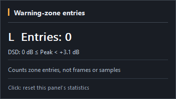
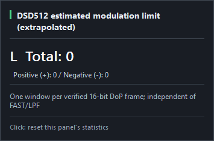

# PCM/DSD PeakMeter v1.0.1 — Final Release Notes

**Release baseline:** October 16, 2026 · foobar2000 Windows x64 · v1.0 → v1.0.1  
**Source tag:** `v1.0.1` · **commit:** `4ea0d9eb3a502d53b13e87785a032532e37712f7`

v1.0.1 improves **peak-warning classifications, raw DSD modulation-limit statistics, typographic/layout clarity, and bilingual statistics tooltips**. It preserves v1.0's DoP signal identification, PCM peak measurement, and DSD FAST and CIC3/Butterworth LPF metering. It **does not modify the original audio stream, DSP audio output, or DAC-bound data**.

> For complete installation and user guidance, DoP identification, FAST/LPF calculations, and limitations, see the [v1.0.1 Final English User Manual](USER_MANUAL_V101_EN.md).

## 1. Reworked PCM/DSD warning boundaries

| Format | Amber: near threshold | Red: at/over threshold |
|---|---|---|
| PCM | **−5 dB ≤ peak < 0 dB** | **peak ≥ 0 dB** |
| DSD | **0 dB ≤ peak < +3.1 dB** | **peak ≥ +3.1 dB** |

Threshold **inclusivity** now matches the final source: precisely **0 dB PCM** and **+3.1 dB DSD** are red. Active threshold captions flash on an approximately 500 ms interval. The MAX value also uses danger color if its recorded displayed peak meets the red boundary.

Amber/Red statistics count **upward entries into exclusive zones**, not samples, frames, or duration. A direct normal→red transition increments red alone; red→amber decay does not add an amber entry. Neither the red warning nor a red MAX is, by itself, proof of digital clipping or DAC analog overload.

## 2. New raw DSD modulation-limit counters

The component examines **original DSD 1-bit payloads from validated DoP frames**, and separately accumulates positive and negative limit-exceeded windows for each channel. The visible left/right total is **positive + negative**.

### Explicit standards classification

| DSD | Window | Negative: number of 1s | Positive: number of 1s | Threshold basis |
|---|---:|---:|---:|---|
| **DSD64** | **28 bits** | **0–3** | **25–28** | **Sony/Philips SACD Annex D.3 standard-based** |
| DSD128 | 56 bits | 0–7 | 49–56 | **Estimated**, extrapolated proportionally from DSD64 |
| DSD256 | 112 bits | 0–15 | 97–112 | **Estimated** |
| DSD512 | 224 bits | 0–31 | 193–224 | **Estimated** |
| DSD1024 | 448 bits | 0–63 | 385–448 | **Estimated** |
| DSD2048 | 896 bits | 0–127 | 769–896 | **Estimated** |

**Crucially, the DSD64 threshold is standards-based, not an estimate.** For DSD128–2048, the **observed bit counts are real measurements**; it is the **classification threshold** that is proportionally estimated. The higher-rate thresholds must not be advertised as independently standardized SACD compliance limits.

**Scanning method:** the implementation examines **one sliding window per verified 16-bit DoP frame**—a **16-bit stride**, not exhaustive 1-bit-stride scanning. Therefore even the standards-based **DSD64 thresholds do not constitute a complete every-possible-window Annex D.3 compliance certification**. Counts represent **examined windows outside a limit**, not independent clipping events or time above threshold. Counting continues regardless of FAST/LPF selection; PCM shows a non-applicable `—` with no modulation-cell hover/reset.

## 3. Left-aligned format in wide vertical layout

- PCM/DSD format labels are **left-aligned** in wide vertical mode, matching other orientations.
- FPS remains aligned to the **right**.
- Existing signal-channel relationships and metering layout meanings remain unchanged.

## 4. Clearer left/right channel typography

L/R labels receive higher **visual weight, brightness, and size** in horizontal and vertical layouts, without changing actual channel mapping or peak measurement.

## 5. Clearer PCM/DSD format labels

The `PCM` and `DSD` prefixes receive distinct stronger typography, separate from the numeric suffix. PCM sampling rates use one **truncated, non-rounded** kHz decimal (`PCM 705.6kHz`); DSD shows a space (`DSD 512`). FPS has no artificial font emphasis.

## 6. Bilingual dark-card statistics tooltips

Each tooltip card separates **heading, principal reading, secondary data, explanation, and reset hint**, with an accent color and window/DPI-aware positioning.

- **Modulation:** per-channel positive/negative counts; DSD64 standards basis and **estimated** higher-rate status.
- **Amber:** near-threshold zone-entry count and range.
- **Red:** reached/exceeded zone-entry count, distinguished from clipping.
- **MAX:** highest displayed level since reset.
- **Reset:** click enabled statistics to reset both L/R histories **for this panel**.
- **Language:** follows the General Preferences English/Korean selection.
- **PCM modulation field:** not applicable; hover and click-to-reset disabled.

| Warning tooltip | Modulation-limit tooltip |
|---|---|
|  |  |

## Core v1.0 functions retained

- **Automatic DoP detection:** alternating `0x05/0xFA` 24-bit carrier markers, left/right agreement, 32 consecutive valid frames, and a **one-second majority vote**. Repeated conclusions are no-ops.
- **FAST:** original DSD64–2048 modulation-density windows of **28–896 bits**, with default empirical display offset **−4.8586 dB** and **0.0000 dB** for uncorrected output.
- **LPF:** **metering-only CIC3 plus cutoff-compensated Butterworth**, cutoff **20–200 kHz**, default **40 kHz**; Slow/Medium/Sharp (default Medium).
- **Peak Hold:** immediate rise, **0.50 s hold → 30 dB/s descent**.
- **PCM:** Golden PCM sample-peak path preserved.
- **DSD warnings:** displayed peak thresholds and original-bit modulation-limit counts remain **separate concepts**.

## Installation and packaging

Install `foo_pcm_dsd_peakmeter_v1.0.1_x64.fb2k-component` using foobar2000 `Preferences > Components > Install` and restart. The component ZIP contains **one root-level `foo_pcm_dsd_peakmeter.dll`**, with **no `64/` or `x64/` folder**.

The standalone DLL and `PCM_DSD_PEAKMETER_v1.0.1_Windows_x64.zip` are alternative distribution formats, not components to install simultaneously. Back up any existing manual installation and verify published binaries with the official `SHA256SUMS.txt`.

## Measurement limits and provenance

- FAST is **not** LPF, and LPF is **not** an audio-output filter.
- The variable LPF is **not certified reconstructed DSD True Peak**, not identical to every SACD Annex D.1 measurement filter, and not a DAC analog output measurement.
- PCM sample peaks, DSD FAST density peaks, DSD LPF output peaks, and modulation-limit window counts are **different metrics**.
- The Stage 19/20 **1 kHz −12 dBFS, DSD64/DSD512** experiments cited in the manuals are **historical reference validation**. Do not reinterpret them as a newly completed v1.0.1 all-format/long-duration test.
- New component version **1.0.1**, TEST build and actual user-provided UI screenshots were confirmed. Previous v1.0 assets, source history and tags remain intact.

**Known release SHA256:** DLL `AD33EC851B7632FF502D7B6B05ECCCD1AAFE0A04806056DB8D2AD47857262FFD`; `.fb2k-component` `5C2E1B07F8B419152D0545895EB1C536504F2F7C9390584F43B510A36B2E2F9A`; Windows ZIP `E032BBEAB323B0ECAAA4EB7085E7CC87D437FD8ED841F967B6EBD7FE857ADAB6`.

**Sources:** Sony/Philips *Super Audio CD Audio Signal Properties v1.3* Annex D.2/D.3 · v1.0 Engineering Technical Report (2026-10-16) · v1.0.1 private source commit `4ea0d9eb3a502d53b13e87785a032532e37712f7`.
