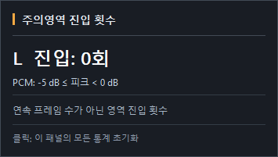
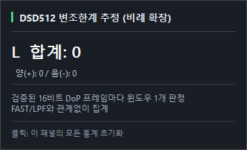

# PCM/DSD PeakMeter v1.0.1 — Final 변경내역

**발행 기준:** 2026-10-16 · foobar2000 Windows x64 · v1.0 → v1.0.1  
**소스 태그:** `v1.0.1` · **커밋:** `4ea0d9eb3a502d53b13e87785a032532e37712f7`

v1.0.1은 **피크 주의·초과 표시, 원본 DSD 변조한계 통계, 레이아웃 가독성, 통계 Tooltip**을 개선한 업데이트입니다. v1.0의 DoP 자동판별, PCM 계측, DSD FAST 및 CIC3·Butterworth LPF 기반 계측 구조를 유지하며 **재생 스트림·DSP 출력·DAC로 보내는 오디오를 수정하지 않습니다**.

> 자세한 설치, DoP 자동판별, FAST/LPF 원리, 표준 한계와 사례는 [v1.0.1 한국어 최종 사용설명서](USER_MANUAL_V101_KO.md)에서 확인할 수 있습니다.

## 1. PCM/DSD 피크 주의·초과 영역 재정의

| 포맷 | 주의(주황) | 초과(빨강) |
|---|---|---|
| PCM | **−5 dB ≤ 피크 < 0 dB** | **피크 ≥ 0 dB** |
| DSD | **0 dB ≤ 피크 < +3.1 dB** | **피크 ≥ +3.1 dB** |

경계값의 **등호 포함 관계를 최종 코드와 일치**시켰습니다. PCM의 정확한 0 dB, DSD의 정확한 +3.1 dB는 빨강입니다. 해당 경고 눈금 텍스트는 약 500 ms 주기로 강조됩니다. MAX도 각 포맷의 빨강 경계에 도달한 기록을 위험색으로 표시합니다.

**통계 주의:** 주황·빨강은 **영역 상승 진입 이벤트 수**입니다. 정상→빨강 직행 시 빨강만 증가하며, 빨강→주황으로 내려올 때 주황을 다시 계수하지 않습니다. 빨강 표시는 자체로 디지털 클리핑이나 DAC 아날로그 포화를 입증하지 않습니다.

## 2. DSD 원본 변조한계 카운터 신설

검증된 DoP의 **원본 DSD 1비트**를 채널별로 검사해 **양(+)/음(−) 변조한계 초과 검사 윈도우**를 계수합니다. 화면 표시: `L 합계 = L 양(+) + L 음(−)`, `R 합계 = R 양(+) + R 음(−)`.

### DSD64와 고배속 DSD의 판정 기준을 명확히 분리

| 포맷 | 윈도우 | 음(−) 초과: 1 개수 | 양(+) 초과: 1 개수 | 기준 |
|---|---:|---:|---:|---|
| **DSD64** | **28비트** | **0–3** | **25–28** | **Sony/Philips SACD Annex D.3 표준 기반** |
| DSD128 | 56비트 | 0–7 | 49–56 | DSD64 밀도 비례 확장 **추정** |
| DSD256 | 112비트 | 0–15 | 97–112 | **추정** |
| DSD512 | 224비트 | 0–31 | 193–224 | **추정** |
| DSD1024 | 448비트 | 0–63 | 385–448 | **추정** |
| DSD2048 | 896비트 | 0–127 | 769–896 | **추정** |

**핵심:** DSD64의 **판정 임계값은 표준 기반으로, 추정값이 아닙니다.** DSD128~2048의 **비트스트림 계측 자체도 실제 측정**이며, **한계 판정 임계값만** DSD64 규격의 비율을 확대 적용한 추정치입니다. 고배속 DSD의 공식 SACD 적합성 판정으로 표현하지 않습니다.

**실제 구현 간격:** 검증된 **16비트 DoP 프레임마다 16비트 이동 윈도우 1개**를 검사합니다. 1비트 이동 전수 검사가 아니므로 **DSD64도 Annex D.3의 모든 시작 위치를 검사하는 완전한 규격 적합성 인증은 아닙니다.** 카운터는 **초과 검사 윈도우 수**이지 독립 클리핑 사건 수가 아닙니다. FAST/LPF 모드 선택과 독립적으로 동작하며 PCM에서는 `—`로 표시하고 Hover·Reset 클릭을 비활성화합니다.

## 3. 세로 넓은 모드의 포맷 정렬 일치

- 세로 넓은 모드의 PCM/DSD 포맷 표기를 **왼쪽 정렬**로 변경.
- 가로·세로 좁은 모드와 통일하고, **FPS는 오른쪽** 정렬 유지.
- 창 크기에 따라 통계와 포맷의 역할·채널 대응 관계를 유지.

## 4. 가로·세로 L/R 가독성 개선

L/R 채널 문자의 **크기, 굵기, 명도**를 개선했습니다. 실제 좌우 채널 위치와 피크바 계측 의미는 유지합니다.

## 5. PCM/DSD 포맷 텍스트 가독성 개선

`PCM`과 `DSD` 접두 문자만 더 뚜렷하게 표현합니다. `PCM 705.6kHz`처럼 kHz 표기는 **소수 첫째 자리 고정·절삭**, DSD는 `DSD 512`처럼 띄어 씁니다. 숫자와 FPS에는 별도의 불필요한 강조를 추가하지 않았습니다.

## 6. 다국어 카드형 통계 Tooltip과 Reset 안내

기본 한 줄 Tooltip을 대신해 **제목·핵심 수치·보조 정보·설명·초기화 안내**를 분리한 다크 카드형 표시를 적용했습니다. 항목별 색상 강조와 DPI·화면 경계 대응을 포함합니다.

- **변조한계:** DSD64는 표준 기반, DSD128 이상은 **‘추정’** 표시; 채널별 (+)/(−) 값 안내.
- **주황:** 주의 영역 진입 이벤트 및 경계 설명.
- **빨강:** 초과 영역 진입 이벤트, 클리핑과 별개임을 안내.
- **MAX:** 마지막 초기화 이후 최대 표시 피크 안내.
- **Reset:** 활성 통계 칸 클릭 시 **해당 패널 L/R 전체 통계** 초기화.
- **언어:** Preferences 일반 탭의 한국어/English 설정을 따름.
- **PCM 변조한계:** 해당 없음 표시, Tooltip과 통계 클릭 비활성.

| 주의 Tooltip | 변조한계 Tooltip |
|---|---|
|  |  |

## 함께 유지되는 v1.0 핵심 기능

- **DoP 자동판별:** 24비트 DoP의 `0x05/0xFA` 교대 마커, L/R 일치, 32개 연속 유효 프레임 확인, **1초 다수결**; 반복 판정은 No-op.
- **FAST:** DSD64~2048별 28~896비트 윈도우의 직접 변조 밀도 피크. 표시 Offset 기본 `−4.8586 dB`, `0.0000 dB`는 무보정.
- **LPF:** 원본 DSD 1비트에 대한 **계측 전용 CIC3 + 컷오프 보정 Butterworth**. Cut-off **20–200 kHz**, 기본 **40 kHz**, Slow/Medium/Sharp 기본 Medium.
- **Peak Hold:** 새 피크 즉시 상승, **0.50초 유지 → 30 dB/s 하강**.
- **PCM:** 기존 Golden 샘플 피크 측정 경로 보존.
- **DSD 경고:** 표시 피크의 +3.1 dB 경계와 변조한계 비트 윈도우 계수는 별도 통계.

## 설치와 패키지 구성

`foo_pcm_dsd_peakmeter_v1.0.1_x64.fb2k-component`를 foobar2000 `Preferences > Components > Install`에서 설치하고 재시작하세요. 이 파일의 압축 내부에는 **`foo_pcm_dsd_peakmeter.dll` 한 개만 최상위**에 있으며 `64/`, `x64/` 하위 폴더가 없습니다.

단독 DLL과 `PCM_DSD_PEAKMETER_v1.0.1_Windows_x64.zip`은 대체 배포 수단으로, 서로 중복 설치하지 않습니다. 설치·교체 전 백업하고, 공식 릴리스의 `SHA256SUMS.txt`로 바이너리 무결성을 확인하세요.

## 기술적 한계 및 검증 기록의 범위

- FAST는 LPF가 아니고, LPF는 음악 재생 경로에 적용되는 출력 필터가 아닙니다.
- LPF 수치는 **인증된 reconstructed DSD True Peak**, 모든 SACD Annex D.1 조건의 적합성 측정값, 또는 DAC 아날로그 피크 측정값을 의미하지 않습니다.
- PCM sample peak, DSD FAST 밀도 피크, DSD LPF 출력 피크, 변조한계 윈도우 카운터는 **서로 다른 지표**입니다.
- v1.0 Stage 19/20의 1 kHz −12 dBFS·DSD64/512 측정은 **과거 검증 근거**이며 v1.0.1 모든 DSD 포맷·장시간 운용의 신규 인증 결과로 소급하지 않습니다.
- 새 설치·표시·버전 `1.0.1`은 TEST 빌드·사용자 제공 스크린샷으로 확인했습니다. 기존 v1.0 바이너리·태그·릴리스는 보존합니다.

**바이너리 검증 SHA256:** DLL `AD33EC851B7632FF502D7B6B05ECCCD1AAFE0A04806056DB8D2AD47857262FFD`; Component `5C2E1B07F8B419152D0545895EB1C536504F2F7C9390584F43B510A36B2E2F9A`; Windows ZIP `E032BBEAB323B0ECAAA4EB7085E7CC87D437FD8ED841F967B6EBD7FE857ADAB6`.

**참조:** Sony/Philips *Super Audio CD Audio Signal Properties v1.3*, Annex D.2/D.3 · v1.0 기술보고서(2026-10-16) · v1.0.1 Private 소스 커밋 `4ea0d9eb3a502d53b13e87785a032532e37712f7`.
