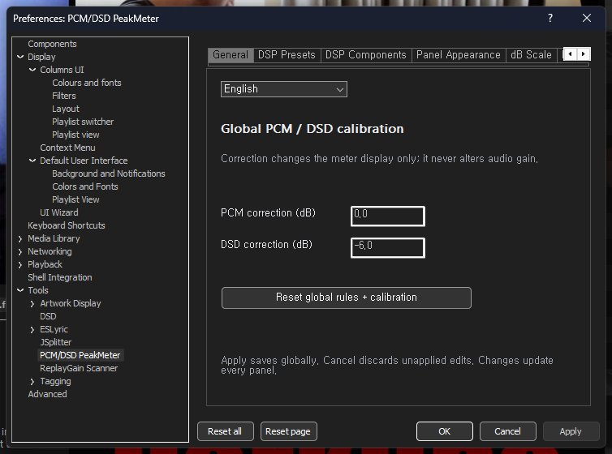
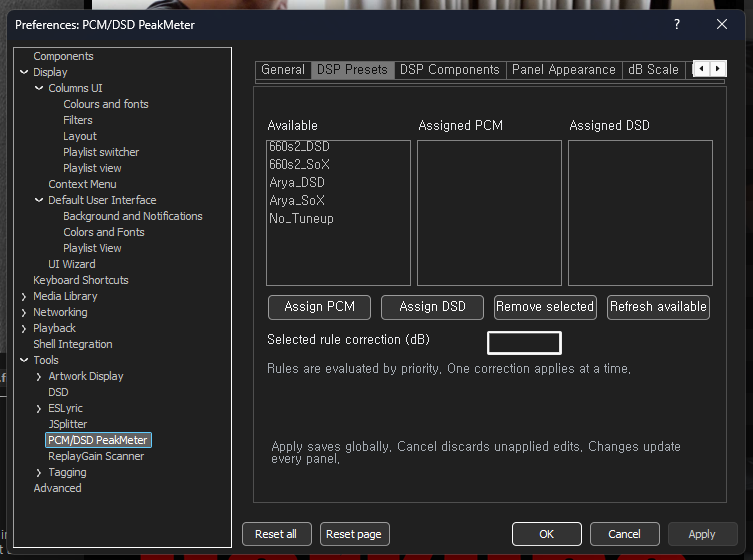
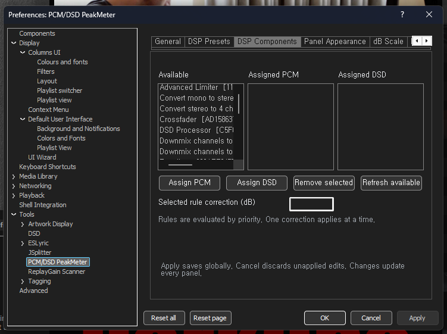
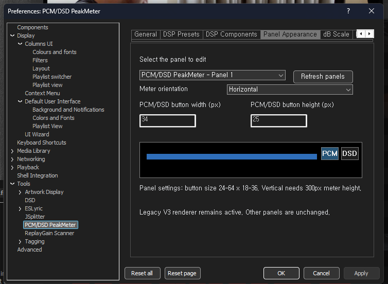
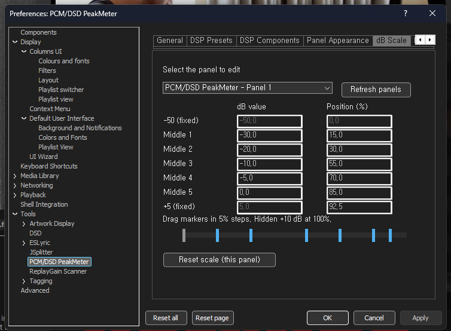
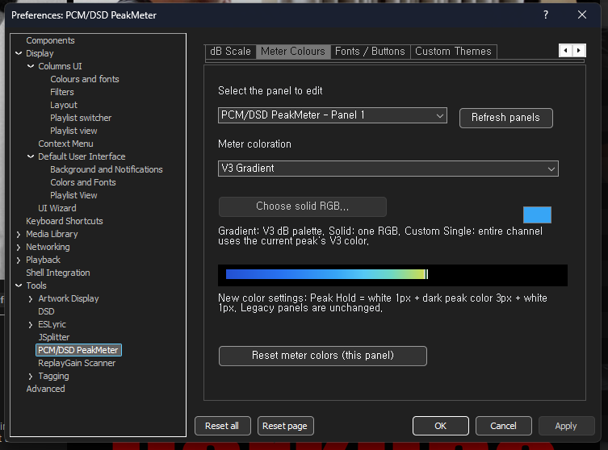
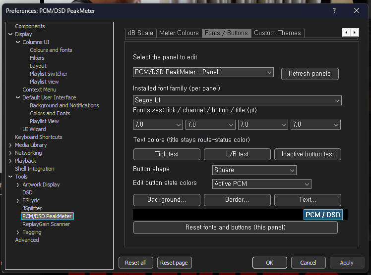
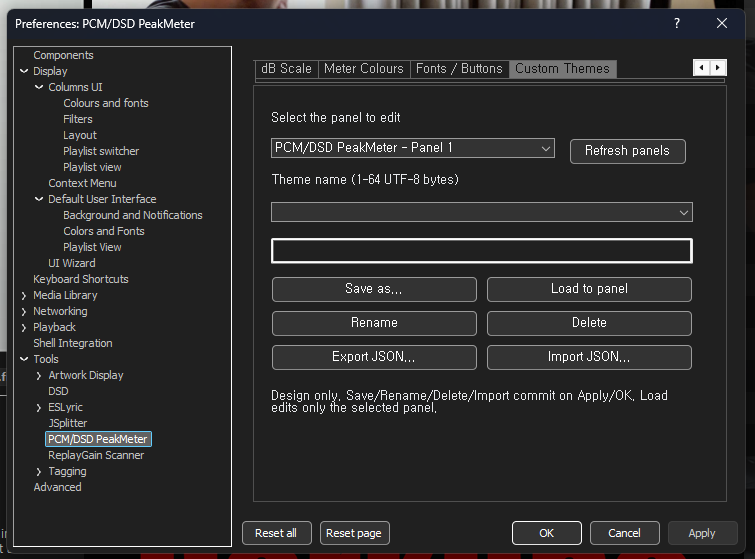

# PCM/DSD PeakMeter v0.4.0 — User Manual (English)

> **Official release:** [v0.4.0](https://github.com/jjh212/PCM_DSD_PEAKMETER_RELEASES/releases/tag/v0.4.0) · **Platform:** foobar2000 on Windows x64 · **Documentation revision:** 2026-10-13
> [English](USER_MANUAL_EN.md) · [한국어](USER_MANUAL_KO.md) · [Combined manual: English → Korean](USER_MANUAL.md) · [Troubleshooting](TROUBLESHOOTING_EN.md)

## 1. What PCM/DSD PeakMeter does

PCM/DSD PeakMeter is a native C++ **visualization-only** component for foobar2000. It displays stereo **L/R** peak bars and retained peak indicators, and can be hosted either in an independent, resizable window or as a Columns UI panel. It supports automatic PCM/DSD display-mode detection, manual PCM/DSD buttons, horizontal and vertical layouts, a customizable dB scale, fonts, button colors, meter colors, and per-panel themes.

**It does not** insert or remove DSPs, resample audio, convert PCM to DSD, modify playback gain or alter the audio output device. The PCM/DSD mode is a display interpretation, not an output-mode switch. In particular, a DSD indicator and its display correction **do not certify native DSD bitstream true-peak values**.

### 1.1 Actual interface examples

**Standalone window — horizontal orientation**


**Standalone window — vertical orientation**


**Embedded in a foobar2000 theme / Columns UI layout**


The screenshots show actual user-tested layouts and settings. Your appearance depends on the configured panel, theme, Windows scaling and audio activity.

## 2. Download, integrity and installation

### 2.1 Verified release

| Item | Verified value |
|---|---|
| Version | **v0.4.0**, stable |
| Platform | Windows **x64** |
| Binary file | `foo_pcm_dsd_peakmeter.dll` |
| Binary size | **471,040 bytes** |
| SHA256 | `74C66AF9E58B5040F6243A90E6DD39B65AB5B1C6B93A4E2A0A5127D6E5535A55` |
| Download | [Official GitHub Release](https://github.com/jjh212/PCM_DSD_PEAKMETER_RELEASES/releases/tag/v0.4.0) |
| Checksum file | [SHA256SUMS.txt](https://github.com/jjh212/PCM_DSD_PEAKMETER_RELEASES/releases/download/v0.4.0/SHA256SUMS.txt) |

1. **Exit foobar2000 completely**. Do not overwrite a DLL while its process is still running.
2. Back up your existing component folder and its DLL (if previously installed).
3. Download `foo_pcm_dsd_peakmeter.dll` and `SHA256SUMS.txt` from the official v0.4.0 release.
4. Compare the SHA256 of the downloaded DLL with the expected value above. On Windows PowerShell:

   ```powershell
   Get-FileHash -Algorithm SHA256 -LiteralPath 'C:\path\to\foo_pcm_dsd_peakmeter.dll'
   ```

5. For the portable foobar2000 layout verified in this project, place the DLL at:

   ```text
   <foobar2000 portable folder>\profile\user-components-x64\foo_pcm_dsd_peakmeter\foo_pcm_dsd_peakmeter.dll
   ```

   Other installations may use a different component directory; follow their actual component management layout. Do **not** copy the entire profile from another installation.
6. Restart foobar2000. Confirm that the component is recognized, open the meter, and verify that its PCM/DSD buttons and L/R bars appear.

**Multiple portable copies:** each portable foobar2000 folder holds its **own DLL**. An older DLL in a testing copy can remain in use even when another copy has been updated. If the update seems ineffective, identify the actual running executable and loaded module path before changing the source or settings.

## 3. Opening and operating the meter

### 3.1 Independent window

Open the **PCM/DSD PeakMeter** command supplied by the installed component in foobar2000's menu. The independent window can be moved and resized; its size/position are retained. Its PCM/DSD buttons and title remain visible down to the configured minimum size. If another window hides it when switching foobar2000 into a particular fullscreen skin, treat that as a separate window layering (Z-order) investigation.

### 3.2 Columns UI panel

Add **PCM/DSD PeakMeter** as a panel in your Columns UI layout. The enclosing layout controls the available space; the panel reports its minimum requirements to its host. The same Preferences UI can edit each active instance independently.

### 3.3 Understanding the display

- **L and R:** left and right playback channels.
- **Bars and peak-hold marks:** current meter visualization and peak markers; colors are configurable.
- **PCM / DSD:** display-mode selection buttons; using them does not change the sound device or PCM/DSD conversion.
- **dB ticks:** labels and positions are adjustable per panel. When space is too tight, overlapping tick text can be omitted while the bars and mode buttons remain visible.
- **Route/status title:** a status-colored title whose color is distinct from the user-adjustable tick and button-text colors.

## 4. Automatic detection, manual selection and calibration

### 4.1 Auto-detection order

The auto resolver observes the **applied Core DSP chain**, not just a selected preset name, and evaluates evidence in this order:

1. **DSP Presets:** a user rule for a **confirmed applied** preset, if one matches.
2. **DSP Components:** user-defined rules matching active DSP components. A component earlier in the active chain has priority. If two matching components have the same rank, DSD takes precedence over PCM.
3. **Built-in DSD recognition:** recognized active DSD Processor / DSD Trellis SDM identifiers where available.
4. **Unknown Auto:** if no conclusive evidence is present, the resolver preserves an **unknown** origin; its default on-screen effective mode may be PCM. This is **not proof** that the actual output stream is PCM.

The SACD decoder's Output setting alone is **diagnostic information, not decisive evidence**. This component does not rely on an external `foo_outinfo` component for the stated detection path.

### 4.2 Manual mode

Use the **PCM** or **DSD** button when you need to override the display interpretation manually. Automatic evidence and a manual selection are distinct states. Do not infer that clicking DSD starts DSD conversion or changes your playback format.

### 4.3 Display correction

Defaults: **PCM 0.0 dB**, **DSD −6.0 dB**. The correction affects the meter's **shown level only**, never the actual samples, output gain, or device settings. Global corrections apply when no more specific rule correction wins; a matching user preset/DSP rule carries **one individual correction**, not a sum of multiple values.

Supported correction input is **−30.0 to +30.0 dB in 0.1 dB increments**. Use the decimal display format accepted by your localized settings, e.g. `-6,0` or `-6.0` as presented.

## 5. Minimum window / panel dimensions — v0.4.0

The **button cluster** consists of the PCM and DSD mode buttons plus the `DSD/PCM PeakMeter` title area. These are **minimum client-area dimensions**; the actual independent window's outer frame can be larger.

| Orientation | Minimum client width | Minimum client height |
|---|---|---|
| Horizontal | Button-cluster width **+ 100 px** | Button-cluster height |
| Vertical UP or DOWN | Button-cluster width | Button-cluster height **+ 100 px** |

The computed limit reflects the configured button size, title font and relevant Windows DPI/frame geometry. **Dragging a window edge stops at the minimum**, instead of allowing a blank or unusable meter. The bars and controls stay visible, while overlapping dB labels can be suppressed.

- **Independent window:** the Win32 frame constrains the drag operation.
- **Columns UI panel:** the panel communicates minimum size limits to the Columns UI host.
- When the panel becomes larger, normal dB labels and meter space reappear as room permits.
- Preferences also notes that the **full vertical meter design benefits from 300 px or more of meter height**; that design recommendation is distinct from the enforced minimum of cluster height + 100 px.

## 6. Preferences — eight pages, illustrated

Open foobar2000 **Preferences → Tools → PCM/DSD PeakMeter** (as shown in the screenshots). The eight pages are arranged along the top; small navigation arrows reveal tabs that do not fit in the current Preferences width.

### 6.1 General — language and global level corrections



**Controls:** English/Korean language selection; **PCM correction (dB)**; **DSD correction (dB)**; **Reset global rules + calibration**.

**How to use:** select a language, type the corrections, then choose **Apply** to commit without leaving the dialog or **OK** to commit and close. The reset button stages default global rules and corrections; review before applying. Language and global calibration are not per-panel appearance options.

**Example:** keeping PCM at `0.0` and DSD at `-6.0` retains the standard *display* relationship while leaving playback gain unchanged.

### 6.2 DSP Presets — assign an applied preset to PCM or DSD



**Controls:** Available, Assigned PCM, Assigned DSD; **Assign PCM**, **Assign DSD**, **Remove selected**, **Refresh available**, **Selected rule correction (dB)**.

**Procedure:**

1. Refresh the list if you changed foobar2000's DSP presets.
2. Select a preset from **Available**.
3. Assign it to **PCM** or **DSD**. The entry moves into the chosen assignment list.
4. Select the assigned rule and enter an optional individual correction.
5. Apply/OK. A selected-but-not-applied preset in DSP Manager is *not* an active-route confirmation.

Matching an applied preset takes precedence over component rules. Its correction is **the one correction used** for that selection.

### 6.3 DSP Components — assign individual DSP plugins



**Controls:** the same three assignment lists and actions as DSP Presets, but the available items are DSP **components** rather than complete preset configurations.

**Procedure:** choose a component from Available, assign PCM/DSD, optionally enter the rule's correction, then Apply/OK. Use **Remove selected** to remove an assignment without uninstalling the DSP from foobar2000.

**Priority:** among matching user component rules, the active chain order decides which rule wins; a tie resolves to DSD. A matched user preset rule overrides component rules. This page **does not add or remove DSPs from the audio chain**.

### 6.4 Panel Appearance — select a panel, orientation and button dimensions



**Controls:** Select the panel to edit, **Refresh panels**, Meter orientation, PCM/DSD button width (px), PCM/DSD button height (px), live layout preview.

1. Choose the target instance, e.g. **PCM/DSD PeakMeter - Panel 1**. Refresh if you opened or closed panels.
2. Choose **Horizontal**, **Vertical UP (CCW)** or **Vertical DOWN (CW)**.
3. Enter a button width **24–64 px** and height **18–36 px** (the shown default example is **34 × 25 px**).
4. Check the preview, then Apply/OK. Only the selected panel's appearance is modified.

The minimum size is recalculated from the selected panel's actual button/title configuration. If you have pending unsaved changes and attempt to switch panels, save or discard those edits before selecting another instance.

### 6.5 dB Scale — customize tick values and relative positions



**Controls:** select panel, dB value, Position (%), draggable markers, **Reset scale (this panel)**.

The default axis has seven displayed ticks:

| Tick | dB | Position |
|---|---:|---:|
| Fixed low | −50 | 0% |
| Middle 1 | −30 | 15% |
| Middle 2 | −20 | 30% |
| Middle 3 | −10 | 55% |
| Middle 4 | −5 | 70% |
| Middle 5 | 0 | 85% |
| Fixed high | +5 | 92.5% |

The underlying scale extends to a **hidden +10 dB endpoint at 100%**. Marker dragging snaps in **5% steps**. The ordering must remain monotonic and neighboring tick positions cannot overlap; invalid entries prevent applying. Press **Reset scale (this panel)** to restore the original axis for only the selected panel.

### 6.6 Meter Colours — gradient, fixed RGB or peak-dependent single color



**Color modes:**

- **V3 Gradient:** the original multi-color dB palette.
- **Solid RGB:** one user-chosen RGB color.
- **Custom Single (peak dB):** fills the whole channel in the V3 color corresponding to its current peak level.

Choose a color mode, select **Choose solid RGB…** when applicable, inspect the preview, and Apply/OK. **Reset meter colors (this panel)** restores the panel's color settings. Under new color modes, the peak-hold marker uses a **1 px white + 3 px dark peak color + 1 px white** treatment. Existing legacy panels are preserved where applicable.

### 6.7 Fonts / Buttons — typography, shape and mode-state colors



**Font controls:** installed font family; four font sizes (tick, channel L/R, PCM/DSD button, title), measured in points. Text-color buttons affect tick text, channel labels, and inactive button text. The title retains its **route/status color**, not an arbitrary independent title-color selection.

**Buttons:** choose **Square** or **Rounded rectangle**. Choose the state to customize — **Active PCM**, **Active DSD**, **Inactive**, **Disabled** — then set **Background**, **Border**, and **Text** colors for that state. A small live preview helps inspect the result. Use **Reset fonts and buttons (this panel)** to restore the chosen panel's defaults.

Large button/title fonts can also change the computed minimum window size. Apply/OK to keep the edits; unrelated panels remain unchanged.

### 6.8 Custom Themes — portable appearance presets



**Controls:** Theme name, **Save as…**, **Load to panel**, **Rename**, **Delete**, **Export JSON…**, **Import JSON…**.

1. Adjust the selected panel's scale, colors, orientation, fonts and buttons as desired.
2. On **Custom Themes**, enter a unique theme name of **1–64 UTF-8 bytes** (not 64 Unicode characters) and click **Save as…**.
3. Use **Load to panel** to apply that saved appearance **only to the selected panel**.
4. **Export JSON…** creates a portable appearance definition; **Import JSON…** imports a compatible theme file.
5. Theme library changes (save, rename, delete, import) are staged until **Apply/OK**.

**Scope warning:** Custom Themes are **design/appearance-only**. They do not include or overwrite your global DSP preset rules, DSP component rules or PCM/DSD calibration.

## 7. Global settings, per-panel settings, Apply/OK/Cancel

| Scope | Pages / functions | Impact |
|---|---|---|
| Global | General, DSP Presets, DSP Components | Route rules, language and applicable display corrections across panels |
| Per-panel | Panel Appearance, dB Scale, Meter Colours, Fonts / Buttons | Only the selected meter instance |
| Shared theme library; per-panel load | Custom Themes | Save/rename/import in the shared library; applying a theme edits only the selected panel |

- **Apply:** stores staged valid changes and leaves Preferences open.
- **OK:** applies changes and closes Preferences.
- **Cancel:** discards **unapplied** changes; it does **not** undo an earlier successful Apply.
- **Reset page / Reset all:** stages resets for the relevant settings; check the pending state and Apply/OK to store them.
- **Invalid input:** correct the highlighted/invalid field before Apply/OK. An unknown or newer panel configuration is kept protected rather than silently overwritten.

## 8. Troubleshooting and compatibility notes

**An update appears to have no effect.** Confirm the running foobar2000 executable path and the loaded `foo_pcm_dsd_peakmeter.dll` path; each portable instance has its own component folder. Then verify the DLL SHA256.

**The meter seems blank when extremely small.** Ensure v0.4.0 is actually loaded; the verified minimum-size behavior is designed to preserve the meter and controls. Check selected orientation, large fonts/buttons and Columns UI host constraints.

**A preset assignment does not switch the display.** The preset must be confirmed *applied* to the current DSP chain. Check DSP Components assignments and the button/manual state too.

**The meter disappears behind a fullscreen DarkOne window.** This is tracked separately as a Z-order issue, **not** a claimed v0.4.0 fix.

**Display numbers differ from other peak tools.** Correction is applied to the *visual level* and the source is the available meter observation path; the output bitstream true peak is not measured/certified as native DSD by this release.

See [English troubleshooting](TROUBLESHOOTING_EN.md), [한국어 문제 해결](TROUBLESHOOTING_KO.md), and the [v0.4.0 changelog](../CHANGELOG.md).

## 9. Verification record

- Windows Release x64 (Visual Studio 2026 / MSVC v145): **PASS**.
- Core/layout automated regression: **15/15 PASS**.
- User acceptance: **5/5 PASS** — standalone horizontal and vertical; Columns UI horizontal and vertical; minimum-size rendering.
- Four separately backed-up portable installations: **all four DLL SHA256 checks PASS**.
- Public GitHub release asset was re-downloaded and its SHA256 was verified before publication.

The user-test results apply to the tested environment; they are not a guarantee for every custom foobar2000 theme or host configuration.
