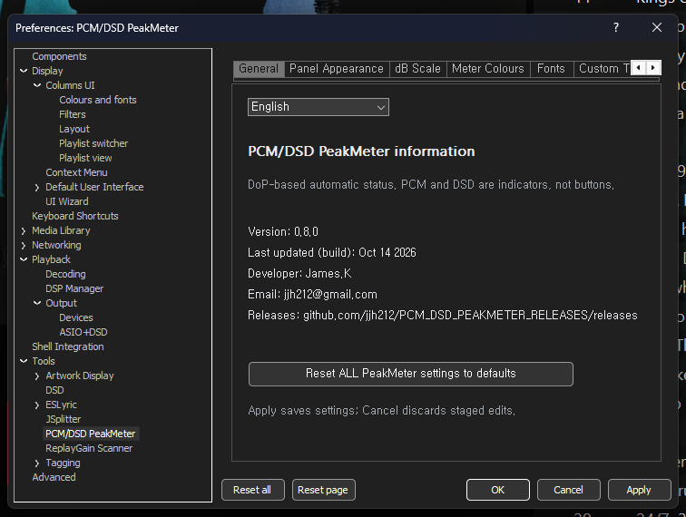
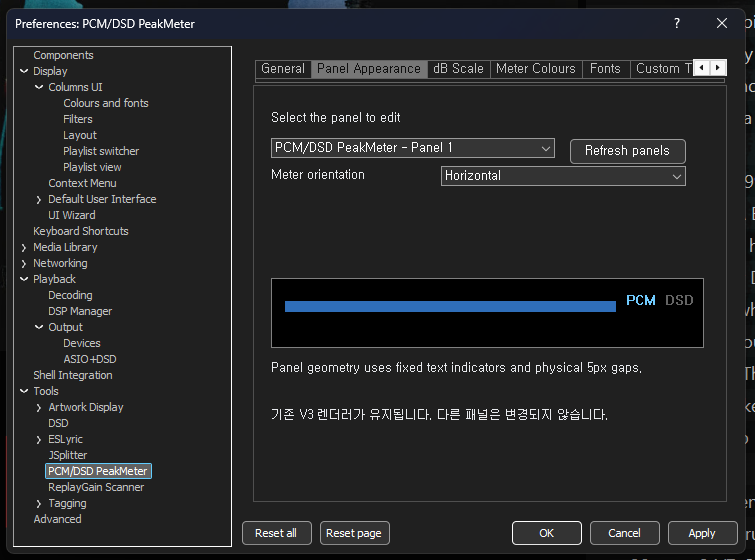
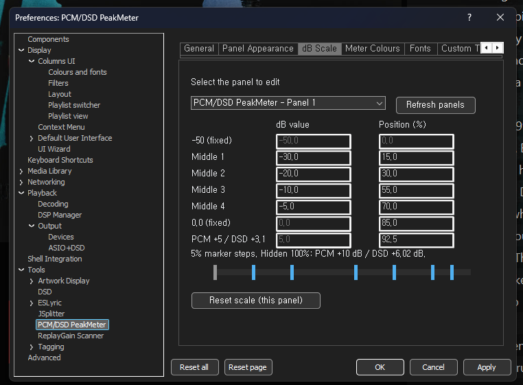
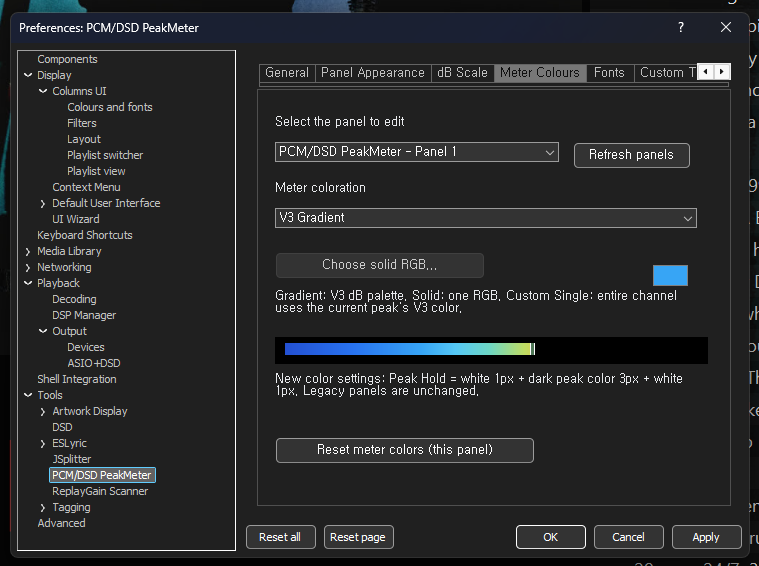
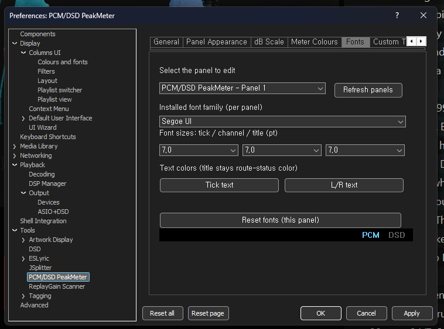
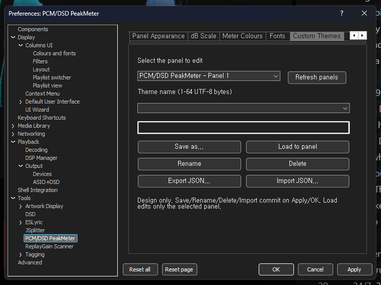
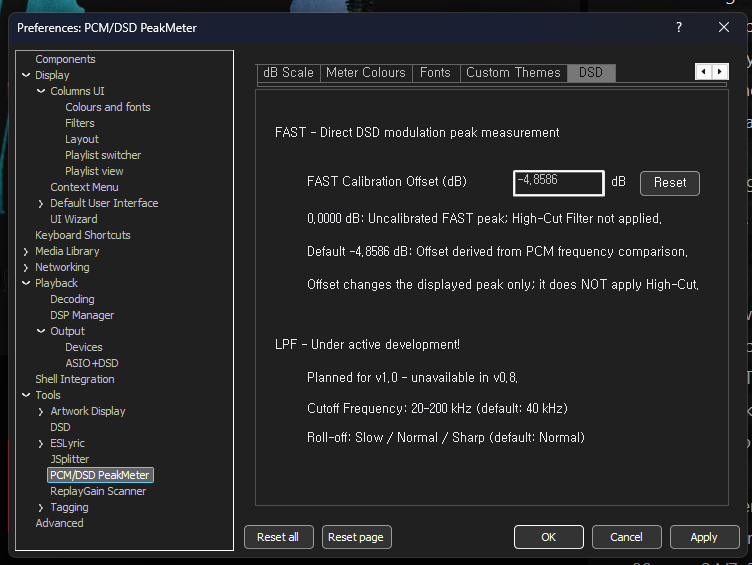

# PCM/DSD PeakMeter v0.8.0 — User Manual (English)

**Release:** [v0.8.0](https://github.com/jjh212/PCM_DSD_PEAKMETER_RELEASES/releases/tag/v0.8.0) · **Date:** 2026-10-14 · [한국어](USER_MANUAL_KO.md) · [Change history](CHANGELOG_V080_EN.md)

## 1. Introduction and system requirements

PCM/DSD PeakMeter v0.8.0 is a **display-only** native Windows x64 component for **foobar2000**. It can be used as a standalone meter window or embedded in **Columns UI**. It does not change playback gain, insert DSPs, convert audio, or change the DAC output format. A compatible DoP stream must be visible at the meter's capture path for DSD detection.

| Requirement | Detail |
|---|---|
| OS | Windows x64 (developed and tested on Windows 11) |
| Host | foobar2000 x64 and a compatible Columns UI installation for embedded use |
| Component file | `foo_pcm_dsd_peakmeter.dll` |
| Release | [v0.8.0](https://github.com/jjh212/PCM_DSD_PEAKMETER_RELEASES/releases/tag/v0.8.0) |
| SHA256 (DLL) | `DFEE5B07E0C23D4252C3382F5CE69616D479445B449C20C34031FB33D4F17E60` |

### Install / update

1. **Close foobar2000 completely.** Back up the previous component DLL before replacing it.
2. Download the DLL and `SHA256SUMS.txt` from the linked release. Verify using PowerShell: `Get-FileHash -Algorithm SHA256 -LiteralPath 'C:\path\foo_pcm_dsd_peakmeter.dll'`.
3. For the tested portable configuration copy the DLL into `<foobar2000-portable>\profile\user-components-x64\foo_pcm_dsd_peakmeter\`.
4. Restart foobar2000; add the component as a Columns UI panel or open its independent window. Open **Preferences → Tools → PCM/DSD PeakMeter**.
5. Settings and themes are stored in the host's own profile. Updating the DLL does not require copying another installation's profile.

## 2. Automatic identification and metering

### DoP marker detection (no manual PCM/DSD switch)

The capture stream is inspected for alternating **DoP markers `0x05` and `0xFA`**, including left/right channel synchronization and marker validation. A one-second voting window stabilizes PCM/DSD mode selection; ties or insufficient input retain the current state. Repeated confirmation of an unchanged mode does not reset the meter. **PCM** and **DSD** are **indicators**, not selectable mode buttons. A DSP profile name is not used to claim that DSD is active.

DoP markers identify the *presence of DoP framing*, not the DSD multiplier by themselves. The meter uses the **verified DoP carrier sample rate** to classify DSD64 through DSD2048. PCM mode displays the captured PCM sample rate (e.g., `PCM 44.1kHz`, `PCM 705.6kHz`); DSD mode displays the DSD format (e.g., `DSD512`). A sample rate alone does **not** prove that a stream is DoP.

### DSD-format-specific FAST window

Each verified DoP carrier uses the corresponding moving direct-modulation bit window:

| Format | 44.1-kHz-family DoP carrier | 48-kHz-family DoP carrier | FAST window per channel |
|---|---:|---:|---:|
| DSD64 | 176.4 kHz | 192 kHz | 28 bits |
| DSD128 | 352.8 kHz | 384 kHz | 56 bits |
| DSD256 | 705.6 kHz | 768 kHz | 112 bits |
| DSD512 | 1411.2 kHz | 1536 kHz | 224 bits |
| DSD1024 | 2822.4 kHz | 3072 kHz | 448 bits |
| DSD2048 | 5644.8 kHz | 6144 kHz | 896 bits |

The meter counts DSD one-bits in the moving window and calculates a direct modulation peak. For a window of N bits, `M = abs(2 × ones − N) / N` and the uncalibrated SACD-reference display is `20 × log10(2M)` for M > 0. The configured FAST offset is then applied to the **displayed value**. The same calibrated data path drives the **instantaneous bar**, **Peak Hold**, **orange/red warning statistics**, and **maximum displayed peak**. Auxiliary short-window diagnostics are not a separate displayed warning threshold.

**Important limits:** FAST measures the **1-bit modulation density**, not a low-pass-filtered reconstructed analog waveform and not PCM True Peak. PCM and DSD readings therefore do not have identical physical meanings. Actual DSD64–DSD2048 playback on every possible device/transport has not been comprehensively validated; the implementation has passed supported-format synthetic window tests and actual DSD512 observation.

### FAST calibration and planned LPF

- Default displayed DSD FAST offset: **−4.8586 dB** (user adjustable and resettable).
- **0.0000 dB:** uncalibrated direct-modulation measurement; no low-pass/high-cut filter.
- **−4.8586 dB:** empirical display alignment parameter derived from PCM frequency comparison; it does not normalize output volume or guarantee PCM/DSD physical equivalence.
- **LPF is not available in v0.8.0.** The DSD Preferences page lists future controls only: cutoff **20–200 kHz** (planned default **40 kHz**) and Slow / Normal / Sharp (planned default Normal). Do not interpret these as active filtering.

## 3. Reading the meter

- Stereo **L/R** instantaneous bars and approximately 1.4-second peak-hold markers.
- In **PCM**, orange warning region starts at **0 dB**, red at **+5 dB**, with upper scale limit **+10 dB**.
- In **DSD**, orange region starts at **0 dB**, red at **+3.1 dB**, with upper direct-modulation scale **+6.02 dB**. The meter region and alarm classification follow the same *displayed calibrated* peak.
- Per-channel statistics show separate **orange/red entry counts** and each channel's **maximum calibrated displayed peak**.
- **Click anywhere in the statistics strip to reset** counters and maxima. Individual cells provide hover / pressed feedback. There is no separate RESET label. PCM↔DSD automatic changes also reset mode-specific statistics.
- Horizontal / vertical and compact layouts are supported; minimum display modes preserve core readings while selectively hiding crowded tick labels.
- The PCM/DSD state text is informative, not a switch. A paused/stopped meter may retain its previously displayed peak/statistics.
## 4. Preferences reference / settings screenshots

### 4.1 General

Language choice, version 0.8.0, developer information, release URL and global reset.

### 4.2 Panel Appearance

Select individual panel; set horizontal or vertical orientation; preview meter layout.

### 4.3 dB Scale

Adjust intermediate tick values and positions per panel; fixed limits remain fixed.

### 4.4 Meter Colours

Choose V3 Gradient, solid RGB or peak-dependent single-colour style.

### 4.5 Fonts

Select installed font, sizes for ticks/channel/title and text colours.

### 4.6 Custom Themes

Save, load, rename, delete; JSON import/export for appearance-only settings.

### 4.7 DSD

Set FAST offset; review direct-modulation and planned/disabled LPF options.

## 5. Practical display examples

### Full horizontal display

### Full vertical display

## 6. Compatibility notes and troubleshooting

- Ensure the DLL is installed in the *active* foobar2000 profile and restart foobar2000 after replacement.
- DoP detection depends on actual capture-point data; a DSD-labelled preset or high PCM sample rate is not sufficient proof.
- Do not equate a calibrated DSD modulation-density peak with PCM reconstruction true peak, output voltage, or loudness.
- Third-party skin errors such as DarkOne4Mod / JSplitter GDI+ font initialization are independent of the PeakMeter DLL. A host theme can encounter a transient invalid font size during early layout initialization.
- If you change orientation, language or colour/theme settings, use **Apply** or **OK** to save; **Cancel** discards pending changes.

## 7. Minimum-size modes — final screenshots

### Horizontal minimum-size mode

### Vertical minimum-size mode

