# PCM/DSD PeakMeter v1.0 — User Manual

**Component:** PCM/DSD PeakMeter for foobar2000 · **Platform:** Windows x64 · **Version:** v1.0

**Essential principle:** This is a **measurement and display-only** component. It does **not** modify the original PCM/DSD audio, playback DSP chain, DAC-bound stream, or sound quality. The DSD LPF processes **metering data only**.

## 1. Installation and environment

- Use with foobar2000 x64 as a supported Columns UI panel or standalone meter window.
- Package options: `foo_pcm_dsd_peakmeter_v1.0_x64.fb2k-component` or `foo_pcm_dsd_peakmeter.dll`.
- Example portable DLL location: `profile/user-components-x64/foo_pcm_dsd_peakmeter/foo_pcm_dsd_peakmeter.dll`.
- Before manually replacing the DLL, completely close foobar2000 and back up the existing file. Verify distribution checksums against `SHA256SUMS.txt`.
- Settings: **Preferences → Tools → PCM/DSD PeakMeter**.
- The Components and General Preferences pages identify version **1.0**.

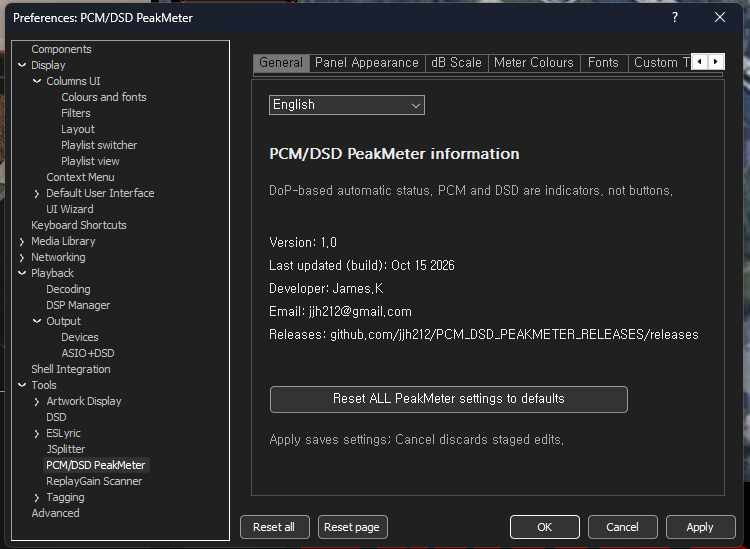

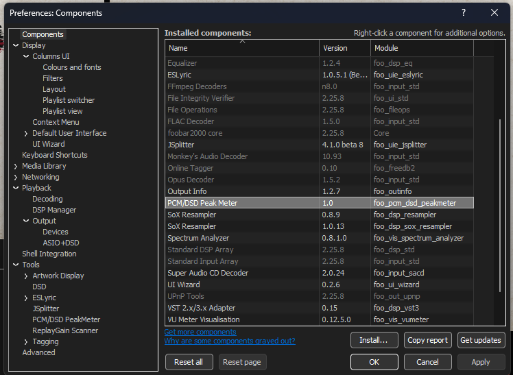

### Opening the meter

Select **View → Visualizations → PCM/DSD PeakMeter** to open a standalone window. Compatible Columns UI layouts can also host the meter as an embedded panel.

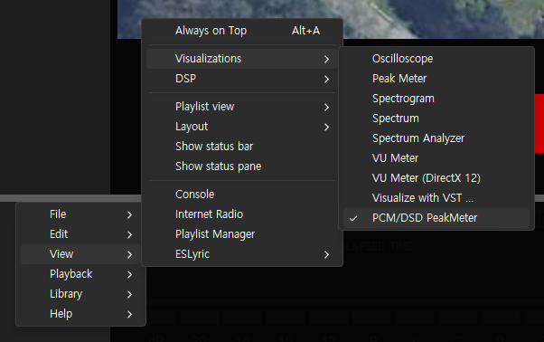

## 2. Reading the meter

- **L/R:** stereo channel readings.
- **Peak bars:** current measured peaks. **Peak Hold:** a marker that holds briefly, then falls.
- **Orange counter:** count of **entries into the caution range**, not time spent there or the number of clipped samples.
- **Red counter:** count of **entries into the danger range**, not time spent there or the number of clipped samples.
- **Maximum dB:** highest displayed peak value observed for each channel.
- **Reset:** click the **numeric statistics area** to clear entry counters and maximum readings. The PCM/DSD format indicator is not a button.

| Mode | Orange / caution | Red / danger | Upper scale tick |
|---|---|---|---|
| **PCM** | ≥ 0 dB and < +5 dB | ≥ +5 dB | +10 dB |
| **DSD** | ≥ 0 dB and < +3.1 dB | ≥ +3.1 dB | +6.02 dB |

**Distinction:** DSD `+6.02 dB` is the **upper scale tick**, **not** the red entry threshold. The final meter implementation enters its DSD red range at **+3.1 dB**.

### Highlighted threshold labels

The meter's region **background no longer brightens**. Instead, the matching **top and bottom scale labels** brighten simultaneously based on the currently measured playback level:

- PCM: `0dB` for caution; `+5dB` for danger.
- DSD: `0dB` for caution; `+3.1dB` for danger.

Event counters accumulate across time; compare identical playback intervals with equivalent reset conditions when conducting a controlled test.

### v1.0 meter screenshots — DSD512

These are **actual screenshots from the v1.0 TEST meter**, showing DSD512 in horizontal/vertical and full/compact layouts. Peak readings and event counters reflect the capture instant; they are not fixed reference values or performance comparisons between layouts.

**Horizontal — full-size**

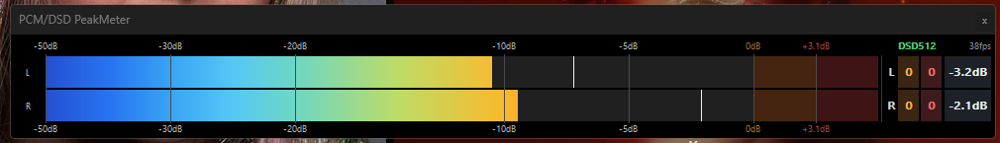

**Horizontal — compact**

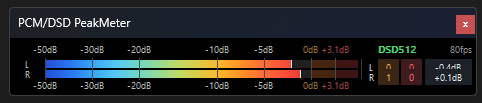

**Vertical — full-size**

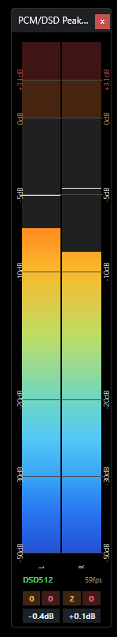

**Vertical — compact**

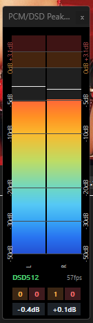

### v1.0 meter screenshots — PCM

The following two images show the **actual v1.0 TEST meter in PCM mode**. The capture sampling rate is visible, with PCM thresholds at `0dB` / `+5dB`.

**Horizontal**

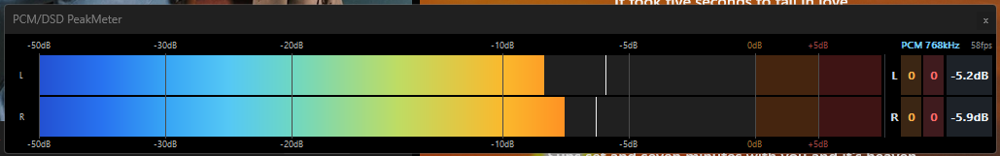

**Vertical**

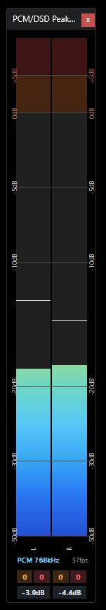

**Note:** Peak values and counts in all screenshots show the display at the capture instant, not fixed reference results.

## 3. Automatic PCM/DSD identification

The component examines actual captured **DoP markers `0x05` / `0xFA`** and their validity to determine PCM/DSD status. A DSP preset's name alone is not proof of DSD playback. PCM mode shows the verified sample rate; DSD mode displays the confirmed format from `DSD64` through `DSD2048`. DSD detection requires compatible DoP data at the component's capture point.

## 4. DSD metering — FAST and LPF

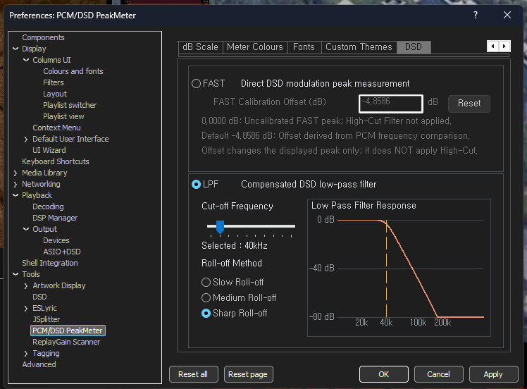

### FAST — Direct DSD modulation peak measurement

- Uses format-specific moving **28–896-bit** windows over DSD 1-bit modulation density.
- **No high-cut/LPF is applied**, so ultrasonic noise can contribute to the displayed peak.
- Default offset: **−4.8586 dB**; editable and resettable.
- `0.0000 dB` represents the **uncorrected display**. `−4.8586 dB` is an **empirical display offset derived from PCM frequency comparison**. It is not a low-pass filter and does not adjust audio gain.

### LPF — Low-pass filtering for measurement only

The LPF progressively **attenuates** frequencies above the user's selected cutoff in the **metering data**, then measures the resulting filtered peak. Its goal is to limit the contribution of ultrasonic DSD noise shaping to unexpectedly high metered peaks.

| Setting | Range / choices |
|---|---|
| Cut-off Frequency | **20–200 kHz**, default **40 kHz** |
| Roll-off Method | **Slow Roll-off / Medium Roll-off / Sharp Roll-off** |
| Default Roll-off | **Medium Roll-off** |
| Response graph | Displays the selected roll-off response curve |

- **Slow:** gentler attenuation, allowing more post-cutoff ultrasonic content into the measurement.
- **Medium:** intermediate attenuation and default setting (previously called `Normal`).
- **Sharp:** steeper attenuation, leaving less post-cutoff ultrasonic content.
- A cutoff is **not a hard frequency wall**. Some higher-frequency components remain according to the selected response.

### Why limit ultrasonic noise?

Inaudible ultrasonic DSD noise can still contribute to a wideband peak calculation. Metered peak values may therefore differ from perceived playback loudness. The LPF offers user-selectable bandwidth and attenuation so that this contribution can be observed and controlled **in the meter**.

Choosing a higher cutoff includes more ultrasonic information **in the measurement**, potentially resulting in a higher displayed peak. A lower cutoff or steeper roll-off suppresses more of this contribution. **These controls do not actually add or remove audible ambience, layering, holographic imaging, or any other sound quality.** Users wishing to observe a wider-band signal may choose a higher cutoff, with the trade-off of potentially higher **meter readings**.

### Example frequency response

Calculated DSD64 attenuation with a **40 kHz cutoff**. These are single-frequency amplitude losses, **not** predicted peak reductions for arbitrary music.

| Frequency | Slow | Medium | Sharp |
|---|---:|---:|---:|
| 40 kHz | −3.01 dB | −3.01 dB | −3.01 dB |
| 60 kHz | −7.89 dB | −14.37 dB | −21.34 dB |
| 80 kHz | −12.49 dB | −24.43 dB | −36.59 dB |
| 100 kHz | −16.38 dB | −32.44 dB | −48.60 dB |
| 150 kHz | −23.91 dB | −47.47 dB | −71.05 dB |
| 200 kHz | −29.72 dB | −58.83 dB | −87.95 dB |

**Invariant:** FAST/LPF select how **metering samples** are calculated and displayed. Neither mode inserts high-cut processing into playback or the DAC-bound stream. These readings are not a certification of reconstructed DSD True Peak or the analog output voltage of a DAC.

## 5. Preferences and appearance

General, Panel Appearance, dB Scale, Meter Colours, Fonts, Custom Themes and DSD settings are provided, along with English and Korean language choices. Horizontal, vertical and compact layouts are supported. `Apply` saves changes, `Cancel` discards pending edits, and `Reset` restores the relevant setting defaults.

The following screenshots show the finalized v1.0 TEST UI.

### 5.1 Panel Appearance

Select the edited panel, its orientation, and preview the layout.

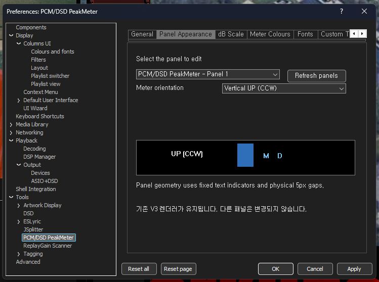

### 5.2 dB Scale

Adjust intermediate scale marks. PCM uses `0dB/+5dB` and DSD uses `0dB/+3.1dB` for the warning boundary labels.

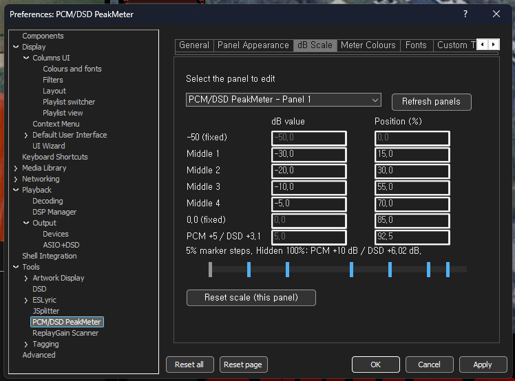

### 5.3 Meter Colours

Choose the V3 gradient or other supported bar coloring. Color selection does not alter measurement algorithms.

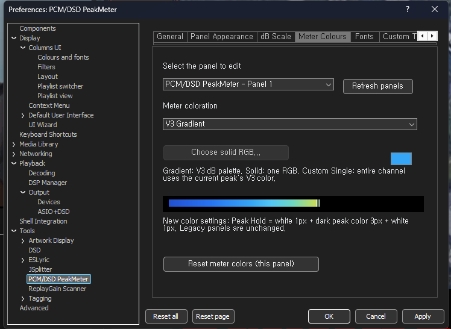

### 5.4 Fonts

Adjust typeface, sizes, and text colors for the selected panel.

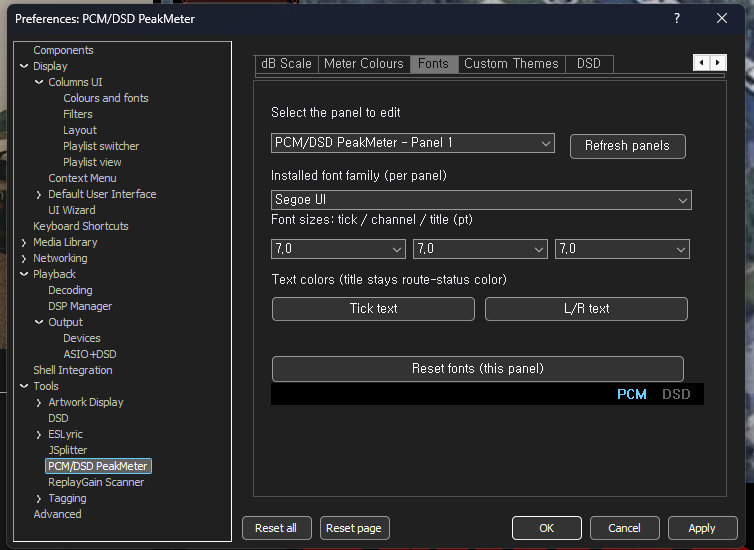

### 5.5 Custom Themes

Save/load appearance themes, rename them, or export/import as JSON.

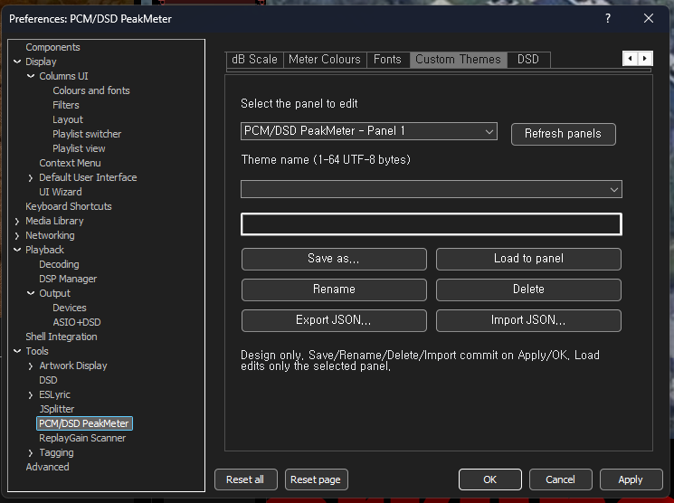

### 5.6 General / DSD

See the actual v1.0 screenshots and explanations in **Sections 1 and 4** for language/version information and FAST/LPF metering.

The v0.8.0 manual remains available separately as historical documentation.

## 6. Live test context and limitations

Practical testing used **JoJo Siwa — Karma / DSD64 / DSD Processor SDM Type B / Nova GE off**. The meter's stereo peaks visibly changed when adjusting cutoff and roll-off settings. Screenshot intervals and counter reset timing may differ, so isolated screenshots must not be interpreted as rigorously identical-time measurements.

Verify the final v1.0 DLL hash against the **published `SHA256SUMS.txt`**. Do not mix binaries from the older v0.8.2 release into v1.0 packages.

## 7. Troubleshooting

- If DSD playback appears as PCM, inspect the **actual DoP data** reaching the capture point.
- If no reading appears, confirm playback and the active foobar2000 profile/component location.
- Fully close foobar2000 before replacing a DLL.
- Confirm metering changes after clicking `Apply` or `OK`.
- FAST, LPF and PCM peak numbers have differing measurement definitions and need not match one-to-one.
