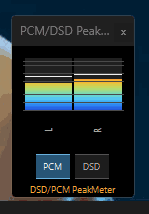
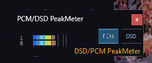

# PCM/DSD PeakMeter v0.4.0 사용자 설명서

대상: **foobar2000 Windows x64 / Columns UI**, 독립 창 및 삽입형 패널. 기준 버전 v0.4.0 Host Resize V2 (2026-10-13).

## 1. 제품 개요

PCM/DSD PeakMeter는 오디오 신호 상태를 시각적으로 보여주는 네이티브 C++ 미터입니다. PCM/DSD 표시, 좌우 채널 피크, 피크 홀드, dB 눈금, 독립 창, Columns UI 삽입형 패널, 다양한 테마/글꼴/버튼 설정을 제공합니다. **신호를 증폭하거나 DSP를 삽입하거나 재생 파일을 변환하지 않습니다.**

**정확성 주의:** DSD -6dB 보정은 미터의 표시용 기본 보정값이지 DAC 출력의 실제 전압 또는 DSD 비트스트림 true-peak를 직접 보증하지 않습니다. 실제 측정 입력 및 라우팅에 따라 표시 의미가 달라집니다.

## 2. 설치 전 준비

1. 현재 foobar2000을 완전히 종료합니다. 작업 관리자에 `foobar2000.exe`가 남아 있지 않은지 확인하세요.
2. 해당 설치본의 `profile\user-components-x64\foo_pcm_dsd_peakmeter\` 폴더와 기존 DLL을 백업합니다.
3. [공식 GitHub v0.4.0 릴리스](https://github.com/jjh212/PCM_DSD_PEAKMETER_RELEASES/releases/tag/v0.4.0)에서 검증된 `foo_pcm_dsd_peakmeter.dll`과 `SHA256SUMS.txt`를 다운로드하고 SHA256을 검증합니다.
4. 검증된 DLL `foo_pcm_dsd_peakmeter.dll`을 해당 폴더에 배치합니다. 다른 프로그램 설치본(테스트/Golden/보관본)은 **폴더마다 별도의 DLL**을 가진다는 점을 주의하세요.
5. foobar2000을 재실행하고 Components 목록에서 인식 여부 및 실제 미터 동작을 확인합니다.

**SHA256(빌드 기준)**: `74C66AF9E58B5040F6243A90E6DD39B65AB5B1C6B93A4E2A0A5127D6E5535A55`  
**파일 크기**: `471,040 bytes`

PowerShell 해시 조회:
```powershell
Get-FileHash -Algorithm SHA256 -LiteralPath 'C:\path\to\foo_pcm_dsd_peakmeter.dll'
```

## 3. 열기

- **독립 창:** foobar2000 메뉴의 `PCM/DSD PeakMeter` 항목으로 엽니다. 독립 창은 자체 위치·크기를 기억합니다.
- **삽입형 패널:** Columns UI의 패널 레이아웃에서 PeakMeter를 추가합니다. 삽입형은 부모 레이아웃의 크기 결정에도 영향을 받습니다.
- **설정:** foobar2000 Preferences의 `PCM/DSD PeakMeter` 페이지에서 편집합니다. 미터를 오른쪽 클릭해 동일 설정 페이지로 진입할 수 있습니다.

DarkOne 테마 사용 시 전체화면에서 독립 창이 다른 창 뒤로 가려지는 현상이 보고되었습니다. 다른 컴포넌트에서도 관찰된 현상이며 이번 v0.4 최소 크기 패치로 해결됐다고 주장하지 않습니다.

## 4. PCM/DSD 판별 및 보정

- **자동 판별:** 적용된 Core DSP 구성을 조회해 규칙 우선순위에 따라 표시 모드를 결정합니다. 선택만 되고 실제 적용되지 않은 DSP 프리셋은 자동 판별의 확정 증거가 아닙니다.
- **사용자 규칙:** `DSP Presets` 또는 `DSP Components`에서 프리셋이나 DSP를 PCM/DSD로 지정할 수 있습니다.
- **기본 판별:** 활성 DSP의 DSD Processor/Trellis가 식별되면 관련 규칙을 이용합니다. SACD Output 설정 단독으로 PCM 또는 DSD를 확정하지 않습니다.
- **수동 전환:** 미터의 `PCM`, `DSD` 버튼을 눌러 수동 표시 모드를 선택할 수 있습니다. 변경된 자동 관측에 따라 표시 상태가 갱신될 수 있습니다.
- **기본 보정:** PCM `0 dB`, DSD `−6 dB`; Preferences에서 보정값을 변경할 수 있습니다. 출력 오디오는 건드리지 않습니다.
- **Unknown:** 충분한 판별 근거가 없는 경우 내부적으로 Unknown 상태를 유지합니다. 화면상 PCM 기본값과 확인된 PCM 경로를 동일하게 취급하지 않습니다.

## 5. 방향과 창 크기

`Panel Appearance`에서 패널을 선택하여 가로/세로 방향과 버튼 크기를 변경합니다.

| 방향 | 최소 클라이언트 너비 | 최소 클라이언트 높이 |
|---|---|---|
| **가로** | 버튼부 너비 + 100px | 버튼부 높이 |
| **세로** | 버튼부 너비 | 버튼부 높이 + 100px |

**버튼부** = PCM 버튼 + DSD 버튼 + `DSD/PCM PeakMeter` 제목. 현재 버튼 치수와 제목 글꼴 폭을 반영하므로 정확한 픽셀 수는 설정 및 Windows DPI에 따라 달라집니다. 독립 창의 외곽 테두리 크기는 최소 클라이언트 크기보다 클 수 있습니다.

- 가장자리에서 드래그해 줄이면 **최소 크기에서 축소가 멈춥니다**. 표시를 없애는 방식이 아닙니다.
- 좌우 피크바와 버튼을 유지합니다. 공간이 부족하면 중복되는 **dB 숫자만 생략**할 수 있습니다.
- 최소 크기에서 확대하면 기존 UI를 복원합니다.
- Columns UI 패널은 해당 호스트의 크기 제어를 따르며, 이 버전은 호스트에 최소 크기 변경 사실을 통지합니다.

## 6. Preferences 8개 탭

| 탭 | 설정 범위 |
|---|---|
| General | UI 언어, PCM/DSD 전역 표시 보정 |
| DSP Presets | 실제 적용된 프리셋에 관한 사용자 PCM/DSD 규칙 |
| DSP Components | 실제 DSP 구성 요소에 관한 사용자 규칙 |
| Panel Appearance | 패널 선택, 가로/세로 모드, 버튼 크기 |
| dB Scale | dB 눈금 위치·범위 및 스케일 |
| Meter Colours | 그라데이션/단색 등 미터 색상 |
| Fonts / Buttons | 글꼴, 버튼 형태·팔레트 |
| Custom Themes | 사용자 테마 저장·불러오기·이름 변경·삭제·JSON 가져오기/내보내기 |

개별 패널에 적용되는 항목과 모든 패널에 적용되는 Global 항목은 별도입니다. 설정을 변경한 뒤 Apply/OK로 반영해야 하는 항목이 있으며, 설정이 갱신된 뒤 최소 크기도 재계산됩니다.


### 실제 검증 화면 — 최소 크기

다음 화면은 사용자 실사용 검증을 통과한 v0.4.0 V2의 최소 크기 상태입니다. 문서 게시용으로 이미지 용량만 최적화했습니다.

**세로 모드 — 최소 너비·높이**



**가로 모드 — 최소 너비·높이**



## 7. 알려진 주의사항

- foobar2000 포터블 설치본을 여러 개 쓰는 경우 **실제 실행된 exe의 경로**와 로드된 DLL의 경로를 확인하세요.
- SDK C4996 경고는 레거시 Columns UI Helper를 가리키며, v0.4 안정화 범위에서는 교체하지 않았습니다.
- foobar2000에서 컴포넌트가 인식되지 않으면 실행 종료, DLL SHA, 설치 경로, x64 여부, 기존 DLL 백업을 확인합니다.
- 전체화면 Z-order 문제는 별도 진단 과제입니다.
- 공개 릴리스 첨부 전에는 이 저장소의 설명서만으로 파일이 다운로드된다고 판단하면 안 됩니다.

상세 업데이트 내용은 [CHANGELOG](../CHANGELOG.md), 문제 해결은 [문제 해결 가이드](TROUBLESHOOTING_KO.md)를 참고하세요.
