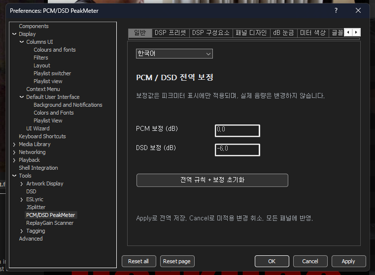
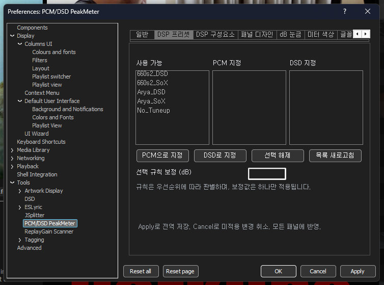
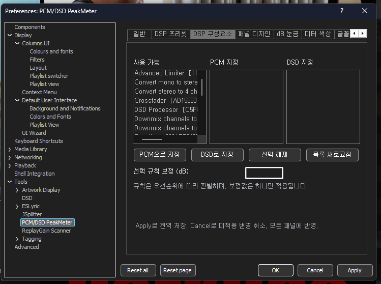
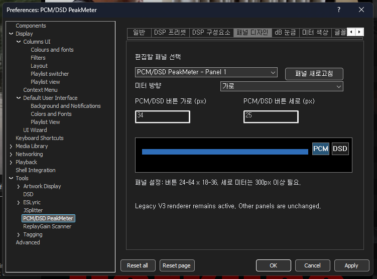
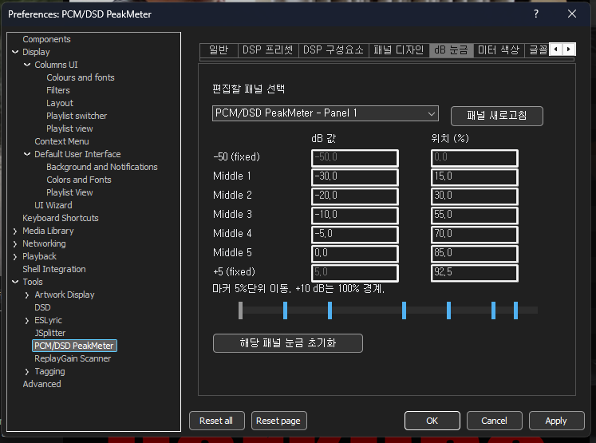
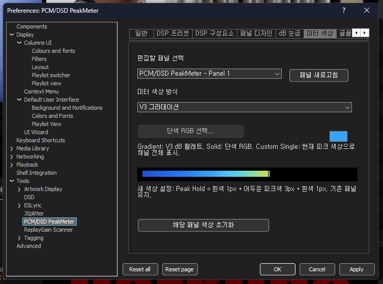
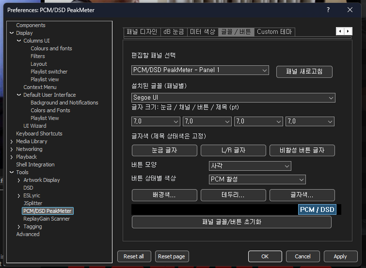
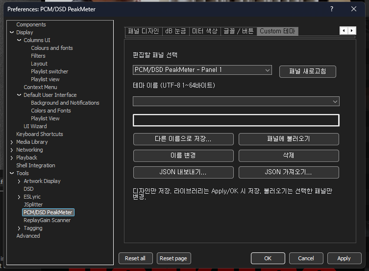

# PCM/DSD PeakMeter v0.4.0 — 사용자 설명서 (한국어)

> **공식 릴리스:** [v0.4.0](https://github.com/jjh212/PCM_DSD_PEAKMETER_RELEASES/releases/tag/v0.4.0) · **대상:** Windows x64 foobar2000 · **문서 기준일:** 2026-10-13
> [English](USER_MANUAL_EN.md) · [한국어](USER_MANUAL_KO.md) · [통합 설명서: 영문 → 한글](USER_MANUAL.md) · [문제 해결](TROUBLESHOOTING_KO.md)

## 1. PCM/DSD PeakMeter 소개

PCM/DSD PeakMeter는 foobar2000용 네이티브 C++ **표시 전용 시각화 컴포넌트**입니다. 좌·우(L/R) 채널의 피크바와 피크 홀드 마커를 보여주며, **독립 창**과 **Columns UI 삽입형 패널**을 지원합니다. PCM/DSD 표시 모드의 자동 판별과 수동 선택, 가로·세로 방향, dB 눈금, 색상, 글꼴, 버튼 스타일, 패널별 사용자 테마를 설정할 수 있습니다.

**하지 않는 일:** 오디오 DSP를 삽입·삭제하거나, PCM→DSD를 변환하거나, 음량·출력 게인·오디오 디바이스·재생 출력 경로를 변경하지 않습니다. 화면의 DSD 표시는 출력 장치를 DSD로 전환하는 버튼이 아닙니다. 이 릴리스는 **네이티브 DSD 비트스트림의 공인 True Peak 측정기**도 아닙니다.

### 1.1 실제 사용 화면

**독립 창 — 가로 모드**


**독립 창 — 세로 모드**


**foobar2000 테마 / Columns UI에 삽입한 예시**


위 화면은 v0.4.0 실사용 환경에서 캡처한 예시입니다. 테마·DPI·선택된 패널 설정·재생 중 신호에 따라 실제 표시는 달라질 수 있습니다.

## 2. 다운로드·무결성 검증·설치

### 2.1 검증된 정식 릴리스

| 항목 | 확정 내용 |
|---|---|
| 버전 | **v0.4.0 정식 릴리스** |
| 대상 | Windows **x64** |
| DLL 이름 | `foo_pcm_dsd_peakmeter.dll` |
| DLL 크기 | **471,040바이트** |
| SHA256 | `74C66AF9E58B5040F6243A90E6DD39B65AB5B1C6B93A4E2A0A5127D6E5535A55` |
| 공식 다운로드 | [GitHub v0.4.0 Release](https://github.com/jjh212/PCM_DSD_PEAKMETER_RELEASES/releases/tag/v0.4.0) |
| 체크섬 파일 | [SHA256SUMS.txt](https://github.com/jjh212/PCM_DSD_PEAKMETER_RELEASES/releases/download/v0.4.0/SHA256SUMS.txt) |

1. **foobar2000을 완전히 종료**합니다. 실행 중인 DLL을 덮어쓰지 않습니다.
2. 기존 설치본의 컴포넌트 폴더와 DLL을 별도로 백업합니다.
3. 정식 릴리스에서 `foo_pcm_dsd_peakmeter.dll`과 `SHA256SUMS.txt`를 다운로드합니다.
4. 다운로드한 DLL의 SHA256이 위 값과 일치하는지 확인합니다.

   ```powershell
   Get-FileHash -Algorithm SHA256 -LiteralPath 'C:\path\to\foo_pcm_dsd_peakmeter.dll'
   ```

5. 본 프로젝트에서 검증한 foobar2000 Portable 구성에서는 다음 경로에 DLL을 놓습니다.

   ```text
   <foobar2000 포터블 폴더>\profile\user-components-x64\foo_pcm_dsd_peakmeter\foo_pcm_dsd_peakmeter.dll
   ```

   설치 방식이 다른 foobar2000은 실제 사용하는 컴포넌트 폴더를 따라야 합니다. **다른 포터블 설치본의 전체 profile을 복사하지 마세요.**
6. foobar2000을 다시 실행하고 컴포넌트 인식, PCM/DSD 버튼 및 L/R 피크바의 표시를 확인합니다.

**중요:** Portable 폴더가 여러 개라면 **DLL도 각각 별개**입니다. 일반 사용본의 DLL을 변경했더라도 PEAK_TEST 같은 별도 설치본은 이전 DLL을 로드할 수 있습니다. 업데이트가 적용되지 않은 것처럼 보인다면 소스를 다시 수정하기 전에 실제 실행 중인 `foobar2000.exe`와 로드된 모듈 경로부터 확인하세요.

## 3. 피크미터 실행과 기본 조작

### 3.1 독립 창 실행

foobar2000의 컴포넌트에서 제공하는 **PCM/DSD PeakMeter** 메뉴로 독립 창을 엽니다. 별도 창이므로 위치·크기를 조절할 수 있고 이전 위치·크기를 기억합니다. 독립 창 최소 크기 이하로 축소할 수 없게 설정돼 있습니다. DarkOne 전체화면에서 다른 창 뒤로 가려지는 경우는 **최소 크기 기능과 별도의 Z-order 현상**입니다.

### 3.2 Columns UI 삽입형 패널

Columns UI의 레이아웃 편집 기능으로 **PCM/DSD PeakMeter** 패널을 추가할 수 있습니다. 외부 레이아웃 호스트가 사용 가능한 공간을 결정하며, 컴포넌트는 최소 크기 정보를 호스트에 전달합니다. 여러 패널을 만들면 Preferences의 **편집할 패널 선택**에서 개별적으로 설정할 수 있습니다.

### 3.3 화면 구성

- **L/R:** 좌·우 채널을 뜻합니다.
- **피크바 / 피크 홀드:** 재생 중 신호의 피크 표현과 홀드 마커입니다. 색상은 설정에서 바꿀 수 있습니다.
- **PCM / DSD 버튼:** 피크미터의 표시 모드를 수동으로 선택합니다. DSP 실행이나 DAC 모드 전환 명령이 아닙니다.
- **dB 눈금:** 해당 패널에 대해 값과 위치를 변경할 수 있습니다. 공간이 부족하면 숫자 겹침을 방지하기 위해 일부 텍스트가 생략될 수 있습니다.
- **DSD/PCM PeakMeter 제목:** 라우팅/상태를 구분하는 제목 색상을 가지며 다른 텍스트 색상 설정과 구분됩니다.

## 4. PCM/DSD 자동 판별·수동 선택·보정값

### 4.1 자동 판별 우선순위

자동 판별기는 **실제로 적용된 Core DSP 체인**을 관찰합니다. DSP Manager에서 단지 선택된 프리셋 이름만을 실제 적용의 증거로 삼지 않습니다.

1. **DSP 프리셋 규칙:** 현재 적용된 DSP 체인과 일치함이 확인된 프리셋에 사용자 규칙이 있다면 우선합니다.
2. **DSP 구성요소 규칙:** 적용 중인 구성요소와 사용자 지정 규칙이 일치하는 경우 사용합니다. 체인에서 앞선 구성요소가 우선하며, 같은 우선순위에서는 DSD를 PCM보다 우선합니다.
3. **내장 DSD 판별:** 활성 DSD Processor / DSD Trellis SDM 등의 인식 가능한 식별자를 이용합니다.
4. **Unknown Auto:** 확정할 근거가 없다면 내부적으로 미확인 상태를 보존합니다. 이때 화면 기본 표시가 PCM이더라도 **실제 출력이 PCM으로 검증된 것은 아닙니다.**

SACD 컴포넌트의 Output 설정은 보조 진단 정보이며, **그 값 하나만으로 PCM/DSD를 확정하지 않습니다.** 현재 판별 경로는 별도 `foo_outinfo` 설치를 필수로 요구하지 않습니다.

### 4.2 수동 PCM/DSD 선택

미터의 **PCM**, **DSD** 버튼으로 표시 모드를 수동 선택할 수 있습니다. 수동 선택 상태와 자동 판별 근거는 서로 다른 개념입니다. DSD 버튼을 눌렀다고 재생 파일이 DSD로 변환되거나 DAC 출력 모드가 변경되지는 않습니다.

### 4.3 표시 보정값

기본값은 **PCM 0.0 dB**, **DSD −6.0 dB**입니다. 이 보정은 **피크미터에 나타나는 표시 수치에만 적용**되며 실제 음량이나 재생 샘플을 변경하지 않습니다. 일치하는 사용자 DSP 프리셋/구성요소 규칙에 별도 보정이 있다면 **하나의 보정값만** 사용하며 여러 보정값을 합산하지 않습니다.

입력 가능한 보정값은 **−30.0~+30.0 dB, 0.1 dB 단위**입니다. 프로그램의 언어·지역 설정에 따라 보이는 소수점 구분 형식(`-6,0` 등)을 따라 입력하세요.

## 5. v0.4.0 최소 너비·높이 제한

여기서 **버튼부**는 **PCM/DSD 버튼 2개 + `DSD/PCM PeakMeter` 제목 영역**을 뜻합니다. 아래는 OS 테두리를 제외한 **클라이언트 영역 최소 크기**입니다.

| 방향 | 최소 너비 | 최소 높이 |
|---|---|---|
| 가로 | 버튼부 너비 **+ 100px** | 버튼부 높이 |
| 세로 UP / 세로 DOWN | 버튼부 너비 | 버튼부 높이 **+ 100px** |

버튼 크기, 제목 글꼴 및 Windows DPI 등을 고려하여 실제 제한이 계산됩니다. 창 가장자리를 드래그해도 **최소 크기 이하로 더 줄어들지 않으며**, 피크바와 버튼이 사라지는 대신 충돌하는 dB 숫자만 생략될 수 있습니다.

- **독립 창:** Windows 창 프레임 수준에서 드래그 최소 크기를 제한합니다.
- **Columns UI 삽입형:** 패널 호스트에 최소 크기 변경 사실을 통지합니다.
- 충분히 확장하면 공간에 맞게 정상 표시 영역을 확보합니다.
- Preferences의 세로 미터 안내에 있는 **300px 이상**은 전체 세로 디자인을 충분히 표시하기 위한 **권장 높이**이며, 이번 릴리스의 **법칙적인 최소 높이(버튼부 +100px)**와는 다른 기준입니다.

## 6. Preferences 8개 탭 — 실제 화면별 설명

foobar2000 **Preferences → Tools → PCM/DSD PeakMeter**로 진입합니다(아래 화면 기준). 상단 8개 탭이 가로로 놓이며 창 폭이 부족할 때는 오른쪽 화살표로 가려진 탭을 볼 수 있습니다.

### 6.1 일반 — 언어와 PCM/DSD 전역 보정



**주요 항목:** 언어(English/한국어), **PCM 보정 (dB)**, **DSD 보정 (dB)**, **전역 규칙 + 보정 초기화**.

**사용 방법:** 언어를 선택하고 보정값을 입력한 후 **Apply** 또는 **OK**를 누릅니다. 전역 초기화 버튼은 전역 규칙과 보정값의 초기화 상태를 준비하므로 저장 전에 내용을 확인하세요. 언어·전역 보정은 패널별 디자인과 분리된 설정입니다.

**예시:** PCM `0,0`, DSD `-6,0`을 유지하면 기본 표시 보정값을 사용하며 음악 재생 게인은 변하지 않습니다.

### 6.2 DSP 프리셋 — 적용 프리셋의 PCM/DSD 규칙



**주요 항목:** 사용 가능 / PCM 지정 / DSD 지정, **PCM으로 지정**, **DSD로 지정**, **선택 해제**, **목록 새로고침**, **선택 규칙 보정 (dB)**.

**절차:**

1. foobar2000에서 DSP 프리셋을 변경하거나 추가했다면 **목록 새로고침**을 누릅니다.
2. **사용 가능** 목록에서 대상 프리셋을 고릅니다.
3. **PCM으로 지정** 또는 **DSD로 지정**을 누릅니다.
4. 할당된 항목을 선택해 필요한 경우 해당 규칙의 개별 보정값을 입력합니다.
5. **Apply/OK**로 저장합니다. *선택만 됐고 실제로 적용되지 않은 프리셋*은 자동 판별 확정 증거가 아닙니다.

실제 적용 프리셋의 규칙이 일치하면 구성요소 규칙보다 먼저 평가하며 해당 규칙의 **보정값 하나**를 적용합니다.

### 6.3 DSP 구성요소 — 개별 DSP 플러그인 규칙



이 탭도 세 가지 목록과 **PCM/DSD 지정**, **선택 해제**, **목록 새로고침**을 제공합니다. 프리셋 전체가 아니라 **개별 DSP 구성요소**를 지정한다는 점이 다릅니다.

**절차:** 사용 가능 목록에서 DSP를 선택한 뒤 PCM 또는 DSD로 지정하고, 선택 규칙의 보정값을 필요에 따라 입력한 다음 Apply/OK로 저장합니다. **선택 해제는 피크미터의 지정 규칙을 삭제**하는 것이지 foobar2000에 설치된 DSP 자체를 제거하는 기능이 아닙니다.

여러 규칙이 동시에 맞으면 활성 DSP 체인 순서가 우선순위를 결정합니다. 적용 프리셋 규칙이 있는 경우에는 프리셋 규칙이 먼저입니다. **이 화면에서 DSP 체인 자체를 수정하지 않습니다.**

### 6.4 패널 디자인 — 편집 대상·방향·버튼 크기



**주요 항목:** **편집할 패널 선택**, **패널 새로고침**, **미터 방향**, **PCM/DSD 버튼 가로(px)**, **세로(px)**, 미리보기.

1. 먼저 편집할 패널(예: **PCM/DSD PeakMeter - Panel 1**)을 선택합니다. 패널을 새로 만들었거나 제거했다면 **패널 새로고침**을 누릅니다.
2. 방향은 **가로**, **세로 UP(반시계)**, **세로 DOWN(시계)** 중 하나를 고릅니다.
3. 버튼 **가로 24~64px**, **세로 18~36px** 범위로 입력합니다. 화면 예시는 기본 크기 **34×25px**입니다.
4. 미리보기를 보고 Apply/OK로 반영합니다. **선택한 패널만** 변경됩니다.

방향·버튼·글꼴에 따라 최소 창 크기도 다시 계산됩니다. 다른 패널로 전환하기 전에 미적용 편집이 있다면 먼저 저장하거나 취소하세요.

### 6.5 dB 눈금 — 눈금값과 위치 편집



**주요 항목:** 편집할 패널, **dB 값**, **위치(%)**, 눈금 마커 드래그, **해당 패널 눈금 초기화**.

기본 눈금은 다음과 같습니다.

| 눈금 | dB 값 | 위치 |
|---|---:|---:|
| 하단 고정 | −50 | 0% |
| Middle 1 | −30 | 15% |
| Middle 2 | −20 | 30% |
| Middle 3 | −10 | 55% |
| Middle 4 | −5 | 70% |
| Middle 5 | 0 | 85% |
| 상단 고정 | +5 | 92.5% |

실제 스케일은 **숨겨진 +10dB = 100% 지점**까지 이어집니다. 마커를 드래그하면 **5% 단위로 이동**합니다. 눈금의 순서는 단조 증가해야 하고 인접 위치가 겹칠 수 없습니다. 잘못된 입력은 Apply/OK에서 거부될 수 있습니다. **해당 패널 눈금 초기화**는 다른 패널에 영향을 주지 않습니다.

### 6.6 미터 색상 — 그라데이션·단색·피크 연동색



**색상 방식:**

- **V3 그라데이션:** 기존 dB 값 기반 다색 팔레트.
- **단색 RGB:** 사용자가 지정한 하나의 RGB 색상으로 표시.
- **Custom Single (피크 dB):** 현재 피크가 위치한 dB 구간에 해당하는 V3 색상을 채널 전체에 단일 색상으로 표시.

색상 방식을 선택하고 필요하면 **단색 RGB 선택…** 버튼으로 색을 고릅니다. 미리보기를 확인한 후 Apply/OK로 저장합니다. **해당 패널 색상 초기화**를 이용할 수 있습니다. 새 색상 설정에서 피크 홀드 마커는 **흰색 1px + 어두운 피크색 3px + 흰색 1px** 구성으로 표현됩니다. 기존 Legacy 패널 표현을 무단 변경하지 않습니다.

### 6.7 글꼴 / 버튼 — 타이포그래피·버튼 모양·상태별 색상



**글꼴:** Windows에 설치된 글꼴을 선택합니다. 눈금 / L·R 채널 / 버튼 / 제목 **4종 글자 크기(pt)**를 개별 조정합니다. **눈금 글자**, **L/R 글자**, **비활성 버튼 글자** 색상을 지정할 수 있습니다. 제목 색상은 **라우트 상태 색상으로 유지**되므로 다른 색상 입력과 별개입니다.

**버튼:** **사각**, **둥근 사각형** 중 모양을 고릅니다. **PCM 활성 / DSD 활성 / 비활성 / Disabled(비사용)** 등 편집할 버튼 상태를 선택한 다음 각각 **배경색**, **테두리**, **글자색**을 설정합니다. 아래 미리보기로 확인할 수 있습니다. **패널 글꼴/버튼 초기화**는 해당 패널만 초기화합니다.

글꼴/버튼 크기를 늘리면 이번 버전의 최소 창 크기도 함께 커질 수 있습니다. 변경 후 Apply/OK를 누르면 다른 패널의 글꼴은 유지됩니다.

### 6.8 Custom 테마 — 패널 디자인 저장·불러오기·JSON



**주요 항목:** **테마 이름**, **다른 이름으로 저장…**, **패널에 불러오기**, **이름 변경**, **삭제**, **JSON 내보내기…**, **JSON 가져오기…**.

1. 선택한 패널의 방향·눈금·미터 색상·글꼴·버튼 디자인을 원하는 상태로 조정합니다.
2. 테마 이름을 **UTF-8 기준 1~64바이트**로 입력한 뒤 **다른 이름으로 저장…**을 누릅니다. 한글은 글자당 바이트 수가 달라지므로 64글자와 동일하지 않습니다.
3. **패널에 불러오기**를 누르면 저장된 디자인을 **현재 선택한 패널에만** 반영합니다.
4. **JSON 내보내기…**는 외부 보관·이동에, **JSON 가져오기…**는 호환되는 디자인 파일을 불러올 때 사용합니다.
5. 테마 라이브러리의 저장·이름 변경·삭제·가져오기 결과는 **Apply/OK 시 확정**됩니다.

**주의:** 사용자 테마에는 **패널의 외형 정보만** 저장됩니다. 전역 PCM/DSD 보정, DSP 프리셋 규칙, 구성요소 규칙을 테마로 덮어쓰지 않습니다.

## 7. 전역 설정과 패널 설정 / Apply·OK·Cancel

| 적용 범위 | 설정 | 영향 |
|---|---|---|
| 전역 | 일반, DSP 프리셋, DSP 구성요소 | 언어, 라우팅 규칙, 해당되는 표시 보정값 |
| 패널별 | 패널 디자인, dB 눈금, 미터 색상, 글꼴/버튼 | 선택한 피크미터 패널 하나 |
| 공용 테마 라이브러리 + 패널별 불러오기 | Custom 테마 | 라이브러리에서 테마를 관리하고, 불러올 때 선택된 패널만 수정 |

- **Apply:** 입력 검증 후 설정을 저장하고 Preferences 창은 열어둡니다.
- **OK:** 설정을 저장한 후 창을 닫습니다.
- **Cancel:** **아직 Apply/OK를 하지 않은 변경만** 취소합니다. 앞서 Apply로 저장한 내용까지 되돌리지는 않습니다.
- **Reset page / Reset all:** 해당 페이지 또는 전체 초기화를 준비합니다. 내용을 확인한 뒤 Apply/OK로 확정하세요.
- **잘못된 입력:** 지정 범위를 벗어나는 값은 수정해야 저장할 수 있습니다. 알 수 없거나 새로운 패널 설정 버전의 원본 데이터는 임의로 덮어쓰지 않도록 보호합니다.

## 8. 문제 해결과 알려진 한계

**업데이트했는데 이전 버전처럼 보이는 경우:** 실행 중인 foobar2000의 실제 경로와 로드된 DLL 경로를 확인하고 SHA256을 비교합니다. 서로 다른 포터블 설치본의 컴포넌트 폴더는 자동으로 동기화되지 않습니다.

**창을 너무 작게 줄이면 내용이 사라지는 경우:** v0.4.0의 최소 크기 제한은 피크바와 버튼을 유지하도록 설계되어 검증됐습니다. 실제 V2 DLL 로딩 여부, 글꼴·버튼 크기, Columns UI 호스트의 레이아웃 제한을 확인하세요.

**DSP 프리셋을 지정했는데 모드가 바뀌지 않는 경우:** 그 프리셋이 실제 적용 DSP 체인과 일치하는지 점검합니다. DSP 구성요소 규칙, 수동 버튼 상태도 함께 확인하세요.

**DarkOne 전체화면에서 독립 창이 뒤로 가려지는 경우:** 별도 Z-order 진단 대상입니다. **v0.4.0 최소 크기 수정으로 해결됐다고 주장하지 않습니다.**

**다른 피크 측정기와 수치가 다른 경우:** 표시 보정은 실제 오디오 출력과 별개이며 현재 컴포넌트가 관측하는 미터 경로에 의존합니다. 네이티브 DSD 비트스트림 True Peak 측정값을 인증하지 않습니다.

[한국어 문제 해결](TROUBLESHOOTING_KO.md) · [English troubleshooting](TROUBLESHOOTING_EN.md) · [상세 변경내역](../CHANGELOG.md)

## 9. v0.4.0 검증 기록

- Visual Studio 2026 / MSVC v145, Windows Release x64 빌드: **PASS**.
- Core/레이아웃 회귀 테스트: **15/15 PASS**.
- 사용자 실사용: **5/5 PASS** — 독립 창 가로·세로, Columns UI 가로·세로, 최소 크기 렌더링.
- 백업을 개별 생성한 Portable 설치본 4개: **최종 DLL SHA256 전부 일치**.
- Public Release 자산 업로드 후 실제 다시 다운로드하여 SHA256 검증하고 정식 게시.

위 결과는 실제 검증 환경에 관한 기록이며, 모든 서드파티 테마·호스트 조합에서의 무조건적인 동작을 보장하는 것은 아닙니다.
