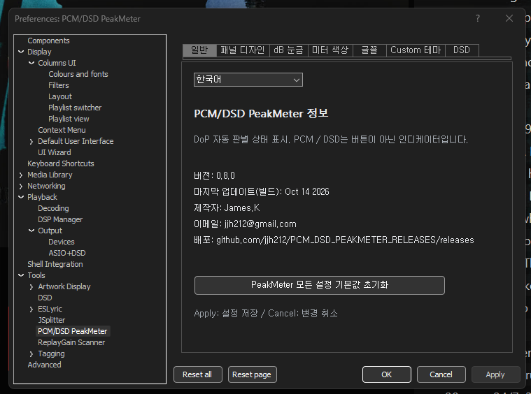
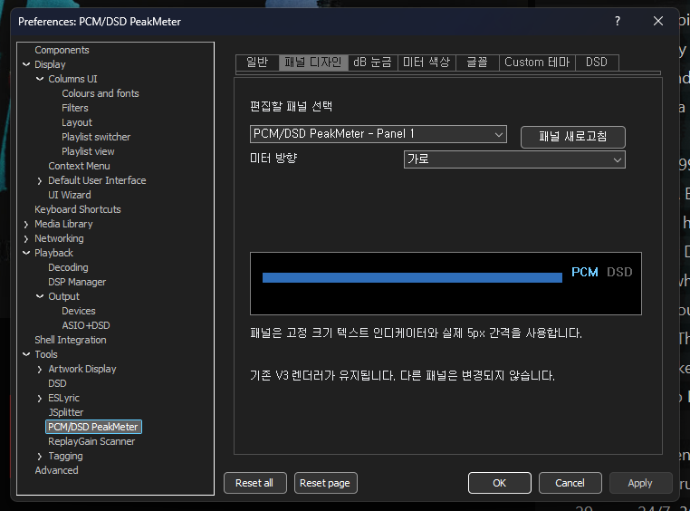
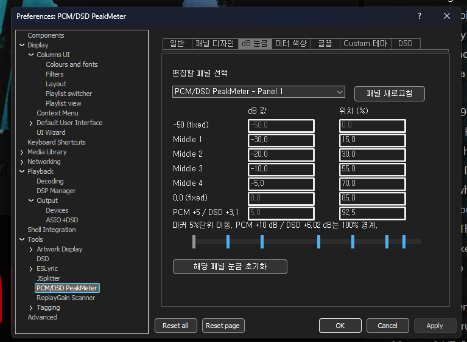
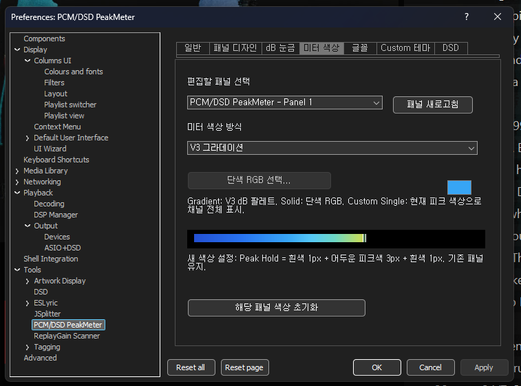
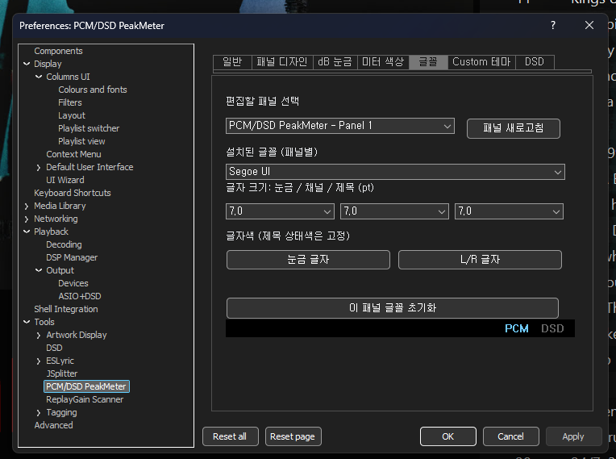
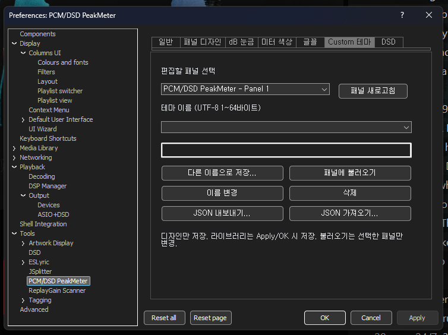

# PCM/DSD PeakMeter v0.8.0 — 사용자 설명서 (한국어)

**릴리스:** [v0.8.0](https://github.com/jjh212/PCM_DSD_PEAKMETER_RELEASES/releases/tag/v0.8.0) · **기준일:** 2026-10-14 · [English](USER_MANUAL_EN.md) · [변경내역](CHANGELOG_V080_KO.md)

## 1. 소개 및 설치 환경

PCM/DSD PeakMeter v0.8.0은 **foobar2000**용 Windows x64 네이티브 C++ **표시 전용** 피크미터입니다. 독립 창 또는 **Columns UI**에 삽입된 패널로 동작합니다. 음량이나 DSP 설정, DAC 출력 방식, PCM→DSD 변환을 변경하지 않습니다. DSD 자동 검출에는 계측 위치에서 실제 DoP 전송 데이터가 관측되어야 합니다.

| 항목 | 내용 |
|---|---|
| 운영체제 | Windows x64 (Windows 11 환경 개발·검증) |
| 호스트 | foobar2000 x64 / 삽입형은 Columns UI |
| DLL | `foo_pcm_dsd_peakmeter.dll` |
| 다운로드 | [v0.8.0 릴리스](https://github.com/jjh212/PCM_DSD_PEAKMETER_RELEASES/releases/tag/v0.8.0) |
| DLL SHA256 | `DFEE5B07E0C23D4252C3382F5CE69616D479445B449C20C34031FB33D4F17E60` |

### 설치·업데이트

1. **foobar2000을 완전히 종료**하고 기존 DLL을 백업합니다.
2. 릴리스의 DLL 및 `SHA256SUMS.txt`를 다운로드해 PowerShell `Get-FileHash -Algorithm SHA256 -LiteralPath 'C:\path\foo_pcm_dsd_peakmeter.dll'`로 해시를 검증합니다.
3. 검증된 Portable 구성에서는 `<foobar2000 포터블>\profile\user-components-x64\foo_pcm_dsd_peakmeter\` 폴더에 DLL을 복사합니다.
4. foobar2000을 재시작한 뒤 Columns UI 패널로 추가하거나 독립 창에서 실행하고 **Preferences → Tools → PCM/DSD PeakMeter**를 엽니다.
5. 기존 설정은 해당 foobar2000 프로필에 보존됩니다. 다른 설치본의 전체 프로필을 복사할 필요는 없습니다.

## 2. PCM/DSD 자동 판별 및 계측

### DoP 마커 자동 판별 — 수동 전환 제거

출력 캡처 스트림에서 **DoP 마커 `0x05` / `0xFA`의 교대 패턴**, L/R 동기와 유효성을 검사합니다. **1초 다수결**로 PCM/DSD 상태를 안정화하고 입력 부족이나 동률에서는 현재 상태를 유지합니다. 같은 상태로 재확정되더라도 피크미터를 초기화하지 않습니다. **PCM / DSD는 조작 버튼이 아닌 상태 인디케이터**입니다. DSP 프로필 이름만으로 DSD 상태를 확정하지 않습니다.

DoP 마커만으로는 DSD64·128 등 세부 규격이 결정되지 않습니다. **검증된 DoP 전송 샘플레이트**를 이용해 DSD 포맷을 분류합니다. PCM은 실제 캡처 샘플레이트(`PCM 44.1kHz`, `PCM 705.6kHz` 등), DSD는 규격(`DSD512` 등)을 표시합니다. **샘플레이트 값만으로 DoP 여부를 단정하지 않습니다.**

### DSD 포맷별 FAST 가변 비트연산

| DSD 포맷 | 44.1kHz 계열 DoP 전송률 | 48kHz 계열 DoP 전송률 | 채널별 FAST 윈도우 |
|---|---:|---:|---:|
| DSD64 | 176.4 kHz | 192 kHz | 28비트 |
| DSD128 | 352.8 kHz | 384 kHz | 56비트 |
| DSD256 | 705.6 kHz | 768 kHz | 112비트 |
| DSD512 | 1411.2 kHz | 1536 kHz | 224비트 |
| DSD1024 | 2822.4 kHz | 3072 kHz | 448비트 |
| DSD2048 | 5644.8 kHz | 6144 kHz | 896비트 |

1비트 변조 밀도를 이동 구간으로 직접 계산합니다. `N`비트 중 1의 개수가 `ones`라면 `M = abs(2 × ones − N) / N`, 무보정 기준값은 `20 × log10(2M)`(M>0)입니다. 설정된 FAST 보정값을 **표시 수치에만** 반영합니다. 같은 보정 후 결과가 **순간 피크바·Peak Hold·주황/적색 경고 통계·채널별 최고 피크**에 함께 적용됩니다. 별도 단기 진단값으로 화면 경고만 따로 판정하지 않습니다.

**해석 주의:** FAST는 **DSD 1비트 변조율**이며 LPF로 재구성한 아날로그 파형이나 PCM True Peak와 동일하지 않습니다. 6개 규격은 자동 윈도우 합성 테스트를 통과했고 실제 검증은 DSD512 중심이므로, 모든 DAC·전송 경로의 실사용을 포괄적으로 보증하지 않습니다.

### FAST 보정과 향후 LPF

- 기본값: **−4.8586 dB** (사용자 변경·초기화 가능).
- **0.0000 dB:** High-Cut/LPF를 적용하지 않은 DSD 직접 변조 피크.
- **−4.8586 dB:** PCM 주파수 비교 기반의 경험적 **표시 보정값**. 실제 출력 음량 변경이나 물리적 정합성 보증이 아닙니다.
- **v0.8.0에는 LPF가 구현되지 않았습니다.** DSD 탭의 20~200kHz(예정 기본 40kHz), Slow/Normal/Sharp(예정 기본 Normal)는 향후 계획 표시이며 실제 필터가 아닙니다.

## 3. 미터 읽기 및 통계 초기화

- 좌·우(L/R) **순간 피크바** 및 약 **1.4초 Peak Hold** 표시.
- **PCM:** 0dB부터 주황, +5dB부터 적색, 최대 눈금 +10dB.
- **DSD:** 0dB부터 주황, +3.1dB부터 적색, 직접 변조율 상한 눈금 +6.02dB. 경고 판정과 배경은 **표시 보정 후 피크**를 기준으로 합니다.
- L/R 각각 **주황/적색 진입 횟수**와 **최대 표시 피크**를 표시합니다.
- **통계 영역 어디든 클릭하면 전체 통계가 초기화**됩니다. 마우스 Hover/Down/Out에 따른 색상 반응이 있으며 별도 RESET 버튼은 없습니다. PCM↔DSD 모드 자동 전환 때도 해당 통계는 초기화됩니다.
- 가로·세로 및 최소 크기에서 레이아웃이 반응형으로 전환되고, 좁을 때 겹치는 눈금 글자만 생략될 수 있습니다.
- PCM/DSD 문구는 표시용이며 버튼이 아닙니다. 일시정지·정지 시 일부 피크·통계 표시가 유지될 수 있습니다.
## 4. 환경설정 탭별 안내 및 화면

### 4.1 일반

언어 선택, 버전 0.8.0, 개발자 정보, 릴리스 주소 및 전체 설정 초기화.

### 4.2 패널 디자인

편집할 패널 선택, 가로/세로 방향과 미리보기.

### 4.3 dB 눈금

패널별 중간 눈금 값·위치 조절 및 고정 경계 확인.

### 4.4 미터 색상

V3 Gradient, 단색 RGB, 현재 피크색 기반 전체색 중 선택.

### 4.5 글꼴

설치 글꼴, 눈금/L·R/제목 크기, 문자색 설정.

### 4.6 Custom 테마

디자인만 저장·불러오기·이름 변경·삭제, JSON 입출력.

### 4.7 DSD

FAST 표시 보정값 설정, 직접 변조 피크와 미구현 LPF 안내.

## 5. 실제 표시 화면

### 가로 모드

### 세로 모드

## 6. 호환성 및 문제 해결

- 현재 실행하는 foobar2000의 **실제 프로필**에 DLL이 설치되었는지 확인하고 교체 후 재시작합니다.
- DoP 실제 데이터가 캡처 경로에 들어와야 합니다. DSP 프리셋 이름 또는 PCM 샘플레이트만으로 DSD를 확정하지 않습니다.
- DSD 변조 밀도 피크를 PCM의 재구성 True Peak, 출력 전압, 체감 음량과 동일하게 해석하지 않습니다.
- DarkOne4Mod / JSplitter의 GDI+ 폰트 초기화 오류 등 **타사 스킨 문제는 PeakMeter DLL과 별개**입니다. 매우 좁은 시작 패널에서 유효하지 않은 폰트 크기를 계산할 수 있습니다.
- 설정 후 **Apply/OK**로 저장하며 **Cancel**은 임시 변경을 취소합니다.

## 7. 최소 모드 — 마지막 두 이미지

### 가로 최소 모드

### 세로 최소 모드

