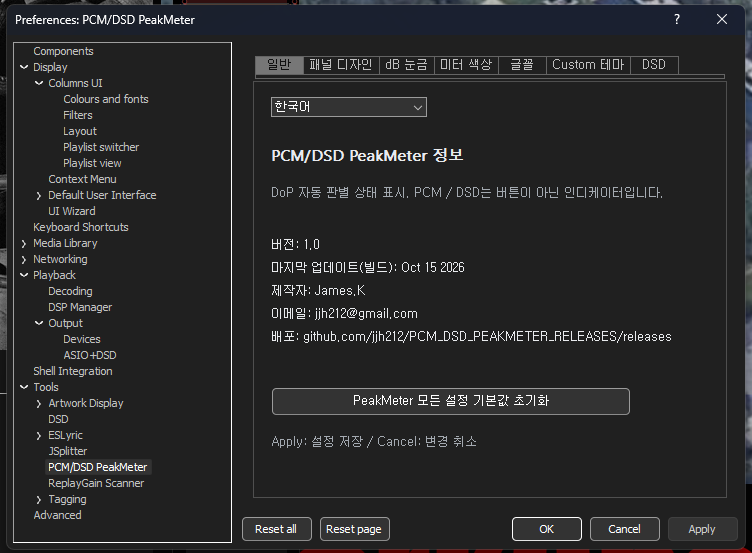
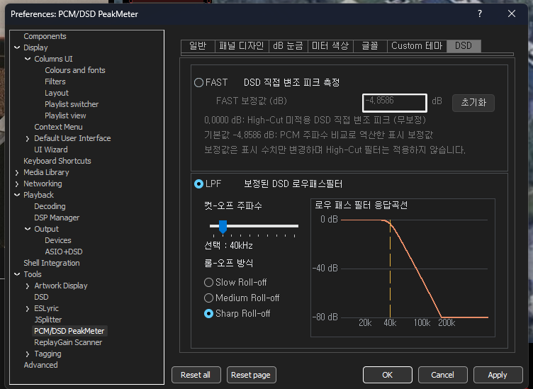
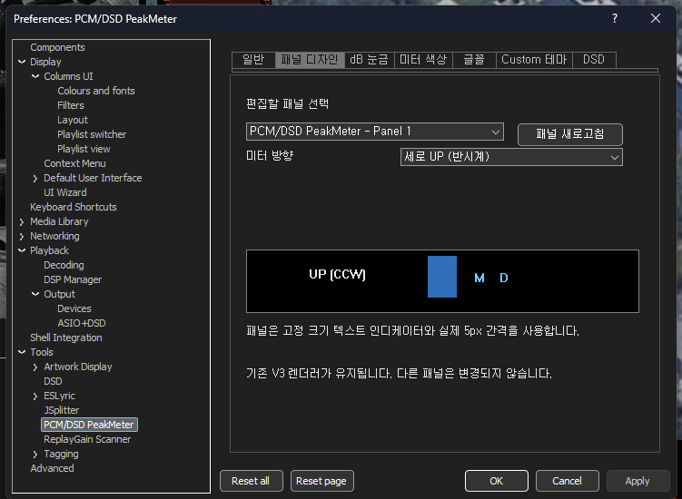
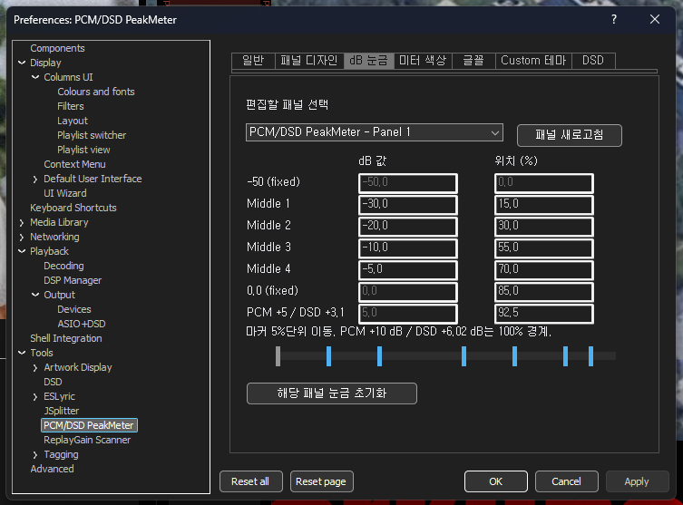
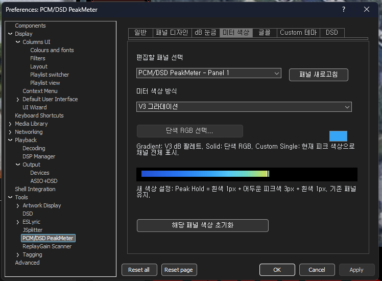
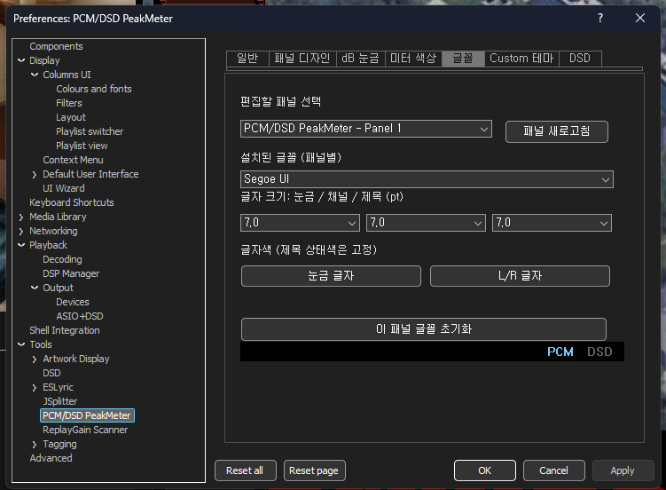
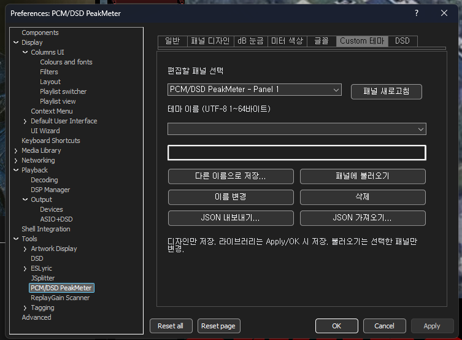

# PCM/DSD PeakMeter v1.0 — 사용자 설명서

**제품:** foobar2000용 PCM/DSD PeakMeter · **플랫폼:** Windows x64 · **버전:** v1.0

**중요:** 이 컴포넌트는 **표시·계측 전용 피크미터**입니다. 원본 PCM/DSD 음원, 재생 DSP 설정, DAC으로 전달되는 오디오 신호를 변경하지 않습니다. DSD LPF는 오직 **피크미터의 계산용 데이터**에 적용됩니다.

## 1. 설치 및 사용 환경

- foobar2000 x64에서 사용하며, 지원되는 Columns UI 패널 또는 독립 창으로 표시할 수 있습니다.
- 설치 파일: `foo_pcm_dsd_peakmeter_v1.0_x64.fb2k-component` 또는 `foo_pcm_dsd_peakmeter.dll`.
- Portable 구성의 DLL 경로 예: `profile/user-components-x64/foo_pcm_dsd_peakmeter/foo_pcm_dsd_peakmeter.dll`.
- DLL 수동 교체 전 foobar2000을 완전히 종료하고 기존 파일을 백업합니다. 배포본의 `SHA256SUMS.txt`로 파일 무결성을 확인합니다.
- 설정 메뉴: **Preferences → Tools → PCM/DSD PeakMeter**.
- 컴포넌트 정보와 일반(General) 탭에는 버전 **1.0**이 표시됩니다.

### 피크미터 열기

foobar2000의 **View → Visualizations → PCM/DSD PeakMeter** 메뉴에서 독립 창을 열 수 있습니다. Columns UI에서는 호환 패널로 삽입하여 사용합니다.

## 2. 피크미터의 표시와 조작

- **L / R:** 좌우 채널별 피크 표시.
- **피크바:** 현재 측정 중인 피크. **Peak Hold:** 최대 피크 마커가 잠시 유지된 후 하강하는 표시.
- **주황색 숫자:** 주의 구간에 **진입한 횟수**. 머문 시간이나 실제 클리핑 샘플 수가 아닙니다.
- **붉은색 숫자:** 위험 구간에 **진입한 횟수**. 머문 시간이나 실제 클리핑 샘플 수가 아닙니다.
- **최대 dB:** 해당 채널에서 계측된 최대 피크 표시값.
- **초기화:** **수치 통계 영역을 클릭**하면 주황/붉은 진입 카운터와 최대 dB 통계가 초기화됩니다. PCM/DSD 상태 표시는 버튼이 아닙니다.

| 모드 | 주의(주황) 구간 | 위험(붉은) 구간 | 표시 상한 눈금 |
|---|---|---|---|
| **PCM** | 0 dB 이상 ~ +5 dB 미만 | +5 dB 이상 | +10 dB |
| **DSD** | 0 dB 이상 ~ +3.1 dB 미만 | +3.1 dB 이상 | +6.02 dB |

**구분:** DSD의 `+6.02 dB`는 **상한 눈금**이며 붉은 카운터 진입 기준이 아닙니다. 최종 피크미터 코드의 DSD 붉은 구간 진입 기준은 `+3.1 dB`입니다.

### 상·하단 경계 눈금 강조

피크바 구간의 **배경 밝기**는 변하지 않습니다. 현재 재생 중인 측정값에 따라, 상단과 하단에 있는 **두 개의 눈금 글자**를 동시에 강조합니다.

- PCM: 주의 시 `0dB`, 위험 시 `+5dB`.
- DSD: 주의 시 `0dB`, 위험 시 `+3.1dB`.

초과 카운터는 이벤트의 누적값이므로 재생 구간이나 측정 시간이 달라지면 단순 숫자 비교가 어렵습니다. 동일 음원의 동일 구간을 반복하여 비교하세요.

### v1.0 실사용 피크미터 화면 — DSD512

아래 네 이미지는 **실제 v1.0 TEST 피크미터에서 캡처한 DSD512 화면**입니다. 가로/세로 배치와 전체/컴팩트 모드를 보여줍니다. 초과 카운터 및 최대 dB는 캡처 시점의 측정 상태로, 레이아웃별 성능 차이나 고정된 기준값을 뜻하지 않습니다.

**가로형 — 전체 화면**

**가로형 — 컴팩트 화면**

**세로형 — 전체 화면**

**세로형 — 컴팩트 화면**

### v1.0 PCM 실사용 피크미터 화면

아래 두 이미지는 **실제 v1.0 TEST PCM 화면**입니다. 상단에 PCM 샘플레이트가 표시되며, 경고 기준은 PCM의 `0dB` / `+5dB`를 사용합니다.

**가로형**

**세로형**

**참고:** 모든 피크 및 카운터 수치는 이미지 캡처 시점의 표시값이며, 테스트 기준치로 사용하지 않습니다.

## 3. PCM/DSD 자동 판별

피크미터가 캡처 지점에서 **DoP 마커 `0x05` / `0xFA`**와 유효성을 검사하여 PCM/DSD 표시를 자동 전환합니다. DSP 프리셋 이름만으로 DSD를 확정하지 않습니다. PCM에서는 해당 PCM 샘플레이트, DSD에서는 확인된 `DSD64`~`DSD2048` 규격을 표시합니다. 재생 체인의 캡처 지점에서 적절한 DoP 데이터가 확인되어야 DSD 모드가 작동합니다.

## 4. DSD 계측 옵션 — FAST / LPF

### FAST — 직접 변조 피크 측정

- 원본 DSD 1비트 직접 변조 밀도를 포맷별 **28~896비트 이동 윈도우**로 계산합니다.
- **High-cut/LPF를 적용하지 않으므로** 비가청 초고역 노이즈가 측정 피크에 영향을 줄 수 있습니다.
- 초기 보정값은 **−4.8586 dB**, 사용자가 수정하거나 Reset할 수 있습니다.
- `0.0000 dB`는 **무보정 표시값**이고, `−4.8586 dB`는 **PCM 주파수 비교로 도출한 경험적 표시 보정값**입니다. 실제 로우패스 처리나 출력 음량 변경이 아닙니다.

### LPF — 피크 계측 전용 로우패스필터

DSD 계측 데이터에서 사용자가 선택한 기준보다 높은 주파수 성분을 점진적으로 **감쇠**한 다음, 그 필터 출력의 피크를 계산합니다. 피크를 과도하게 올릴 수 있는 **노이즈 셰이핑 초고역 성분의 개입**을 줄이려는 기능입니다.

| 설정 | 선택지 및 기본값 |
|---|---|
| Cut-off Frequency | **20~200 kHz**, 기본 **40 kHz** |
| Roll-off Method | **Slow Roll-off / Medium Roll-off / Sharp Roll-off** |
| 기본 Roll-off | **Medium Roll-off** |
| 그래프 | 선택된 Roll-off의 예상 감쇠 곡선 표시 |

- **Slow:** 완만한 감쇠 — 컷오프 이후의 초고역 성분이 더 많이 남습니다.
- **Medium:** 중간 감쇠 — 기본 선택입니다(이전 UI 명칭 `Normal`).
- **Sharp:** 급격한 감쇠 — 컷오프 이후의 초고역 성분이 더 적게 남습니다.
- Cut-off에서 진폭이 즉시 0이 되는 **벽돌형 제거가 아닙니다**. 선택한 감쇠 특성에 따라 일부 성분이 남습니다.

### 왜 초고역 노이즈를 줄이나요?

귀에 직접 들리지 않는 초고역 DSD 노이즈도 광대역 피크 계산에는 참여할 수 있습니다. 이 때문에 **재생상 체감 음량과 계측 피크값이 서로 다르게 보일 수 있습니다.** LPF는 그 영향을 사용자가 지정한 대역·감쇠 방식으로 관찰하도록 합니다.

높은 Cut-off를 선택하면 더 많은 초고역 성분이 **계측에 포함**되어 표시 피크가 높아질 수 있습니다. 낮은 Cut-off나 더 급한 Roll-off에서는 해당 성분의 개입을 더 많이 줄입니다. **잔향·레이어링·홀로그래픽을 실제로 증감시키거나 음질을 변경하는 기능은 아닙니다.** 이와 관련된 성분을 더 넓은 측정 대역에서 확인하려는 사용자는 높은 Cut-off를 선택할 수 있지만, 트레이드오프는 **더 높은 계측 피크**입니다.

### LPF 응답의 참고값

**DSD64 / Cut-off 40 kHz**의 필터 주파수 응답 계산값입니다. 단일 주파수 진폭의 감쇠이며, 실제 음악의 최대 피크 감소량을 의미하지 않습니다.

| 주파수 | Slow | Medium | Sharp |
|---|---:|---:|---:|
| 40 kHz | −3.01 dB | −3.01 dB | −3.01 dB |
| 60 kHz | −7.89 dB | −14.37 dB | −21.34 dB |
| 80 kHz | −12.49 dB | −24.43 dB | −36.59 dB |
| 100 kHz | −16.38 dB | −32.44 dB | −48.60 dB |
| 150 kHz | −23.91 dB | −47.47 dB | −71.05 dB |
| 200 kHz | −29.72 dB | −58.83 dB | −87.95 dB |

**핵심 불변조건:** FAST/LPF는 피크미터에서 표시할 **측정값을 계산하는 방법**을 선택할 뿐, 음악 재생 데이터나 DAC 출력 신호에 어떠한 High-cut도 삽입하지 않습니다. 이 수치를 인증된 DSD True Peak 또는 실제 DAC 아날로그 출력 전압으로 해석하지 마세요.

## 5. 환경설정·언어·외관

일반/패널 디자인/dB 눈금/미터 색상/글꼴/Custom 테마/DSD 탭을 제공합니다. 한국어·영어 UI를 지원하며 가로·세로 및 최소 크기 레이아웃에서 표시 방식이 달라질 수 있습니다. `Apply`는 변경 저장, `Cancel`은 저장하지 않은 변경 취소, `Reset`은 해당 설정의 기본값 복귀에 사용합니다.

현재 v1.0의 각 화면을 다음과 같이 확인할 수 있습니다. 모든 스크린샷은 최종 TEST UI에서 촬영했습니다.

### 5.1 패널 디자인

가로·세로 방향을 선택하고 선택한 패널의 미리보기를 확인합니다.

### 5.2 dB 눈금

중간 눈금 위치·표시값을 조절합니다. PCM의 `0dB/+5dB`, DSD의 `0dB/+3.1dB` 기준을 구분합니다.

### 5.3 미터 색상

V3 그라데이션 등 피크바 색상 표현을 선택합니다. 색상 설정은 계측식에 영향을 주지 않습니다.

### 5.4 글꼴

패널별 글꼴·글자 크기·색상을 조절합니다.

### 5.5 Custom 테마

디자인 저장, 이름 변경, 불러오기와 JSON 내보내기/가져오기를 지원합니다.

### 5.6 일반 / DSD

버전·언어 설정 및 FAST/LPF 계측 옵션은 **1절·4절**의 실제 화면과 설명을 참고하세요.

기존 v0.8.0 문서는 이전 버전의 기록으로 별도 보존합니다.

## 6. 측정 예시와 검증 범위

실사용 검증은 **JoJo Siwa — Karma / DSD64 / DSD Processor SDM Type B / Nova GE off**에서 수행했습니다. Cut-off 및 Roll-off를 변경할 때 피크미터의 좌우 피크 dB 표시가 변화하는 것을 확인했습니다. 측정 구간·카운터 초기화 시점이 다를 수 있어 개별 캡처를 정밀한 동일 구간 비교값으로 해석하지 않습니다.

`v1.0` 릴리스의 최종 DLL SHA256은 배포된 `SHA256SUMS.txt`를 기준으로 검증하세요. 이전 `v0.8.2` 설치 파일이나 DLL을 v1.0으로 혼용하지 마세요.

## 7. 문제 해결

- DSD 음악인데 PCM으로 나오면, 캡처 경로의 **실제 DoP 데이터**와 설정을 확인하세요.
- 피크값이 나오지 않으면 재생 중인지, 사용 중인 foobar2000 프로필에 DLL이 설치됐는지 확인하세요.
- DLL 교체는 foobar2000을 **완전히 종료**한 뒤 진행하세요.
- 설정 변경 결과는 `Apply` 또는 `OK` 이후 피크미터에서 확인하세요.
- 지원 환경과 측정 방법의 차이로 FAST 수치와 LPF 수치 또는 PCM 피크값은 1:1로 동일하지 않을 수 있습니다.
