# PCM/DSD PeakMeter v1.0.1 — Final User Manual

**Windows x64 / foobar2000 · English edition · October 16, 2026**  
**Component version:** PCM/DSD Peak Meter **1.0.1**  
**Audience:** Listeners, digital-audio measurement users, and technical reviewers

> **Essential principle:** PCM/DSD PeakMeter is a **measurement-and-display-only** component. It does not change the original PCM/DSD content, foobar2000 DSP configuration, playback stream, or DAC-bound audio. Its DSD low-pass filter processes **metering data only**.

This is a **standalone, consolidated manual**, incorporating the core v1.0 functions and all six v1.0.1 updates. It supersedes older interface descriptions where thresholds or behavior differ. All feature statements are based on the final v1.0.1 source; separately marked Stage 19/20 measurements are **historical v1.0 experiments**, not new v1.0.1 test results.

## Contents

1. [Installation and launching](#1-installation-and-launching)
2. [Meter display and PCM measurement](#2-meter-display-and-pcm-measurement)
3. [Automatic PCM/DSD identification through DoP](#3-automatic-pcmdsd-identification-through-dop)
4. [DSD metering: FAST](#4-dsd-metering-fast)
5. [DSD metering: LPF](#5-dsd-metering-lpf)
6. [DSD64 standard limits versus higher-rate estimates](#6-dsd64-standard-limits-versus-higher-rate-estimates)
7. [Warning zones, maximum, and reset](#7-warning-zones-maximum-and-reset)
8. [Bilingual statistics tooltip cards](#8-bilingual-statistics-tooltip-cards)
9. [All seven Preferences tabs](#9-all-seven-preferences-tabs)
10. [Reference signal measurements](#10-reference-signal-measurements)
11. [Workflow and troubleshooting](#11-workflow-and-troubleshooting)
12. [Scope, terminology, integrity, and references](#12-scope-terminology-integrity-and-references)

## 1. Installation and launching

### 1.1 Recommended installation

1. In **foobar2000 x64**, open `File > Preferences > Components > Install`.
2. Select `foo_pcm_dsd_peakmeter_v1.0.1_x64.fb2k-component`.
3. Restart foobar2000, then confirm **PCM/DSD Peak Meter / 1.0.1** in the Components list.
4. Open `Preferences > Tools > PCM/DSD PeakMeter > General` and check **Version: 1.0.1**.

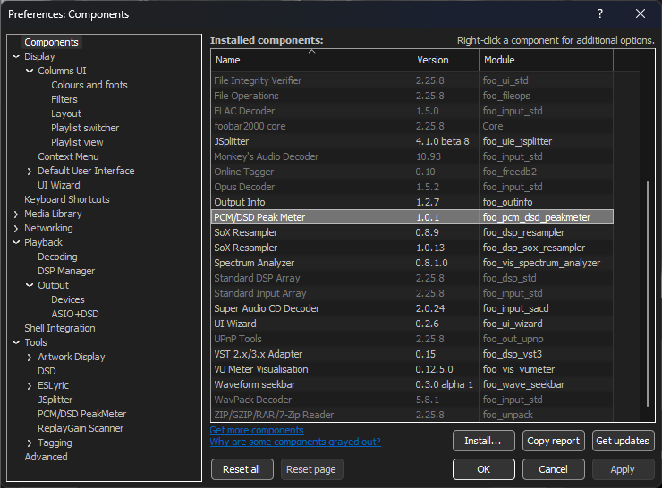

**Installer archive layout:** the `.fb2k-component` contains **one** `foo_pcm_dsd_peakmeter.dll` at the **ZIP root**. There is **no `64/` or `x64/` subdirectory**. The standalone DLL and multi-file Windows ZIP are **alternative distributions**; do not install duplicate copies of the same component.

For manual replacement, exit **all** foobar2000 processes, back up the existing DLL, and then replace it. A typical portable component directory is `profile\user-components-x64\foo_pcm_dsd_peakmeter\`. Do not mix DLLs from different releases.

### 1.2 Opening the meter

- **Standalone window:** `View > Visualizations > PCM/DSD PeakMeter`
- **Columns UI:** add it as a compatible embedded panel
- **Preferences:** `Preferences > Tools > PCM/DSD PeakMeter`

| ① View | ② Visualizations | ③ PCM/DSD PeakMeter |
|---|---|---|
| 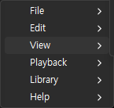 | 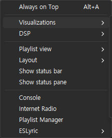 | 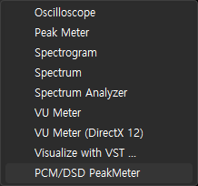 |

## 2. Meter display and PCM measurement

### 2.1 Horizontal and vertical layouts

| Horizontal PCM | Horizontal DSD |
|---|---|
| 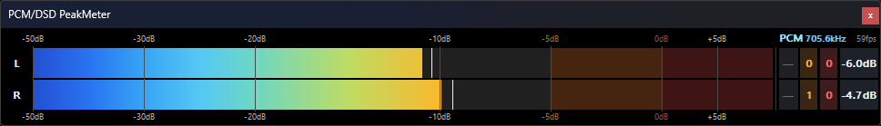 | 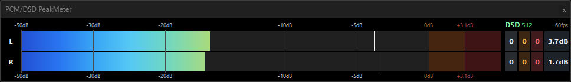 |

| Vertical PCM | Vertical DSD |
|---|---|
| 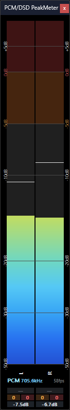 | 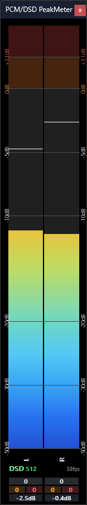 |

**L/R** identifies the two actual audio channels. The PCM/DSD indicators display **automatically detected format**; they are not manual selection buttons. The displayed color reflects the detected route and customizable appearance. Channel statistics are maintained separately.

The v1.0.1 display refinements include:

- Format labels are **left-aligned**, including wide vertical mode; FPS remains **right-aligned**.
- PCM sample rates appear in kHz with **one fixed decimal, truncated rather than rounded**: `PCM 705.6kHz`.
- DSD uses a separator between format and multiplier: `DSD 512`.
- The `PCM`/`DSD` prefix has stronger typography independently of its numeric suffix.
- L/R lettering is larger, brighter, and more prominent throughout the layouts.
- `61fps`, for example, is derived from **observed paint events**, not source sample rate or number of examined DSD windows.

### 2.2 What does the PCM path measure?

PCM measurement uses each captured channel's **digital sample peak**:

\[
P_{\mathrm{PCM}}=\max_n|x[n]|,\qquad L_{\mathrm{PCM}}=20\log_{10}(P_{\mathrm{PCM}})+C_{\mathrm{PCM}}
\]

Here `x[n]` is a captured sample and `C_PCM` is the user-set **display correction**. This is **sample peak**, not interpolated inter-sample true peak or the DAC's analog output. The legacy PCM Golden measurement path is preserved independently of DSD FAST/LPF processing.

### 2.3 Bars, Peak Hold, and FPS

- **Live bar:** follows new peaks immediately and falls according to its configured display ballistics.
- **Peak Hold:** rises immediately on a new peak, holds for **0.50 seconds**, then falls at **30 dB/s**.
- **DSD:** produces audio-time peak buckets targeting **60 Hz**, separated from UI scheduling and painting.
- **FPS:** the displayed number reflects actual screen Paint frequency; **60 FPS is a target, not a guarantee** under all loads and window states.

## 3. Automatic PCM/DSD identification through DoP

### 3.1 Signal-based identification, not name-based inference

v1.0.1 examines **actual captured DoP (DSD over PCM) transport data**. It does not declare DSD simply because a file ends in `.dsf`, a DSP preset contains “DSD,” a DAC advertises DSD support, or a familiar PCM carrier rate appears. Older configuration controls may remain for compatibility, but the final automatic routing decision is based on **verified DoP data**, not DSP preset names, DSP GUIDs, or SACD Output settings.

### 3.2 Structure of a 24-bit DoP carrier word

| Field | Bits | Function |
|---|---|---|
| DoP marker | Upper 8 bits | Alternating `0x05` / `0xFA` markers |
| Original DSD payload | Lower 16 bits | Sixteen DSD data bits used for analysis |

For valid DSD processing, the meter requires **matching left/right markers**, correct marker alternation, and **32 consecutive valid DoP frames**. It strips the marker and analyzes only the **original 16-bit DSD payload** in its original time order. The same verified bits feed FAST, LPF, and modulation-limit analysis.

### 3.3 One-second majority decision and stability

The detector counts valid DoP and PCM-classified frames during each **one-second decision interval**. If verified DoP wins the vote, the mode becomes DSD; if PCM wins, it becomes PCM. There are only **two automatic states**, with **PCM at startup**. Tied votes, missing input, Stop, or Pause do not independently force a mode flip. Repeated votes for the existing mode are a **no-op**, avoiding unnecessary bar/hold resets; a real detected transition updates the meter route.

### 3.4 Recognized carrier rates

| DSD format | 44.1 kHz-family DoP PCM carrier | 48 kHz-family DoP PCM carrier |
|---|---:|---:|
| DSD64 | 176,400 Hz | 192,000 Hz |
| DSD128 | 352,800 Hz | 384,000 Hz |
| DSD256 | 705,600 Hz | 768,000 Hz |
| DSD512 | 1,411,200 Hz | 1,536,000 Hz |
| DSD1024 | 2,822,400 Hz | 3,072,000 Hz |
| DSD2048 | 5,644,800 Hz | 6,144,000 Hz |

A recognized rate **alone is insufficient** for DSD identification: valid DoP marker evidence is mandatory. This table does not guarantee that every specific DAC, driver, or playback output supports these carrier rates. A path exposing only native DSD rather than DoP may not supply the required evidence at this capture point.

## 4. DSD metering: FAST

**FAST analyzes direct modulation density of the original DSD 1-bit stream without a low-pass/high-cut filter.** For an observed window of `W` bits, let `N₁` be the number of one bits:

\[
M=\frac{|2N_1-W|}{W},\qquad L_{\mathrm{FAST}}=20\log_{10}(2M)+C_{\mathrm{FAST}}
\]

| DSD rate | Window | Quantity |
|---|---:|---|
| DSD64 | 28 bits | Direct 1-bit modulation density |
| DSD128 | 56 bits | Direct 1-bit modulation density |
| DSD256 | 112 bits | Direct 1-bit modulation density |
| DSD512 | 224 bits | Direct 1-bit modulation density |
| DSD1024 | 448 bits | Direct 1-bit modulation density |
| DSD2048 | 896 bits | Direct 1-bit modulation density |

The **SACD 0 dB reference corresponds to modulation amplitude 0.5**. Full-scale modulation `M = 1` corresponds to the formula's mathematical limit of **+6.0206 dB**. This does **not** imply that a DSD DAC is always 6.02 dB quieter or louder than a PCM DAC. The **+3.1 dB warning boundary** and the **+6.02 dB mathematical endpoint** have different meanings.

**FAST display offset:** `0.0000 dB` shows direct modulation peak **without offset**. The default and Reset value, `−4.8586 dB`, is an **empirical display correction obtained in prior PCM frequency comparison**. It is **not** a high-cut filter, playback gain change, or new audio-processing stage. Do not interpret it as an offset that should also be applied to LPF measurements.

FAST may include ultrasonic noise-shaped components because it observes the original wideband bitstream. Its peak readings are therefore not required to match PCM sample peaks or LPF output peaks.

## 5. DSD metering: LPF

### 5.1 Purpose

DSD noise shaping can produce substantial **ultrasonic** content. Though inaudible directly, these components can contribute to a **wideband peak measurement**. The LPF progressively suppresses ultrasonic energy in a **measurement-only copy** of the DSD data, then measures the numeric filter output. It does **not** insert a filter into foobar2000 playback or a DAC.

### 5.2 Processing chain

```text
Verified DoP 16-bit payload
           ↓
Original DSD 1-bit → ±1 PDM samples
           ↓
CIC3 low-pass + decimation
           ↓
Cutoff-compensated Butterworth low-pass
           ↓
Per-channel absolute output peak
           ↓
SACD 0.5-reference dB conversion → 60 Hz bucket → UI
```

CIC3 combines three integration/comb stages. Decimation factors are **2/4/8/16/32/64** for DSD64 through DSD2048. The post-decimation processing rate is **1.4112 MHz** for 44.1 kHz-family DSD and **1.536 MHz** for 48 kHz-family DSD. A cutoff-compensated Butterworth post-filter uses **2nd/4th/6th order** according to roll-off selection.

| Setting | Available values | Default |
|---|---|---|
| Metering mode | FAST / LPF | **FAST** on a fresh configuration |
| LPF cutoff | **20–200 kHz** | **40 kHz** |
| LPF roll-off | Slow / Medium / Sharp | **Medium** |
| Response preview | Selected filter's modeled response | Current selection |

**Screenshot note:** the supplied v1.0.1 DSD Preferences screenshot shows a **user-selected LPF configuration**. It does not override the component's initial **FAST** mode default.

- **Slow:** 2nd-order Butterworth post-filter; gentler attenuation.
- **Medium:** 4th-order; default, intermediate attenuation (called `Normal` in older code).
- **Sharp:** 6th-order; stronger post-cutoff attenuation.

The internal Butterworth cutoff is calibrated so the **combined CIC3 × Butterworth response** is approximately **−3.0103 dB at the user-selected cutoff**. A cutoff does **not** remove all frequencies above it instantly.

### 5.3 Peak conversion and example

With the filter output `y[n]`, the per-channel absolute peak and SACD-referenced reading are:

\[
P_{\mathrm{LPF}}=\max_n|y[n]|,\qquad L_{\mathrm{SACD}}=20\log_{10}(2P_{\mathrm{LPF}})
\]

For example, `P_LPF = 0.158113883` gives `20 log10(2 × 0.158113883) = −10.00 dB SACD` in an ideal conversion without further display correction. This is a **numeric filtered peak relative to the SACD 0.5-amplitude reference**—not the amplitude of just the 1 kHz fundamental or the DAC's analog output.

### 5.4 Example attenuation: DSD64, 40 kHz cutoff

The following values are the **calculated frequency response recorded in the v1.0 technical report**, not the expected reduction of a musical recording's overall peak:

| Frequency | Slow | Medium | Sharp |
|---|---:|---:|---:|
| 40 kHz | −3.01 dB | −3.01 dB | −3.01 dB |
| 60 kHz | −7.89 dB | −14.37 dB | −21.34 dB |
| 80 kHz | −12.49 dB | −24.43 dB | −36.59 dB |
| 100 kHz | −16.38 dB | −32.44 dB | −48.60 dB |
| 150 kHz | −23.91 dB | −47.47 dB | −71.05 dB |
| 200 kHz | −29.72 dB | −58.83 dB | −87.95 dB |

A higher cutoff admits more ultrasonic contribution **into the measurement**; lower cutoffs and sharper roll-off suppress more of it. These settings do **not** alter musical ambience, imaging, or actual sound quality.

**Standards distinction:** SACD Annex D.1 specifies separate measurement-filter requirements. The component's **user-variable 20–200 kHz LPF** does **not** necessarily reproduce that fixed response. The displayed peak is **not a certified reconstructed DSD True Peak or an Annex D.1 compliance test result**.

## 6. DSD64 standard limits versus higher-rate estimates

### 6.1 The critical distinction

**DSD64 uses the Sony/Philips SACD *Audio Signal Properties v1.3*, Annex D.3 standard-based 28-bit modulation-density limits. They are not guessed thresholds.**

For DSD128, DSD256, DSD512, DSD1024, and DSD2048, **this project has not established independently specified official Annex D.3 limit thresholds**. It proportionally extrapolates the DSD64 ratios to each longer observation window. **Only the threshold is estimated; the bits themselves are measured directly from the actual captured stream.**

### 6.2 Complete decision table

`N₁` denotes the **measured number of one bits** in each window.

| Format | Window | Normal `N₁` | Negative exceedance | Positive exceedance | Basis |
|---|---:|---:|---:|---:|---|
| **DSD64** | **28 bits** | **4–24** | **0–3** | **25–28** | **Annex D.3 standard-based** |
| DSD128 | 56 bits | 8–48 | 0–7 | 49–56 | Proportional estimate |
| DSD256 | 112 bits | 16–96 | 0–15 | 97–112 | Proportional estimate |
| DSD512 | 224 bits | 32–192 | 0–31 | 193–224 | Proportional estimate |
| DSD1024 | 448 bits | 64–384 | 0–63 | 385–448 | Proportional estimate |
| DSD2048 | 896 bits | 128–768 | 0–127 | 769–896 | Proportional estimate |

The implementation flags **negative** exceedance when `7 × N₁ < W`, and **positive** exceedance when `7 × (W − N₁) < W`. For DSD64, `W = 28`, yielding `N₁ = 0–3` or `25–28` respectively. Higher-rate thresholds are obtained by extrapolating this density proportion.

### 6.3 Actual window scanning and count meaning

- **Input:** original 16-bit payloads from validated left/right DoP frames.
- **Stride:** **one examined window per verified 16-bit DoP frame**, advancing by **16 bits**. This is **not** exhaustive one-bit-step scanning.
- **Statistics:** separate positive and negative exceeded-window totals **per channel**; displayed **total = positive + negative**.
- **FAST/LPF independence:** modulation-limit counting uses original DSD bits regardless of the selected display metering mode.
- **PCM:** shows `—` for the unavailable DSD-specific statistic, with its hover and reset action disabled.

For example, two positive and three negative exceeded windows on left-channel DSD512 yield **L total = 5**. That is **five examined windows** beyond the estimated boundaries, **not five independent clipping events** or five episodes of audible distortion.

**Precise compliance scope:** the DSD64 **threshold** is standard-based, but v1.0.1 samples windows on a **16-bit stride**, not at every possible one-bit start position. Therefore this feature must **not** be claimed to constitute a complete SACD Annex D.3 compliance certification across every possible window. DSD128+ introduces the additional distinction that the **threshold itself is an estimate**.

### 6.4 Not the same as an LPF peak or clipping

An exceeded modulation-density window does **not** prove that the LPF output is above +3.1 dB, that PCM clipped, or that the DAC output distorted. The DSD 1-bit density statistic, the displayed-peak warning zones, and clipping measurements are **different quantities** and should not be conflated.

## 7. Warning zones, maximum, and reset

### 7.1 Inclusive threshold boundaries

| Format | Normal | Amber: near threshold | Red: threshold reached/exceeded |
|---|---|---|---|
| PCM | `P < −5 dB` | **`−5 dB ≤ P < 0 dB`** | **`P ≥ 0 dB`** |
| DSD | `P < 0 dB` | **`0 dB ≤ P < +3.1 dB`** | **`P ≥ +3.1 dB`** |

**Exactly 0 dB in PCM is red; exactly +3.1 dB in DSD is red.** These are the final v1.0.1 source-code rules, overriding older pre-development notes that expressed the thresholds as strictly “above.” Threshold captions flash when active, at approximately **500 ms** intervals.

These classifications use the **displayed peak**; neither a red counter nor the red MAX highlight is a certification of physical clipping.

### 7.2 Distinct statistic units

| Field | Meaning | What is counted |
|---|---|---|
| Modulation Limit | Raw 1-bit DSD density boundary | **Examined windows outside the limit** |
| Amber | Entry into near-threshold region | **Upward zone-entry events** |
| Red | Entry into threshold/reached region | **Upward zone-entry events** |
| MAX | Highest displayed peak since reset | **Maximum dB reading** |

Amber and red do **not** count every sample or frame. A direct **normal → red** jump increments **red only**; **red → amber** while falling does not create another amber entry. A sustained excursion does not add one count for each frame. MAX appears in danger color when it has reached **PCM ≥ 0 dB** or **DSD ≥ +3.1 dB**.

### 7.3 Reset scope

Clicking an **enabled** statistics cell resets **both L/R channels' statistics for that panel**, including the local DSD modulation-limit display baseline. It does **not** reset other panels' histories. The Preferences `Reset all` command resets **configuration**, not the same panel-statistics action.

## 8. Bilingual statistics tooltip cards

Hover a statistics cell to open a dark card with separately styled **title, principal value, supporting values, explanation, and reset instruction**. Accent colors distinguish modulation limits (green), amber (orange), red (red), and MAX (blue). Language follows the existing **General > English/Korean** setting; press `Apply` or `OK` after changing it.

| Modulation Limit | Warning (amber) |
|---|---|
|  |  |

| Exceeded threshold (red) | Maximum |
|---|---|
| 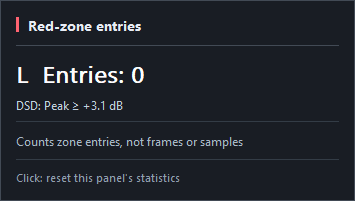 | 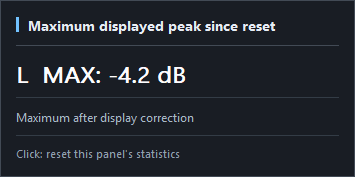 |

- Modulation Limit displays the channel's **total and separate positive/negative counts** and indicates **estimated** for DSD128+.
- Amber and Red display the **zone-entry count** and the applicable PCM/DSD thresholds.
- MAX displays the **maximum reading after display correction**.
- Clicking an enabled statistic resets **that panel's** statistics for both channels.
- PCM modulation-limit cells are **non-applicable**, with no tooltip or click-to-reset on those cells.

## 9. All seven Preferences tabs

The images below are **actual English-language v1.0.1 Preferences screenshots**. Individual selections may reflect the capture session rather than initial defaults.

### 9.1 General — language, component details, and settings reset

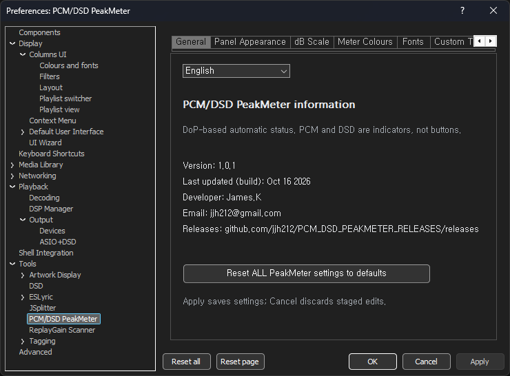

Select English or Korean; the tooltip-card language follows the selection. The page shows version, build date, developer and release address. Settings reset is different from resetting live statistics.

### 9.2 Panel Appearance — layout and orientation

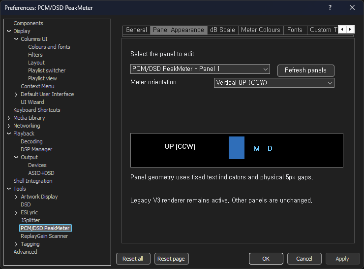

Configure horizontal/vertical presentation and panel geometry. Wide and compact layouts show the same measured signal using different arrangements.

### 9.3 dB Scale — axis display

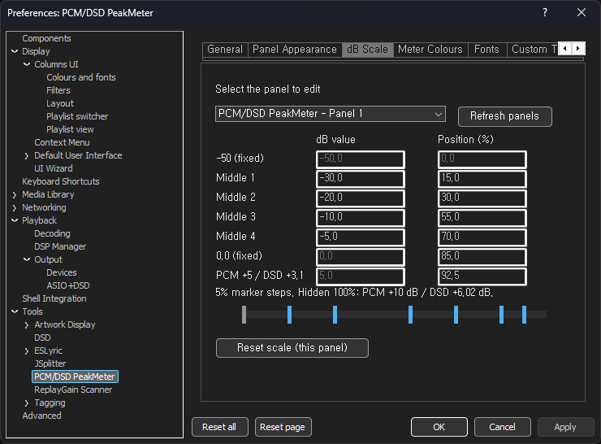

Adjust displayed scales and ticks. Changing their presentation does not change DoP validation, LPF processing, or modulation-limit thresholds.

### 9.4 Meter Colours — Gradient / Solid / Custom

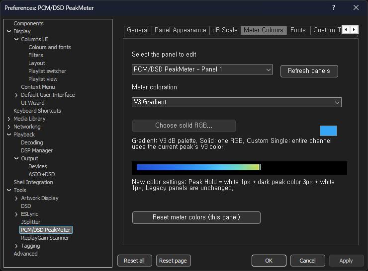

Change bar colors without changing the captured stream or level calculation.

### 9.5 Fonts — readability and labels

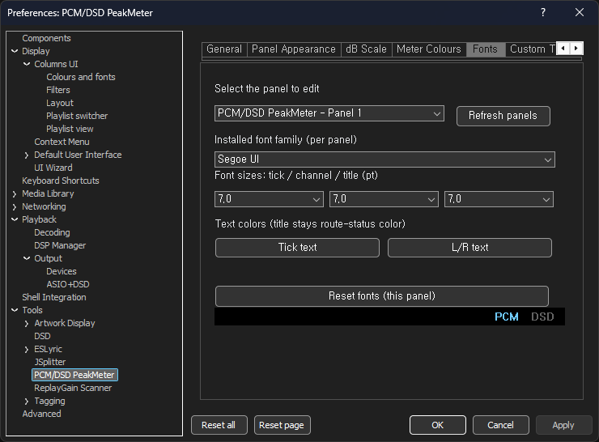

Set text presentation. v1.0.1 also updates the built-in L/R and PCM/DSD typography for legibility.

### 9.6 Custom Themes — appearance profiles

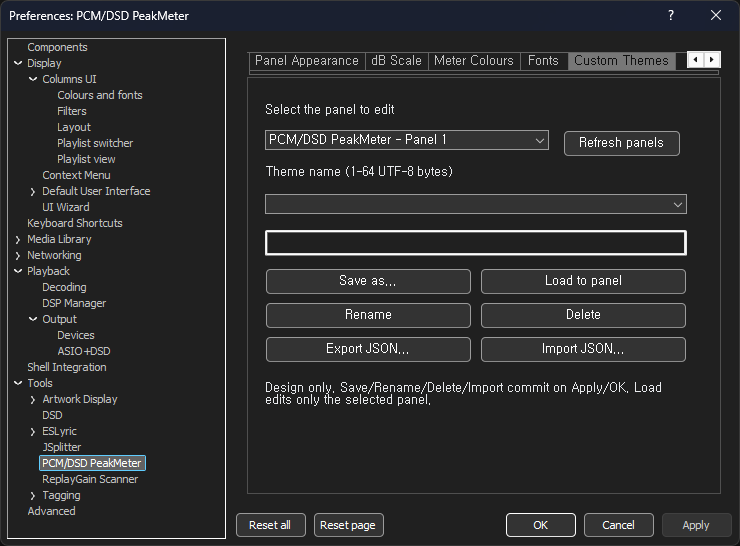

Save and reload styling profiles. Appearance settings are independent of raw DSD modulation-limit measurements.

### 9.7 DSD — FAST / LPF, offset, cutoff, roll-off

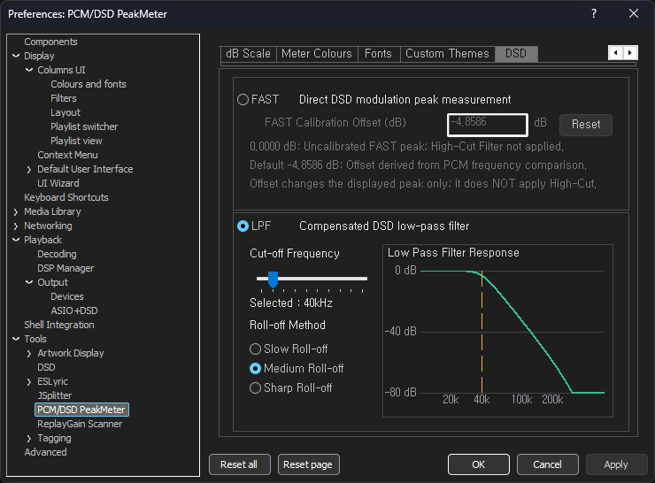

Choose the **FAST** direct density meter or **LPF** filtered meter. Distinguish the FAST offset's **0.0000 dB uncorrected value** from its **−4.8586 dB default**. LPF mode enables **20–200 kHz cutoff** and Slow/Medium/Sharp roll-off controls, with the selected modeled response displayed on the frequency graph. Apply or OK saves changes.

## 10. Reference signal measurements

The values below come from the **Stage 19/20 studies documented in the October 16, 2026 v1.0 engineering report**. They are **historical reference measurements**, not fresh end-to-end v1.0.1 tests of all DSD formats.

### 10.1 A repeatable 1 kHz, −12 dBFS reference

The source was a **1 kHz, −12 dBFS, stereo, 60-second** signal, tested using the recorded **SDM Type B** conditions. Extracted fundamental amplitudes and SACD-referenced levels were:

| Condition | Extracted 1 kHz fundamental | SACD-referenced level | Error vs. expected |
|---|---:|---:|---:|
| Expected | 0.125594322 | −12.000000 dB | 0 |
| DSD64 observed | 0.125592283 | −12.000141 dB | −0.000141 dB |
| DSD512 observed | 0.125593497 | −12.000057 dB | −0.000057 dB |

This validates the **reference fundamental amplitude** under those test conditions. It does **not** demonstrate that all FAST/LPF peaks for arbitrary music have the same small error.

### 10.2 Why fundamental amplitude and LPF instantaneous peak differ

The report's **40 kHz / Medium** comparison:

| Quantity | DSD64 | DSD512 |
|---|---:|---:|
| 1 kHz fundamental amplitude | 0.125592283 | 0.125593497 |
| Maximum LPF output amplitude | 0.132311242 | 0.125595760 |
| Residual RMS after removing 1 kHz | 0.001652454 | 0.000001546 |
| LPF peak converted to SACD dB | −11.547465 dB | −11.999901 dB |

The fundamental was effectively matched, but residual components raised DSD64's maximum LPF output in that specific configuration. The report found approximately **0.0058 dB DSD64/DSD512 peak difference at 20 kHz / Sharp**, versus about **10.10 dB at 200 kHz / Slow**. These are **measured results for those specific test conditions**, not fixed differences between all DSD64 and DSD512 material.

## 11. Workflow and troubleshooting

### 11.1 Practical walkthrough

1. Verify component version **1.0.1** in Components.
2. Play PCM and inspect L/R, the format rate, bars, and observed FPS.
3. Play DSD over a route providing **verifiable DoP frames**, then confirm the DSD format label.
4. Select FAST to view raw density peaks; optionally set offset to **0.0000 dB** to see the uncorrected display.
5. Select LPF and start with **40 kHz / Medium**; compare other cutoff and roll-off settings **in the meter**.
6. Hover the DSD Modulation Limit cell to inspect per-channel totals and the **standard-based/estimated** distinction.
7. Review Amber, Red, and MAX; click an enabled statistics cell to reset that panel's readings.

### 11.2 Questions and symptoms

| Question / symptom | Explanation / check |
|---|---|
| Playing a `.dsf`, but the meter reads PCM | Check for **valid DoP markers at the actual capture point**. File extension and DAC capability are not substitutes. |
| Why does PCM show `705.6kHz`? | A one-decimal **truncated** kHz display, by design. |
| FAST and LPF peaks disagree | **Direct 1-bit density** and **filtered numeric output peak** are different quantities. |
| Does FAST `−4.8586 dB` lower the playback level? | **No.** It is an empirical **display offset**, not a signal-gain or LPF stage. |
| Modulation Limit rises while the red meter warning stays off | Window-density exceedances and displayed-peak thresholds are **different metrics**. |
| Is DSD128 “estimated” from fabricated audio? | **No.** Actual bits are counted. Only the exceedance **threshold** is extrapolated from DSD64. |
| Why is MAX red? | A previous displayed peak reached **PCM ≥ 0 dB** or **DSD ≥ +3.1 dB** since reset. |
| Tooltip language appears unchanged | Change the General-tab language and use `Apply`/`OK`. |
| FPS differs from 60 | FPS is the **observed paint rate**; visibility and processing load matter. |
| Do I need to create a `64/` installation folder inside the component file? | **No.** The approved v1.0.1 component has a single root-level DLL. |

## 12. Scope, terminology, integrity, and references

### 12.1 What must not be inferred

- **PCM sample peak is not interpolated inter-sample true peak.**
- **DSD FAST density peak, DSD LPF peak, and DAC analog output peak are different measurements.**
- A **standard-based DSD64 density threshold** with 16-bit-stride scanning is **not** a full every-bit-start-position SACD compliance certification.
- For **DSD128–2048**, the measured bits are real; **the boundary is extrapolated**.
- Supported-rate code paths and unit tests do not prove identical long-term audio/CPU performance on all formats and computers.
- All **30 supplied screenshots** depict real v1.0.1 UI captures; snapshot readings and user selections are not universal reference values.

### 12.2 Glossary

| Term | Definition |
|---|---|
| PCM sample peak | Largest captured PCM sample magnitude |
| DoP | DSD bits transported inside PCM-format carrier words |
| FAST | Peak of directly measured 1-bit modulation density windows |
| LPF | Peak of a low-pass-filtered metering-only copy of DSD |
| SACD 0 dB reference | Modulation amplitude 0.5 relative to the maximum DSD amplitude |
| Modulation Limit | Per-examined-window raw DSD density boundary verdict |
| Zone Entry | A new **upward transition** into amber or red peak classification |
| MAX | Maximum **displayed dB** since that panel's last reset |
| Peak Hold | A display marker temporarily retaining a peak then decaying |

### 12.3 Files and known release SHA256

| Release asset | SHA256 |
|---|---|
| `foo_pcm_dsd_peakmeter.dll` | `AD33EC851B7632FF502D7B6B05ECCCD1AAFE0A04806056DB8D2AD47857262FFD` |
| `foo_pcm_dsd_peakmeter_v1.0.1_x64.fb2k-component` | `5C2E1B07F8B419152D0545895EB1C536504F2F7C9390584F43B510A36B2E2F9A` |
| `PCM_DSD_PEAKMETER_v1.0.1_Windows_x64.zip` | `E032BBEAB323B0ECAAA4EB7085E7CC87D437FD8ED841F967B6EBD7FE857ADAB6` |

The published release's **`SHA256SUMS.txt` is authoritative** for binary asset integrity. Private source repository: `jjh212/PCM_DSD_PEAKMETER`. Public distribution: [`jjh212/PCM_DSD_PEAKMETER_RELEASES`](https://github.com/jjh212/PCM_DSD_PEAKMETER_RELEASES).

### 12.4 Provenance and version boundaries

- **v1.0.1 implementation:** private source commit `4ea0d9eb3a502d53b13e87785a032532e37712f7`, tag `v1.0.1`.
- **Standard basis:** Sony/Philips, *Super Audio CD Audio Signal Properties v1.3*, especially Annex D.2 and D.3; [reference document](https://www.sonicstudio.com/pdf/dsd/SACD_SignalPropertiesV13.pdf).
- **Reference measurements:** *PCM/DSD PeakMeter v1.0 — Implementation, Algorithms, Standards and Measurement Verification Technical Report*, dated October 16, 2026; Stage 19/20 data.
- **Version-specific changes:** [English v1.0.1 release notes](CHANGELOG_V101_EN.md).
- **Preservation:** v1.0 manuals, history, tags, and previous release assets are not retroactively changed.
