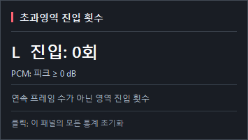
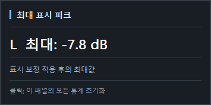
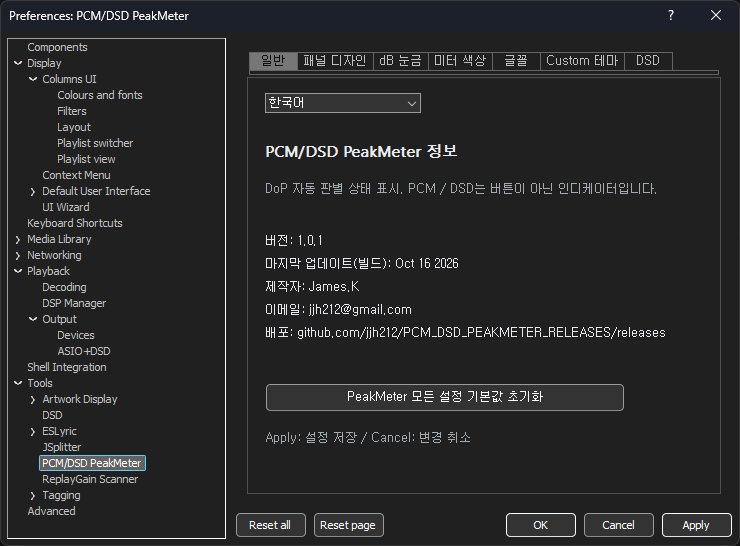
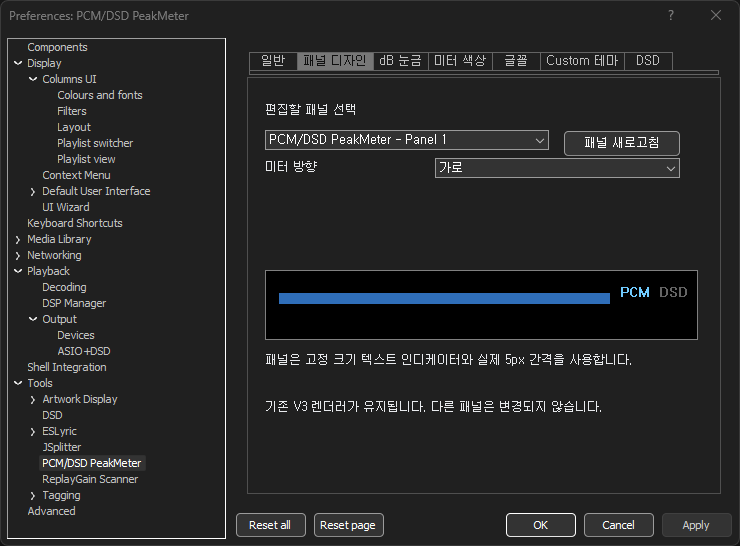
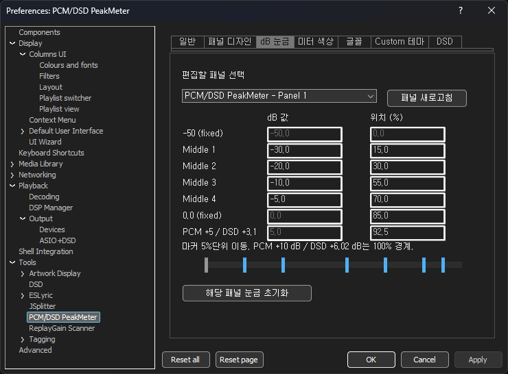
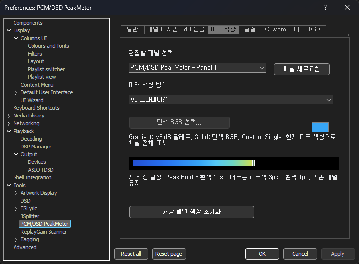
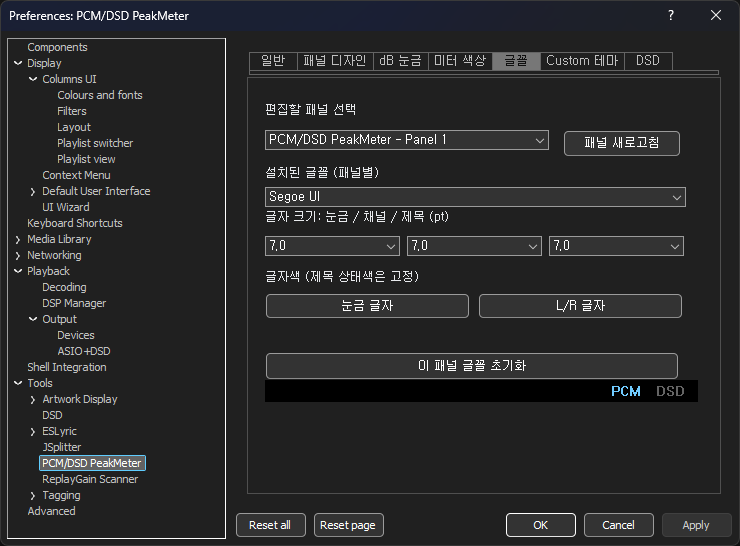
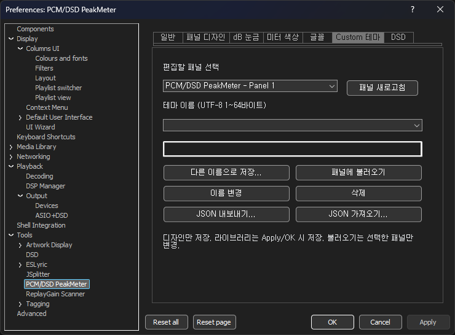
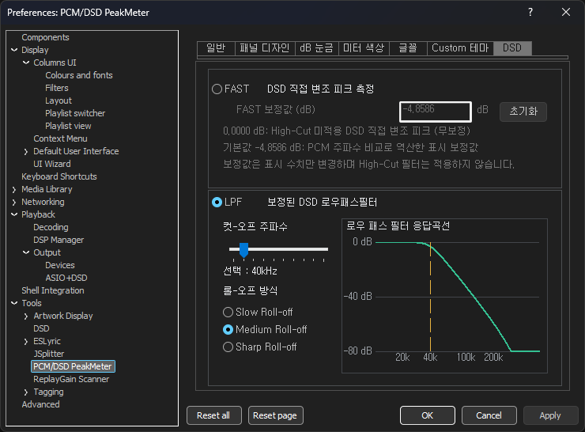

# PCM/DSD PeakMeter v1.0.1 — 최종 사용자 설명서

**Windows x64 / foobar2000 · 한국어판 · 2026-10-16**  
**대상 버전:** PCM/DSD Peak Meter **1.0.1**  
**대상 독자:** 일반 사용자, 오디오 계측 사용자, 기술 검증 담당자

> **제품 핵심 원칙:** 이 컴포넌트는 오디오 신호를 **읽어서 분석하고 표시하는 피크미터**입니다. PCM/DSD 원본, foobar2000 DSP 설정, 실제 재생 스트림, DAC로 전달되는 오디오를 수정하지 않습니다. DSD LPF도 **피크미터 내부의 계측 데이터**에만 적용됩니다.

이 설명서는 v1.0의 주요 기능과 v1.0.1의 여섯 가지 업데이트를 합친 **독립적인 통합 설명서**입니다. 이전 버전 설명서를 먼저 읽을 필요가 없습니다. 설명·수치의 기준은 v1.0.1 확정 소스이고, 별도로 표시한 Stage 19/20 실험 데이터는 v1.0 당시 확보된 참고 검증 자료입니다.

## 목차

1. [설치·실행·버전 확인](#1-설치실행버전-확인)
2. [미터 화면과 PCM 계측](#2-미터-화면과-pcm-계측)
3. [DoP 기반 PCM/DSD 자동판별](#3-dop-기반-pcmdsd-자동판별)
4. [DSD 계측 원리: FAST](#4-dsd-계측-원리-fast)
5. [DSD 계측 원리: LPF](#5-dsd-계측-원리-lpf)
6. [DSD64 표준 변조한계와 고배속 추정치](#6-dsd64-표준-변조한계와-고배속-추정치)
7. [피크 주의·초과·MAX·초기화](#7-피크-주의초과max초기화)
8. [카드형 Tooltip 사용법](#8-카드형-tooltip-사용법)
9. [환경설정 7개 탭](#9-환경설정-7개-탭)
10. [실측 참고 자료와 해석](#10-실측-참고-자료와-해석)
11. [사용 시나리오와 문제 해결](#11-사용-시나리오와-문제-해결)
12. [검증 범위·용어·배포 무결성](#12-검증-범위용어배포-무결성)

## 1. 설치·실행·버전 확인

### 1.1 권장 설치 방식

1. **foobar2000 x64**의 `File > Preferences > Components > Install`을 엽니다.
2. `foo_pcm_dsd_peakmeter_v1.0.1_x64.fb2k-component` 파일을 선택해 설치합니다.
3. foobar2000을 재시작하고 `Components` 목록에서 **PCM/DSD Peak Meter / 1.0.1**을 확인합니다.
4. `Preferences > Tools > PCM/DSD PeakMeter > 일반`에서 **버전: 1.0.1**을 확인합니다.


**설치 패키지 구조:** `.fb2k-component` 내부에는 `foo_pcm_dsd_peakmeter.dll` **한 개가 압축파일 최상위에 있습니다**. `64/` 또는 `x64/` 디렉터리는 없습니다. 직접 DLL을 설치하는 방식이나 Windows ZIP을 이용하는 방식은 **대체 배포 형태**이며 같은 컴포넌트를 중복 설치하는 방식이 아닙니다.

수동 교체 시에는 foobar2000의 모든 인스턴스를 종료하고 기존 DLL을 백업한 다음 교체하세요. 일반적인 portable 설치 경로는 `profile\user-components-x64\foo_pcm_dsd_peakmeter\foo_pcm_dsd_peakmeter.dll`입니다. 다른 버전의 DLL과 v1.0.1 패키지를 혼합하지 마세요.

### 1.2 실행과 설정 접근

- **독립형 창:** `View > Visualizations > PCM/DSD PeakMeter`
- **Columns UI 패널:** 레이아웃 편집에서 호환 UI 패널로 배치
- **설정:** `Preferences > Tools > PCM/DSD PeakMeter`

| ① View | ② Visualizations | ③ PCM/DSD PeakMeter |
|---|---|---|
|  |  |  |

## 2. 미터 화면과 PCM 계측

### 2.1 가로·세로 화면

| PCM 가로형 | DSD 가로형 |
|---|---|
|  |  |

| PCM 세로형 | DSD 세로형 |
|---|---|
|  |  |

피크바의 **L/R은 실제 좌·우 채널**입니다. PCM/DSD 표시 영역은 조작 버튼이 아니라 **자동판별 결과 인디케이터**입니다. 녹색 DSD, 하늘색 PCM 등 표시 스타일은 현재 상태와 사용자 색상 설정에 따라 달라질 수 있습니다. 화면 오른쪽의 통계는 각 채널별로 유지됩니다.

v1.0.1 표시 개선:

- 포맷은 왼쪽, FPS는 오른쪽에 정렬합니다. **세로 넓은 모드도 왼쪽 포맷 정렬**입니다.
- `PCM 705.6kHz`와 같이 PCM 샘플레이트는 kHz **소수 첫째 자리까지 절삭**합니다(반올림하지 않음).
- `DSD 512`처럼 포맷 문자와 배속 숫자를 띄어 씁니다.
- `PCM`, `DSD` 문자만 별도 강조하고 숫자·FPS의 기본 의미를 유지합니다.
- 모든 가로·세로 모드에서 **L/R 글자의 명도·굵기·크기**를 개선했습니다.
- `61fps`와 같은 값은 **실제 화면 Paint 횟수의 관측치**이며, 신호의 샘플레이트나 매초 분석한 윈도우 수가 아닙니다.

### 2.2 PCM은 무엇을 측정하나요?

PCM은 측정 지점에서 획득한 각 채널의 **디지털 샘플 피크(sample peak)**를 표시합니다.

\[
P_{\mathrm{PCM}}=\max_n|x[n]|,\qquad L_{\mathrm{PCM}}=20\log_{10}(P_{\mathrm{PCM}})+C_{\mathrm{PCM}}
\]

`x[n]`은 캡처된 PCM 샘플이고 `C_PCM`은 설정에 의한 표시 보정입니다. 이는 **샘플 피크**이지 보간 후 inter-sample true peak 또는 DAC 아날로그 출력 측정값을 뜻하지 않습니다. 피크미터는 PCM Golden 계측 경로를 보존하며 DSD FAST/LPF와 다른 계산 방식을 씁니다.

### 2.3 순간바와 Peak Hold

- **순간바:** 새 피크에 빠르게 상승한 뒤 지정된 감쇠 특성으로 내려옵니다.
- **Peak Hold 마커:** 신규 피크를 즉시 따라가며 **0.50초 유지**, 이후 **30 dB/s** 속도로 연속 하강합니다.
- **DSD 순간바:** 60 Hz 버킷을 사용한 표시를 목표로 하며 기존 DSD 표시 감쇠 특성은 별도로 유지됩니다.
- **FPS 표시:** 화면 실제 Paint 횟수로 계산하며 성능 환경에 따라 달라집니다. 60FPS는 목표이지 모든 시스템에서의 보증 수치가 아닙니다.

## 3. DoP 기반 PCM/DSD 자동판별

### 3.1 파일 확장자나 DSP 이름으로 판단하지 않습니다

v1.0.1은 **실제로 캡처된 DoP(D​SD over PCM) 데이터의 유효성**을 검사해 PCM/DSD를 자동 판별합니다. `.dsf` 파일 이름, DSP 프리셋 이름, DAC 기기 이름, 샘플레이트 수치만으로 DSD라고 단정하지 않습니다. 설정 화면에 과거 호환용 DSP 규칙 항목이 남아 있어도 **최종 자동판별의 증거는 검증된 DoP 스트림**입니다.

### 3.2 24비트 DoP 전송 구조

DoP는 PCM 캐리어의 **채널당 24비트 워드**에 DSD 비트를 실어 보냅니다.

| 비트 위치 | 내용 | 역할 |
|---|---|---|
| 상위 8비트 | `0x05`, `0xFA` | DoP 마커, 순서대로 교대 |
| 하위 16비트 | DSD 1비트 페이로드 16개 | 실제 계측에 쓰는 원본 DSD 비트 |

검증 절차는 **L/R 마커 일치 → `0x05`/`0xFA` 교대 → 연속 32개 유효 DoP 프레임 확인**입니다. 24비트 캐리어에서 마커를 제거한 **16비트 페이로드**만 DSD FAST·LPF·변조한계 측정에 사용합니다. 데이터의 비트 순서도 원래 DoP 시간 순서를 유지합니다.

### 3.3 판별의 시간적 안정성

1초 구간마다 유효 DoP 프레임과 PCM 판정 프레임을 집계해 **다수결**로 모드를 선택합니다. 시작 상태는 PCM이며 자동 상태는 **PCM/DSD 두 가지**입니다. 동률·입력 없음에서는 기존 상태를 유지합니다. 일시정지나 신호 중단 하나만으로 모드를 뒤집지 않으며, 이전과 같은 판정이면 미터·Peak Hold를 불필요하게 초기화하지 않습니다. 실제 경로가 변경될 때에만 경로 전환 처리를 합니다.

### 3.4 지원 표기와 캐리어 관계

| 표시 DSD | 44.1 kHz 계열 DoP PCM 캐리어 | 48 kHz 계열 DoP PCM 캐리어 |
|---|---:|---:|
| DSD64 | 176,400 Hz | 192,000 Hz |
| DSD128 | 352,800 Hz | 384,000 Hz |
| DSD256 | 705,600 Hz | 768,000 Hz |
| DSD512 | 1,411,200 Hz | 1,536,000 Hz |
| DSD1024 | 2,822,400 Hz | 3,072,000 Hz |
| DSD2048 | 5,644,800 Hz | 6,144,000 Hz |

표시는 확인된 **DoP 마커와 해당 캐리어율**을 함께 근거로 결정합니다. 위에 기재된 모든 조합에서 DAC·드라이버·foobar2000 출력 경로가 실제 지원된다는 뜻은 아닙니다. DoP 없이 네이티브 DSD만 전달되는 경로라면 이 캡처 지점의 DoP 증거를 확보하지 못할 수 있습니다.

## 4. DSD 계측 원리: FAST

**FAST는 LPF를 거치지 않은 DSD 원본 1비트의 직접 변조 밀도**를 계산합니다. 포맷별 이동 윈도우의 1 개수(`N₁`)와 윈도우 길이(`W`)로 변조 진폭을 구합니다.

\[
M=\frac{|2N_1-W|}{W},\qquad L_{\mathrm{FAST}}=20\log_{10}(2M)+C_{\mathrm{FAST}}
\]

| DSD | FAST 윈도우 | 계측 기준 |
|---|---:|---|
| DSD64 | 28비트 | 원본 1비트 밀도 |
| DSD128 | 56비트 | 원본 1비트 밀도 |
| DSD256 | 112비트 | 원본 1비트 밀도 |
| DSD512 | 224비트 | 원본 1비트 밀도 |
| DSD1024 | 448비트 | 원본 1비트 밀도 |
| DSD2048 | 896비트 | 원본 1비트 밀도 |

여기서 **SACD 표시 기준 0 dB는 변조 진폭 0.5**, 변조율 1.0에 대응하는 수학적 표시 상한은 **+6.0206 dB**입니다. 이 값은 DAC 출력이 PCM보다 항상 6.02 dB 작거나 크다는 뜻이 아닙니다. 또한 +3.1 dB의 경고 경계와 +6.02 dB의 수학적 상한은 서로 다른 개념입니다.

**FAST 표시 보정값:** `0.0000 dB`는 무보정 직접 변조 피크입니다. 기본값/Reset인 `−4.8586 dB`는 과거 PCM 주파수 비교에서 얻은 **경험적 표시 오프셋**입니다. 음성 신호를 감쇠시키거나 High-cut/LPF를 적용하는 기능이 아닙니다. 이 오프셋을 LPF 결과에 동일하게 적용하는 것으로 해석하지 마세요.

FAST는 원본 DSD의 넓은 대역 변조와 초음파 노이즈의 영향을 함께 반영할 수 있으므로, PCM 샘플 피크나 LPF 피크와 일치할 필요가 없습니다.

## 5. DSD 계측 원리: LPF

### 5.1 LPF가 필요한 이유

DSD 노이즈 셰이핑에 따른 초고주파 성분은 가청 대역 밖에 있어도 **광대역 순간 피크**에 영향을 줄 수 있습니다. LPF는 계측 복사본에서 초고역을 점진적으로 감쇠해 **필터를 통과한 수치 신호의 피크**를 관찰합니다. 이것이 **소리를 실제로 바꾸거나 DAC에 필터를 설치한다는 뜻은 아닙니다**.

### 5.2 실제 필터 처리 경로

```text
검증된 DoP 16-bit payload
          ↓
DSD 1-bit → ±1 PDM 변환
          ↓
CIC3 저역통과 + Decimation
          ↓
컷오프를 보정한 Butterworth 저역통과
          ↓
L/R 채널별 필터 출력의 절댓값 최대
          ↓
SACD 0.5 기준 dB 환산 → 60 Hz 버킷 → 화면
```

CIC3는 3단 적분·Comb 처리에 해당하며, DSD64~2048에 맞춰 **2, 4, 8, 16, 32, 64배**로 Decimation합니다. 44.1 kHz 계열의 후단 처리율은 1.4112 MHz, 48 kHz 계열은 1.536 MHz입니다. 후단 Butterworth는 선택된 Roll-off 방식에 따라 2/4/6차입니다.

| 설정 | 선택값 | 기본값 |
|---|---|---|
| 측정 모드 | FAST / LPF | **FAST** (새 설치 기본 설정) |
| LPF Cut-off | **20–200 kHz** | **40 kHz** |
| Roll-off | Slow / Medium / Sharp | **Medium** |
| 응답 그래프 | 선택된 필터의 주파수 응답 | 현재 선택값 표시 |

**중요:** 설명서에 나온 실제 Preferences 스크린샷에서는 사용자가 **LPF를 선택한 상태**입니다. 스크린샷의 선택 상태가 신규 설치 시 기본 모드(FAST)를 의미하지는 않습니다.

- **Slow Roll-off:** 후단 Butterworth 2차, 비교적 완만하게 감쇠.
- **Medium Roll-off:** 4차, 기본 선택, Slow와 Sharp의 중간 특성.
- **Sharp Roll-off:** 6차, 상대적으로 급격한 고역 감쇠.

선택한 Cut-off는 **CIC3와 후단 Butterworth의 합성 응답이 그 주파수에서 약 −3.0103 dB**가 되도록 보정됩니다. 따라서 40 kHz를 선택한다고 40 kHz 이상의 성분이 즉시 0이 되는 것은 아닙니다.

### 5.3 LPF 피크와 SACD 기준 레벨

필터 출력 `y[n]`의 최고 절댓값을 `P_LPF`라 하면 표시 기준은 다음과 같습니다.

\[
P_{\mathrm{LPF}}=\max_n|y[n]|,\qquad L_{\mathrm{SACD}}=20\log_{10}(2P_{\mathrm{LPF}})
\]

**예:** 보정·추가 표시값이 없는 이상적 환산에서 `P_LPF = 0.158113883`이면 `20 log10(2 × 0.158113883) = −10.00 dB SACD`입니다. 이는 실제 DSD LPF 출력 피크와 SACD 0.5 진폭 기준의 관계를 나타냅니다. `−10 dB`라는 숫자만으로 1 kHz 기본파 레벨이나 DAC 아날로그 출력 전압을 알 수는 없습니다.

### 5.4 필터 감쇠 예시: DSD64 / Cut-off 40 kHz

아래는 **v1.0 기술보고서에 기재된 계산 주파수 응답**입니다. 실제 음악의 피크 감소량이 아니라 해당 주파수에서의 **진폭 감쇠**입니다.

| 주파수 | Slow | Medium | Sharp |
|---|---:|---:|---:|
| 40 kHz | −3.01 dB | −3.01 dB | −3.01 dB |
| 60 kHz | −7.89 dB | −14.37 dB | −21.34 dB |
| 80 kHz | −12.49 dB | −24.43 dB | −36.59 dB |
| 100 kHz | −16.38 dB | −32.44 dB | −48.60 dB |
| 150 kHz | −23.91 dB | −47.47 dB | −71.05 dB |
| 200 kHz | −29.72 dB | −58.83 dB | −87.95 dB |

Cut-off를 높이면 더 많은 고역 성분이 **계측값에 참여**할 수 있고, 낮추거나 Roll-off를 높이면 고역의 기여를 더 줄일 수 있습니다. 이는 음원의 잔향·레이어링을 실제로 증가·감소시키는 조작이 아닙니다.

**표준과의 구별:** Sony·Philips SACD의 Annex D.1은 별도의 규정 필터 조건을 갖습니다. 본 제품의 **20–200 kHz 가변 LPF**는 그 고정 필터와 항상 동일하지 않으며, 출력은 **공인 DSD True Peak 또는 Annex D.1 적합성 성적서가 아닙니다**.

## 6. DSD64 표준 변조한계와 고배속 추정치

### 6.1 가장 중요한 구분

**DSD64의 판정 임계값은 Sony·Philips SACD *Audio Signal Properties v1.3*, Annex D.3의 연속 28비트 변조 밀도 규격에 근거합니다. 임의로 추정한 수치가 아닙니다.**

반면 **DSD128·256·512·1024·2048에는 이 프로젝트에서 동일하게 적용할 별도의 공식 Annex D.3 판정 임계값이 확인되지 않았습니다.** v1.0.1은 DSD64 비율을 각 윈도우 길이에 비례 확장한 **추정 판정 기준**을 사용합니다. **추정인 것은 임계값이고, 실제 비트 개수 자체가 아닙니다.**

### 6.2 판정표

`N₁`은 해당 윈도우에서 직접 센 **1비트 개수**입니다.

| DSD 포맷 | 윈도우 | 정상 `N₁` | 음(−) 초과 | 양(+) 초과 | 기준 성격 |
|---|---:|---:|---:|---:|---|
| **DSD64** | **28 bit** | **4–24** | **0–3** | **25–28** | **Annex D.3 표준 기반** |
| DSD128 | 56 bit | 8–48 | 0–7 | 49–56 | 비례 확장 추정 |
| DSD256 | 112 bit | 16–96 | 0–15 | 97–112 | 비례 확장 추정 |
| DSD512 | 224 bit | 32–192 | 0–31 | 193–224 | 비례 확장 추정 |
| DSD1024 | 448 bit | 64–384 | 0–63 | 385–448 | 비례 확장 추정 |
| DSD2048 | 896 bit | 128–768 | 0–127 | 769–896 | 비례 확장 추정 |

계산 원리는 선택 윈도우 `W`에 대해 `7 × N₁ < W`이면 **음(−)**, `7 × (W − N₁) < W`이면 **양(+)** 초과로 판정하는 것입니다. DSD64에서는 `W=28`이므로 각각 1의 개수 **0–3 / 25–28**에 해당합니다. 고배속 표의 경계는 그 비율을 확대 적용한 것입니다.

### 6.3 실제 검사 방식과 표시값

- **원본 데이터:** L/R 양쪽 마커가 유효한 DoP에서 추출된 16비트 페이로드.
- **검사 간격:** **검증된 16비트 DoP 프레임 1개당 16비트 이동 윈도우 1개**. 1비트씩 이동하는 전수 검사가 아닙니다.
- **카운터:** 채널마다 음(−) 초과 윈도우 수와 양(+) 초과 윈도우 수를 별도 누적하고 **합계 = 음(−) + 양(+)**을 표시.
- **모드 독립성:** FAST/LPF 중 무엇을 선택하든 원본 DSD 비트스트림 기반으로 계수.
- **PCM:** 변조한계 검사를 수행하지 않으며 `—`로 표시. 해당 칸은 Hover와 Reset 클릭 비활성.

예를 들어 DSD512의 L 채널에 양(+) 2회와 음(−) 3회가 계수되었다면 **L 합계 5**가 표시됩니다. 여기서 5는 **임계값 밖으로 나온 검사 윈도우 5개**이지, 독립적인 5번의 클리핑 사건 또는 5번의 청감상 왜곡을 뜻하지 않습니다.

**엄밀한 검증 범위:** DSD64의 **임계값**은 표준 기반이지만 v1.0.1 검사는 **16비트 간격으로 선택한 윈도우만 평가**합니다. 따라서 모든 1비트 시작 위치를 검사하는 완전한 SACD 규격 적합성 인증 시험으로 해석하면 안 됩니다. DSD128 이상의 판정은 그보다 한 단계 더 구분하여 **임계값 자체가 비례 확장 추정**입니다.

### 6.4 원본 변조한계와 LPF 피크는 독립적입니다

원본 DSD 비트의 밀도 경계에 도달했다고 해서 **LPF 피크가 +3.1 dB**이거나 **PCM이 클리핑됐다**는 뜻이 아닙니다. 반대로 LPF 출력 피크가 높아도 이 변조한계 카운터와 동일한 물리량은 아닙니다. 통계는 목적이 다르므로 비교·혼용하지 마세요.

## 7. 피크 주의·초과·MAX·초기화

### 7.1 최종 판정 경계 (등호 중요)

| 포맷 | 일반 | 주황색: 기준 근접 | 빨강: 기준 도달·초과 |
|---|---|---|---|
| PCM | `P < −5 dB` | **`−5 dB ≤ P < 0 dB`** | **`P ≥ 0 dB`** |
| DSD | `P < 0 dB` | **`0 dB ≤ P < +3.1 dB`** | **`P ≥ +3.1 dB`** |

**PCM에서 정확히 0 dB, DSD에서 정확히 +3.1 dB는 빨강**입니다. 이는 v1.0.1의 실제 코드 기준입니다. 경고 영역은 **현재 표시 피크**의 분류이며, 실제 출력 클리핑 검사와 동일하지 않습니다. 경계 눈금 텍스트에는 약 **500 ms 간격의 강조 표시**를 적용합니다.

### 7.2 각 통계의 서로 다른 집계 단위

| 칸 | 의미 | 실제 집계 단위 |
|---|---|---|
| 변조한계 | 원본 DSD 1비트 밀도 판정 | **임계값 초과 검사 윈도우 수** |
| 주황 | 근접 영역으로 진입 | **상승 진입 이벤트 수** |
| 빨강 | 초과 영역으로 진입 | **상승 진입 이벤트 수** |
| MAX | 마지막 초기화 이후 최고 표시 피크 | **dB 최댓값** |

주황·빨강은 매 프레임 누적하지 않습니다. **일반→빨강으로 곧바로 이동하면 빨강만 +1**, 빨강→주황으로 하강할 때 주황을 추가하지 않습니다. 하나의 초과 상태가 지속되는 동안 프레임 수만큼 카운트하지 않습니다. MAX가 PCM `0 dB 이상` 또는 DSD `+3.1 dB 이상`이면 MAX 문자가 붉은색으로 나타납니다.

### 7.3 초기화 범위

DSD의 활성 통계 칸 또는 PCM의 주황·빨강·MAX를 클릭하면 **해당 패널의 L/R 통계 전체가 함께 초기화**됩니다. DSD 변조한계 화면 카운터도 함께 기준값을 재설정합니다. **Preferences의 `Reset all`은 설정 초기화**로, 통계 칸의 클릭 초기화와 다른 기능입니다. 한 패널의 클릭은 다른 패널의 통계 이력 전체를 초기화하는 동작이 아닙니다.

## 8. 카드형 Tooltip 사용법

통계 숫자 위에 포인터를 올리면 제목, 핵심 값, 보조 정보, 설명, Reset 안내를 분리한 **다크 카드형 Tooltip**이 나타납니다. 헤더 강조색은 항목에 따라 녹색(변조한계)·주황·빨강·파랑(MAX)으로 구별됩니다. 언어는 Preferences 일반 탭에서 한국어 또는 English를 선택하고 `Apply`/`OK`를 누르면 바뀝니다.

| 변조한계 | 주의(주황) |
|---|---|
|  |  |

| 초과(빨강) | MAX |
|---|---|
|  |  |

- 변조한계 Tooltip은 L/R 합계와 **양(+)/음(−) 분리값**을 제공합니다. DSD128 이상은 **‘추정’**으로 표시합니다.
- 주황/빨강 Tooltip은 **진입 이벤트 수**와 해당 포맷의 dB 경계를 설명합니다.
- MAX Tooltip은 **표시 보정 후의 최고 기록**을 보여줍니다.
- 활성 통계 칸 클릭은 **해당 패널의 L/R 통계 초기화**입니다.
- PCM 변조한계 칸은 미적용이므로 Hover·클릭이 동작하지 않습니다.

## 9. 환경설정 7개 탭

아래는 **실제 v1.0.1 한국어 환경설정 화면**이며, 스크린샷의 선택값은 예시일 수 있습니다.

### 9.1 일반 — 언어·컴포넌트 정보·설정 초기화



한국어/영어를 선택하면 설정 UI와 카드 Tooltip의 표시 언어가 함께 바뀝니다. 컴포넌트 버전, 빌드 일자, 개발자와 공개 릴리스 주소를 표시합니다. 설정 초기화는 재생 통계 클릭 초기화와 구별하세요.

### 9.2 패널 디자인 — 방향과 구성



가로·세로, 크기 및 패널 표시에 관한 항목을 조정합니다. 넓은 세로형과 좁은 세로형은 같은 데이터를 다른 공간 배치로 표시합니다.

### 9.3 dB 눈금 — 표시 눈금



PCM/DSD 눈금 및 표시 간격을 조정합니다. 스케일·눈금의 디자인을 바꾸더라도 DoP 검증, LPF 처리 및 변조한계 기준 자체는 변하지 않습니다.

### 9.4 미터 색상 — Gradient / Solid / Custom



피크바 색상 표현을 변경하며 디지털 입력 신호나 피크 계산을 변경하지 않습니다.

### 9.5 글꼴 — 숫자·레이블 가독성



읽기 편한 폰트와 크기를 구성합니다. v1.0.1의 L/R 및 PCM/DSD 가독성 개선은 기본 표시 디자인에도 반영돼 있습니다.

### 9.6 Custom 테마 — 스타일 구성 관리



사용자 지정 테마를 저장·불러오는 화면입니다. 테마는 기본적으로 표현 스타일이며 DSD 변조한계 기준을 바꾸지 않습니다.

### 9.7 DSD — FAST / LPF, Offset, Cut-off, Roll-off



FAST와 LPF 중 계측 방식을 선택합니다. FAST 보정값 `0.0000 dB`와 기본 `−4.8586 dB`의 의미를 구분해 확인하세요. LPF를 선택하면 **20–200 kHz Cut-off**와 Slow/Medium/Sharp Roll-off를 설정하고, 그래프에서 **선택된 응답곡선**을 확인합니다. 변경 사항은 `Apply` 또는 `OK`로 저장합니다.

## 10. 실측 참고 자료와 해석

이 절은 **2026-10-16 작성된 v1.0 기술보고서의 Stage 19/20 계측 결과**를 인용한 참고 예시입니다. **새로운 v1.0.1 전 포맷 실측이 수행됐다고 뜻하지 않습니다.**

### 10.1 1 kHz / −12 dBFS 기준 신호

기준 음원은 **1 kHz, −12 dBFS, 스테레오, 60초**이며, 비교는 보고서에 기록된 SDM **Type B** 조건에서 수행했습니다. 복원한 1 kHz 기본파는 다음과 같습니다.

| 항목 | 추출 기본파 진폭 | SACD 레벨 환산 | 이론값 대비 오차 |
|---|---:|---:|---:|
| 이론 예상 | 0.125594322 | −12.000000 dB | 0 |
| DSD64 실측 | 0.125592283 | −12.000141 dB | −0.000141 dB |
| DSD512 실측 | 0.125593497 | −12.000057 dB | −0.000057 dB |

이 결과는 **1 kHz 기본파 레벨 정합성** 검증입니다. FAST/LPF의 모든 음악 피크가 이와 동일한 오차로 표시된다는 주장은 아닙니다.

### 10.2 LPF 순간 피크와 기본파는 다릅니다

기술보고서의 **40 kHz / Medium** 사례:

| 관측값 | DSD64 | DSD512 |
|---|---:|---:|
| 1 kHz 기본파 진폭 | 0.125592283 | 0.125593497 |
| LPF 순간 최고 진폭 | 0.132311242 | 0.125595760 |
| 1 kHz 제거 후 잔류 RMS | 0.001652454 | 0.000001546 |
| LPF 환산 최고 피크 | −11.547465 dB | −11.999901 dB |

기본파는 사실상 같은 레벨이지만 LPF 순간 피크에는 고주파 잔류 성분이 영향을 줍니다. 보고서에서 **20 kHz / Sharp**의 DSD64–DSD512 피크 차이는 약 **0.0058 dB**, **200 kHz / Slow**에서는 약 **10.10 dB**였습니다. **이는 조건이 지정된 과거 시험 결과이지 임의 음악의 보편적인 차이가 아닙니다.**

## 11. 사용 시나리오와 문제 해결

### 11.1 추천 확인 절차

1. 설치 후 `Components`의 버전 **1.0.1**을 확인합니다.
2. PCM 재생에서 L/R 순간바·포맷·FPS가 표시되는지 확인합니다.
3. **DoP가 캡처되는** DSD 재생에서 DSD 배속과 녹색 DSD 상태를 확인합니다.
4. FAST를 선택하고 원본 변조 밀도 기반 계측을 관찰합니다. 필요하면 표시 보정값을 **0.0000 dB**로 바꾸어 무보정 값을 확인합니다.
5. LPF로 전환해 40 kHz / Medium을 기준으로 Cut-off와 Roll-off 변경 효과를 비교합니다.
6. DSD 변조한계 칸에 Hover해 L/R 합계·양음 분리값과 **표준/추정 구분**을 확인합니다.
7. 주황·빨강·MAX의 의미를 확인하고 통계 칸을 클릭해 패널 기록 초기화를 확인합니다.

### 11.2 흔한 질문

| 현상/질문 | 확인 및 해석 |
|---|---|
| DSD 파일인데 PCM으로 표시됨 | **캡처 지점에 실제 DoP 마커가 있는지** 확인. 파일 이름이나 DAC 출력 모드만으로 DSD라고 판단하지 않음. |
| PCM 샘플레이트가 705.6으로 나타남 | 실제 Hz 값을 kHz로 환산해 **한 자리 절삭**한 표시; 포맷 표시 정책. |
| FAST와 LPF 피크가 다름 | 원본 변조 밀도와 LPF 후 출력 피크는 **서로 다른 측정량**. |
| FAST `−4.8586 dB`는 음량 감소인가? | 아니오. **표시용 경험적 오프셋**, 출력 신호·LPF에 적용되지 않음. |
| DSD 변조한계가 올라가는데 붉은 피크가 아님 | 1비트 밀도 초과 **검사 윈도우**와 표시 피크 경고는 목적과 단위가 다름. |
| DSD128의 ‘추정’은 신호를 가짜로 계산한다는 뜻인가? | 아니오. **실제 원본 비트를 세며**, 변조한계 임계값만 DSD64에서 비례 확장함. |
| 같은 신호인데 MAX 색이 다름 | 현재 모드의 빨강 경계(PCM 0 / DSD +3.1 dB)에 도달했는지 확인. |
| Tooltip이 한국어·영어로 바뀌지 않음 | Preferences 일반 탭의 언어를 선택하고 `Apply/OK`를 눌러 확인. |
| FPS가 반드시 60이 아님 | FPS는 **실제 Paint 실측치**. PC 부하·창 상태·가시성 영향 가능. |
| `64/` 폴더를 생성해야 하는가? | **아니오.** v1.0.1 `.fb2k-component`에는 루트 DLL 하나만 있음. |

## 12. 검증 범위·용어·배포 무결성

### 12.1 정확도와 한계

- **PCM sample peak ≠ inter-sample true peak.**
- **DSD FAST 변조 밀도 피크 ≠ LPF 출력 피크 ≠ DAC 아날로그 출력 피크.**
- **DSD64 표준 기반 변조한계 임계값**을 사용하는 것과 **모든 1비트 위치의 SACD 적합성 인증**은 다릅니다.
- **DSD128~2048은 임계값 추정**이지만, 계산 대상 비트스트림은 실제 캡처 데이터입니다.
- 지원 포맷 목록·독립 테스트의 존재와 **모든 DSD 배속에서의 동일 수준 실사용·장시간 안정성 검증**은 구분합니다.
- 이 문서의 모든 스크린샷은 **제공된 실제 v1.0.1 화면**이고, 순간값·개인 설정값은 고정된 측정 기준값이 아닙니다.

### 12.2 용어

| 용어 | 뜻 |
|---|---|
| PCM Sample Peak | 수집한 PCM 샘플 절댓값의 최대 |
| DoP | DSD 1비트를 PCM 형태의 전송 프레임에 적재하는 방식 |
| FAST | 원본 DSD 1비트 윈도우의 직접 변조 밀도 피크 |
| LPF | DSD 계측 복사본을 저역통과시킨 수치 신호 피크 |
| SACD 0 dB | 최대 DSD 변조 진폭 0.5를 기준으로 한 레벨 정의 |
| Modulation Limit | 원본 1비트 밀도의 검사 윈도우별 초과 판정 |
| Zone Entry | 주황 또는 빨강 상태로 **새로 진입**한 사건 |
| MAX | 패널의 마지막 통계 초기화 이후 최대 표시 dB |
| Peak Hold | 순간 피크를 일정 시간 붙잡고 감쇠하는 표시 마커 |

### 12.3 배포 파일과 SHA256

| 파일 | SHA256 |
|---|---|
| `foo_pcm_dsd_peakmeter.dll` | `AD33EC851B7632FF502D7B6B05ECCCD1AAFE0A04806056DB8D2AD47857262FFD` |
| `foo_pcm_dsd_peakmeter_v1.0.1_x64.fb2k-component` | `5C2E1B07F8B419152D0545895EB1C536504F2F7C9390584F43B510A36B2E2F9A` |
| `PCM_DSD_PEAKMETER_v1.0.1_Windows_x64.zip` | `E032BBEAB323B0ECAAA4EB7085E7CC87D437FD8ED841F967B6EBD7FE857ADAB6` |

배포 무결성의 최종 판단 기준은 **해당 릴리스의 `SHA256SUMS.txt`**입니다. Private 소스 저장소는 `jjh212/PCM_DSD_PEAKMETER`, 공식 공개 배포 저장소는 [`jjh212/PCM_DSD_PEAKMETER_RELEASES`](https://github.com/jjh212/PCM_DSD_PEAKMETER_RELEASES)입니다.

### 12.4 근거·버전 구분

- **v1.0.1 실제 구현 기준:** Private Git 커밋 `4ea0d9eb3a502d53b13e87785a032532e37712f7`, 태그 `v1.0.1`.
- **표준 근거:** Sony·Philips, *Super Audio CD Audio Signal Properties v1.3*, 특히 Annex D.2·D.3. [원문 자료](https://www.sonicstudio.com/pdf/dsd/SACD_SignalPropertiesV13.pdf).
- **LPF 실측 근거:** 2026-10-16 작성 「PCM/DSD PeakMeter v1.0 구현 구조·계측 알고리즘·표준 정합성·실측 검증 기술보고서」의 Stage 19/20 값.
- **v1.0 → v1.0.1 세부 변경사항:** [한국어 변경내역](CHANGELOG_V101_KO.md).
- **이력 보존:** 과거 v1.0 설명서·릴리스 및 SHA256은 새로운 v1.0.1 자료로 소급 변경하지 않습니다.
